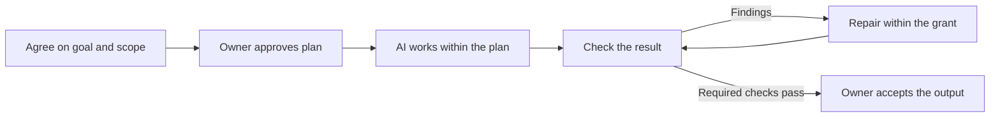

# OneCrew

**Give AI a clear scope. Track the work. Check the result before accepting it.**

OneCrew is a local workflow tool for people who delegate work to AI assistants. It adds work contracts, verification records, project knowledge, and a progress dashboard to Claude Code, so you can see what was agreed, what was checked, and what needs your decision.

[Get started](docs/GETTING-STARTED.en.md) · [Releases](https://github.com/tamnguyendev/one-crew/releases) · [Report an issue](https://github.com/tamnguyendev/one-crew/issues) · [Limitations](#current-limitations)

> **Beta:** this guide targets the published **`2.5.0.dev31`** release, tested on Windows. The separate `2.5.0.dev28+mrr.4` release adds experimental multi-repository reading; it does **not** include the later changes (the dev28 tracking list, the dev30 user-level hook, the dev31 background tracking and shared-resource leases). Choose a release explicitly rather than installing from `main`.

## Why OneCrew?

When an AI says “I'm working on it” or “done,” you still need to know:

- What did we agree to build, and what changed since then?
- What is running, waiting for a check, or waiting for me?
- Which output was checked, by what method, and against which version?
- What failed, what was fixed, and what still needs verification?
- What context and lessons can the next task reuse?

OneCrew records these as plans, events, and evidence in a local ledger. Its dashboard reads those records so you can follow a task beyond a chat summary.

Use it when a task needs explicit scope, checkable outputs, or a handoff you can inspect later. For a one-off question with no work to track, the setup may be unnecessary. OneCrew works alongside your assistant; it does not replace the assistant or automatically turn every chat or subagent into a tracked task.

## What you can do

These capabilities are included in the dev31 release. Their availability does not mean every host, provider, or workflow has been tested end to end.

| Capability | What it gives you |
|---|---|
| **Agree on the work first** | Versioned plans with the goal, expected outputs, editable paths, milestones, and limits. Review the proposed solution before authorizing work. |
| **Keep work within its scope** | Claude Code hooks check supported tool operations against an enforced plan and record refusals. Coverage has limits; this is not an OS sandbox. |
| **Track progress locally** | A browser dashboard with task lists, project/status filters, decisions needing your attention, and a timeline of recorded activity. |
| **Follow solution changes** | Inspect the recorded solution and revisions, with before/after information where the ledger contains it. |
| **Separate output from verification** | See generated outputs, milestone results, and evidence. A generated file or successful model response is not automatically an accepted result. |
| **Follow test and repair cycles** | Link findings, repairs, and rechecks through the existing workflow. The UI displays recorded cycles; it cannot reconstruct activity that was never recorded. |
| **Reuse project knowledge** | Initialize a project wiki, retrieve relevant context, and record or withdraw knowledge with supporting evidence. This is external memory, not model training. |
| **Resume with context** | Use continuation and handoff records to carry task state and relevant knowledge forward. Reopening a chat alone does not reconnect it automatically. |
| **Report problems** | Collect local diagnostic information through `support` commands and review it before sharing. |
| **Keep acceptance explicit** | Owner commands separate approval and final acceptance from AI execution and checking. They are refused when detected inside an AI session. |

### A typical task

For example: **“Fix the login error, keep the existing API, and show that the failing case now passes.”**



The owner approves the work, the assistant implements it, and configured command checks or reviewers produce evidence. Routine work inside the grant does not require a new approval for each edit. A material change outside that grant needs a new decision.

This workflow also fits documentation and source-analysis tasks: define the expected output and choose an appropriate check. The quickstart uses a small documentation task so you can learn the workflow before applying it to production code.

## Start here

**Requirements:** Windows 10/11, PowerShell 5.1+, Python 3.10+, Git 2.40+, and a working Claude Code CLI login. The project must be a Git repository with at least one commit. Linux and macOS are not verified by this guide.

The [English getting-started guide](docs/GETTING-STARTED.en.md) walks through downloading a verified wheel, installing it into a separate venv, connecting a disposable project, completing a first task, and opening the dashboard.

**Follow that guide from step 1.** It is the single installation path for this README. At the end, you will have a greeting file checked by a command, a recorded result, and a task visible in the dashboard. The demo does not claim to validate a real-model reviewer or every hook path.

**Already using OneCrew?** Do not replace a shared runtime while tasks are active. Read [upgrading an existing project](docs/GETTING-STARTED.en.md#upgrading-an-existing-project) first. Successful installation does not prove existing plans and consumers can safely switch runtimes.

## What the dashboard tells you

With the variables from the getting-started guide:

```powershell
& $OneCrew --project $Project --state-root $State track open
```

The local viewer helps answer **what is happening, what changed, what was checked, and who needs to act next**. It shows recorded tasks, not every Claude conversation on your machine. A connected page means it can read its data source; it does not mean the work has passed verification.

The page is read-only. Where a validated owner command is available, you can copy it and run it in your own terminal. Opening evidence is not approval; closing the page does not stop a worker. Missing evidence or timing data means unknown, not zero work or success.

## How it fits together

| Component | Responsibility |
|---|---|
| **Your assistant** | Discusses the solution, prepares the plan, and performs authorized work. |
| **Project hooks** | Inspect supported tool calls in connected Claude Code sessions. |
| **Workflow and verifiers** | Run configured checks and record results associated with the work being checked. |
| **Local ledger** | Stores plans, decisions, events, and verification references in your state directory. |
| **Project wiki** | Holds reusable context and lessons; it does not grant permissions or replace evidence. |
| **Dashboard** | Presents recorded progress and evidence without approving or executing work. |
| **You** | Set the scope, decide matters outside the grant, and accept the result. |

The ledger and dashboard are local. Model-backed work still uses the provider and credentials you configure; relevant task context may be sent to that provider. OneCrew is not an offline model or a cloud account-wide monitoring service.

## Release and integration status

| Area | Status |
|---|---|
| Contracts, wiki/context, verification, findings, diagnostics, and tracking UI | Included in the **dev31 beta** described here. |
| Reading multiple repositories in one task (MR-R) | **Separate experimental release:** [dev28-mrr.4](https://github.com/tamnguyendev/one-crew/releases/tag/v2.5.0.dev28-mrr.4). Read-only source use, not arbitrary multi-repo editing; its release notes report no real-model trial. |
| Claude Code plugin (CP-1) | Separate from the Python wheel. Do not assume installing this release installs a marketplace plugin. |
| Background-work tracking, one review per request, shared-resource leases, skill delivery | **Included in dev31.** Optional hook events (`hook install --print --background`) let the dashboard show subagents and background commands the host reports; a check request is reviewed and charged once; heavy resources you declare are held across sessions, plans, and ledgers on the machine; an approved, pinned skill can be delivered to a native worker. Known limits: the [dev31 release notes](https://github.com/tamnguyendev/one-crew/releases/tag/v2.5.0.dev31), issues [#55](https://github.com/tamnguyendev/one-crew/issues/55), [#36](https://github.com/tamnguyendev/one-crew/issues/36), [#32](https://github.com/tamnguyendev/one-crew/issues/32), [#41](https://github.com/tamnguyendev/one-crew/issues/41). |
| User-level hook coverage and shell-parser hardening | **Included since dev30.** Optional `onecrew hook user install` makes every Claude Code session on the machine, subagents included, ask the plan of the project it writes in; git commands that discard uncommitted work outside the owned scope are refused. Known limits: the [dev30 release notes](https://github.com/tamnguyendev/one-crew/releases/tag/v2.5.0.dev30), [issue #25](https://github.com/tamnguyendev/one-crew/issues/25), [issue #12](https://github.com/tamnguyendev/one-crew/issues/12). |
| Other assistant hosts and providers | Support depends on the adapter and workflow. Claude Code hook behavior is not a guarantee of equivalent protection in another host. |

For version-specific evidence and limitations, use the [release notes](https://github.com/tamnguyendev/one-crew/releases), not a feature name or passing test count alone.

## Current limitations

- **Hooks are not a security boundary.** They cover supported operations in connected sessions. External processes, sessions outside the configured project, and shell forms the parser does not understand may escape that coverage. Do not use this beta to contain untrusted code.
- **Installation is not enforcement.** `doctor` checks configuration; a proposed plan is not an enforced plan. Verify hook behavior in a disposable project before relying on it.
- **Tracking is based on recorded events.** OneCrew does not expose hidden model reasoning or automatically capture every subagent action, token, or tool call.
- **Budgets depend on the execution path.** Contract `max_calls` applies to calls managed by OneCrew; it does not meter every call made by a Claude Code session under hooks.
- **Checks have a cost.** Repository snapshots and environment checks can be expensive on large trees. This beta does not guarantee shorter development time or complete test coverage.
- **Provider validation is limited.** Mechanical checks and fixtures do not prove a real-provider workflow. Check the evidence for the release and adapter you use.
- **Language coverage is incomplete.** This README and the getting-started guide are in English, but the dashboard is primarily Vietnamese. The guide includes a label glossary; setting `ONECREW_LANG=en` does not translate the whole product. Many release notes and detailed guides remain Vietnamese.

The [known-issues list](docs/obs2/su-dung/LOI-DA-BIET.vi.md) contains additional version-specific details (Vietnamese).

## Documentation

- [Getting started](docs/GETTING-STARTED.en.md) — installation, first task, troubleshooting, upgrades, and removal.
- [Changelog](docs/CHANGELOG.md) — release history.
- [English first-task template](examples/hello-onecrew.template.json) — schema-v2 sample with a content check; fill its provenance before proposing it.
- [Core and package boundaries](docs/v2-core.vi.md) — detailed reference, Vietnamese.
- [Tracking guide](docs/obs2/su-dung/DANH-SACH-CONG-VIEC.vi.md) — detailed UI guide, Vietnamese.
- [Historical architecture](docs/LICH-SU.vi.md) — earlier v1 workflows. Checkout-only `job`/`work`/`delivery` commands are not the installed v2 quickstart.

## Feedback and contributions

Useful contributions include reproducible bugs, clearer onboarding, platform validation, and focused fixes with counterexamples.

Before starting a substantial change, check the [open issues](https://github.com/tamnguyendev/one-crew/issues) for related work. For a bug, include the installed version, OS, exact command or UI action, expected and actual behavior, and a minimal reproduction. Distinguish a simulated test from a real assistant session.

Do not post credentials, private source, raw ledgers, or full assistant transcripts. Inspect diagnostic bundles before sharing, even when redaction has run. For a code change, describe the affected behavior and run relevant checks; unrelated full-suite runs are not evidence for the specific bug.

**License status:** no license file is included in this repository snapshot. Licensing terms need to be clarified by the maintainer; this README does not declare an open-source license.
