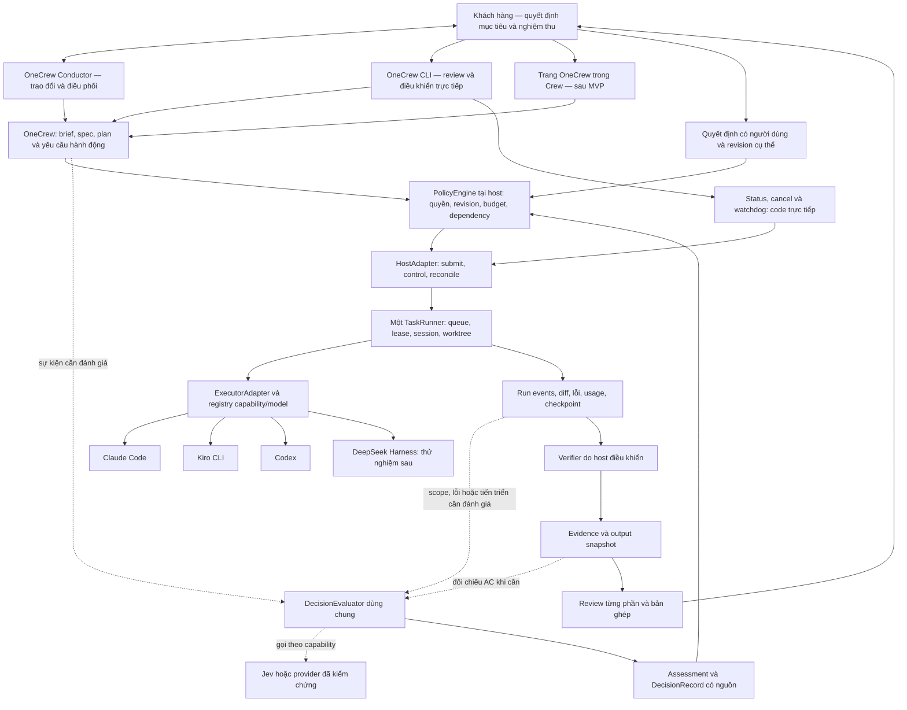

> Bản lịch sử trước review ngày 09/10/2026 (Asia/Saigon), giữ cả nội dung đang soạn. Trạng thái và ưu tiên trong bản này không phải baseline hiện hành. Xem [kiến trúc hiện hành](architecture.vi.md) và [kế hoạch hiện hành](mvp-backlog.vi.md).

# Kiến trúc OneCrew

## Runtime implementation update — SPEC-004

The local CV profile now has one Python controller as the dispatch/budget authority, Codex JSON-only workers, deterministic task/risk routing, sealed host HTTP gates and bounded review/repair. Native Windows sandbox and Node guards support local tests; Docker remains an alternative requiring a working engine. Models do not own scope, tests or acceptance.

See [runtime contracts and limitations](autonomous-runtime.vi.md), [SPEC-004](../specs/SPEC-004-autonomous-local-run.md), and [verification evidence](autonomous-coverage.md). The broader architecture below remains a target; free-form conversation, multiple repos/backends and pause/resume/reorder are not completed by this slice.

Baseline thiết kế hợp nhất ngày 08/10/2026 sau review toàn bộ flow. Đây là tài liệu chính về thành phần, quyền quyết định, dữ liệu và đường thực thi. [Review flow](decision-flow-review.vi.md) mô tả các điểm DF và ca nghiệm thu; [backlog](mvp-backlog.vi.md) xác định thứ tự triển khai. Cập nhật kiến trúc không đồng nghĩa cấp quyền chạy task hoặc nghiệm thu implementation.

| Thành phần | Trạng thái thực tế |
|---|---|
| CLI review/approve spec local | Đã triển khai; 24 test được ghi nhận trong coverage, chưa cách ly quyền worker |
| Pilot review Flutter qua CLI | Claude lỗi OAuth; Codex trả báo cáo và usage qua cầu nối thử nghiệm; chưa chứng minh cancel/recovery/gate runtime |
| Conductor, DecisionEvaluator, policy và task runtime | Thiết kế, chưa triển khai |
| Kiro Crew làm host | Ứng viên cần spike; chưa chốt khả năng tích hợp |
| Jev làm nhà cung cấp đánh giá | Ứng viên cần benchmark; chưa gọi API hoặc gửi source tới TypeSafe |

Các quyết định nền: CLI trước; khách hàng trao đổi qua Conductor; chọn model theo công việc; một DecisionEvaluator dùng chung cho các đánh giá ngữ nghĩa; code giữ quyền và ngân sách; một host duy nhất giữ queue; bàn giao từng phần có phiên bản. Các vai không mặc định dùng một model và không bắt mọi task đi qua đủ vai.

Yêu cầu ưu tiên: khắc phục task kéo dài và khó can thiệp khi dùng Claude Desktop với OneTechAI. Contract cụ thể: [kiểm soát task dài](control-and-latency.vi.md). Host phải tiếp nhận điều khiển độc lập với lượt suy luận, giữ budget xuyên suốt các vai và không báo đã dừng khi worker còn hoạt động.

[Audit lịch sử thực tế](claude-history-audit.vi.md) bổ sung một ràng buộc: task cấp sản phẩm phải gắn với luồng người dùng thử được, package/commit và evidence tương ứng. Mọi workflow/agent/phiên/máy đều quy về task đó để cộng budget; mở workflow mới không tạo ngân sách mới. Trạng thái code xong, gate xanh, đã triển khai bản thử và người dùng chấp nhận là các mốc riêng.

## 1. Bản đồ trách nhiệm



Sơ đồ là kiến trúc mục tiêu. Kiro Crew là ứng viên cho TaskRunner; transport từng ExecutorAdapter phải được spike chứng minh, không giả định cả ba CLI đều dùng cùng ACP. PolicyEngine là module kiểm soát gắn với host, không phải scheduler thứ hai. Host phải kiểm quyền điều khiển kể cả đường CLI trực tiếp; đường này không chờ Conductor hay evaluator.

Review toàn luồng bổ sung [16 điểm quyết định DF01–DF16](decision-flow-review.vi.md), từ hội thoại tới recovery. Một DecisionEvaluator dùng chung cung cấp đánh giá có kiểu; policy host vẫn sở hữu quyền áp dụng. Evaluator không được tự dispatch, approve, sửa scope/budget hoặc chặn đường status/cancel. Các lớp policy/evaluator trong sơ đồ đều chưa triển khai.

| Trách nhiệm | Chủ sở hữu mục tiêu |
|---|---|
| Queue, lease, retry vận hành, process/session, lịch | Host duy nhất; Kiro Crew nếu qua spike |
| Tạo và phối hợp worktree cho tác vụ | Host qua adapter đã kiểm chứng |
| Nội dung spec, role, gate, tiêu chí nghiệm thu | OneCrew |
| Đánh giá ngữ nghĩa | DecisionEvaluator chỉ trả đánh giá/đề xuất; không có quyền thực thi |
| Áp dụng quyết định, model routing và ngân sách | PolicyEngine tại host; kiểm quyền và freshness tại thời điểm hành động, lưu DecisionRecord |
| Kết quả tool và tình trạng phiên native | Runtime backend, được HostAdapter chuẩn hóa và giữ giá trị gốc |
| Trạng thái thực thi task | Host là nguồn duy nhất |
| Kết quả kiểm chứng kỹ thuật | Verifier với gate đã ghim và evidence đúng revision |
| Nghiệm thu sản phẩm, phạm vi và quyền phát hành | Khách hàng theo quyền đã cấp; host ghi nhận và cưỡng chế, evaluator không tự phê duyệt |
| Bộ nhớ dự án | Crew hoặc repository đã chọn; OneCrew chỉ giữ reference/provenance |

Không tạo queue OneCrew riêng cạnh host. Kho OneCrew giữ spec, approval, decision, evidence và output; projection trạng thái host có thể dựng lại, còn quyết định khách hàng là bản ghi bền vững có nguồn, không được tái tạo bằng suy đoán từ transcript hoặc kết quả AI. SQLite của CLI hiện tại chưa tạo được ranh giới quyền này.

### Các interface và ranh giới dữ liệu

| Thành phần | Nhận và trả | Không được sở hữu |
|---|---|---|
| Conductor | Tin nhắn + trạng thái có nguồn → brief/spec/plan hoặc đề xuất hành động | Approval thay khách hàng, queue và vòng retry riêng |
| DecisionEvaluator | DecisionRequest giới hạn context → Assessment có kiểu/uncertainty và provenance | Tool sửa repo, dispatch, tăng budget, sửa policy |
| PolicyEngine | Assessment tùy chọn + quyền/trạng thái hiện hành → action được phép hoặc lý do chờ, DecisionRecord | Tự bịa quyền khi thiếu dữ liệu hoặc bỏ mandatory gate |
| HostAdapter | Action hợp lệ → native run ID, events, status/control/reconcile | Đánh dấu đã dừng khi backend chưa xác nhận |
| ExecutorAdapter | WorkPackage → artifact/diff/log/usage và capability thực | Tự mở mục tiêu, workflow hoặc model ngoài policy |
| Verifier | Snapshot + gate version → evidence kỹ thuật | Nghiệm thu thay khách hàng hoặc sửa gate để xanh |
| Output/Decision store | Snapshot bất biến + quyết định có revision → review/diff/history | Cho worker ghi đè approval, snapshot được review hoặc budget |

Đây là contract thiết kế, không phải danh sách module code đã tồn tại. Registry ghi backend/model/effort hỗ trợ, context/tools, cancel/resume/usage và kết quả kiểm chứng; capability chưa biết được ghi unknown, không mặc định hỗ trợ.

### Luồng vận hành chuẩn

1. **Trao đổi:** Conductor giữ brief và nguồn quyết định. Lệnh rõ ràng đi handler trực tiếp; câu hỏi ngữ nghĩa cần thiết mới dùng evaluator.
2. **Đề xuất:** chốt phần bàn giao nhỏ, AC và non-goals; kiểm bản nhanh/chi tiết và phụ thuộc. Người dùng duyệt spec và cấp quyền chạy, có thể cùng một quyết định.
3. **Chuẩn bị:** lập plan có revision, output checkpoint và ownership; đánh giá độ khó/rủi ro rồi policy chọn cấu hình model đủ năng lực. Task quá rộng phải được làm rõ hoặc chia nhỏ trước.
4. **Dispatch:** host kiểm lại quyền, revision, budget, dependency và lease; submit idempotent qua một đường thực thi. Assessment cũ không tự đủ điều kiện chạy.
5. **Thực thi:** worker trả events và checkpoint; host đo usage/tiến triển. Chỉ gọi evaluator khi có đề xuất ngoài scope, lỗi chưa rõ hoặc tín hiệu cần đánh giá; mọi vòng dùng ngân sách mục tiêu chung.
6. **Kiểm chứng và review:** verifier kiểm gate trên snapshot; đưa từng phần ra review với diff/evidence/cách thử. Phản hồi trong scope quay lại đúng phần, phần phụ thuộc chờ và phần độc lập tiếp tục khi được phép.
7. **Bàn giao:** kiểm bản ghép và đủ AC; ghi nghiệm thu của khách hàng. Publish/deploy kiểm quyền riêng đã cấp, không suy từ worker completed hoặc AI score.
8. **Can thiệp và recovery:** status/pause/cancel/reorder/reconcile là đường code ở mọi thời điểm; giữ output, budget và lịch sử, không reset khi đổi model hoặc phiên.

Các bước này không bắt buộc mỗi bước gọi AI. Ma trận [DF01–DF16](decision-flow-review.vi.md) xác định trigger và thẩm quyền chi tiết.

Sau review tổng thể 08/10/2026, ranh giới điều phối được làm rõ: Conductor đề xuất mục tiêu và phân rã công việc; TaskRunner/host là đường thực thi duy nhất, sở hữu task/run, queue, bộ đếm retry và ngân sách. Conductor gửi đề xuất thay kế hoạch qua adapter; không mở một vòng scheduler/retry riêng. Khi tích hợp phải chứng minh planner/replan native của host dùng cùng phạm vi và bộ đếm, hoặc tắt phần chồng lặp. Chưa có bằng chứng này thì chưa bật workflow tự động. Ưu tiên kiểm chứng khả năng mở rộng conductor sẵn có của Crew trước khi tạo một conductor thực thi độc lập.

### OneCrew Conductor: đầu mối trao đổi với khách hàng

Yêu cầu bổ sung ngày 08/10/2026: người dùng đóng vai khách hàng, trao đổi và truy vấn thông tin qua một đầu mối; OneCrew tiếp nhận công việc và điều phối các vai phía dưới. Conductor là vai hội thoại xuyên suốt, kết hợp làm rõ yêu cầu và theo dõi bàn giao. Đây là thiết kế, chưa có runtime hội thoại/dispatch trong CLI hiện tại.

| Vai | Trách nhiệm và quyền quyết định |
|---|---|
| Khách hàng | Chọn mục tiêu, ưu tiên, phạm vi và ngân sách; duyệt thay đổi; chấp nhận kết quả sản phẩm |
| Conductor | Hiểu nhu cầu, tra cứu thông tin có nguồn, hỏi điểm còn thiếu, đề xuất lát nhỏ, soạn spec nháp, điều phối trong quyền đã cấp và tổng hợp kết quả |
| Worker/tester/reviewer | Thực hiện phần được giao và trả artifact, evidence, blocker; lựa chọn các vai cần thiết theo workflow, không bắt mọi việc qua đủ vai |
| Host và verifier | Giữ trạng thái thực thi, kiểm quyền/ngân sách, gọi gate và xác nhận kết quả kỹ thuật; Conductor không tự thay thế các kiểm soát này |

Một cuộc trao đổi có thể bắt đầu khi chưa có spec hoặc task thực thi. Conductor duy trì brief gồm mục tiêu, điều đã thống nhất, giả định, câu hỏi mở và việc để sau; mỗi quyết định giữ nguồn từ lượt trao đổi của khách hàng. Lời đề xuất của AI chưa trở thành quyết định của khách hàng. Không sinh spec mới sau mỗi tin nhắn và không tạo task thực thi chỉ vì một chủ đề được nhắc tới.

Conductor phân biệt ba ý định trong cùng hội thoại:

- **Hỏi thông tin:** đọc source/tài liệu/evidence cần thiết, trả lời kèm nguồn và độ mới; báo rõ phần chưa xác minh. Lệnh đọc trạng thái trực tiếp vẫn lấy dữ liệu host mà không cần gọi model.
- **Làm rõ nhu cầu:** cập nhật brief, hỏi ít câu có ảnh hưởng đến kết quả, trình bày lựa chọn và hệ quả bằng ngôn ngữ người dùng. Công việc khảo sát có giới hạn riêng trong ngân sách mục tiêu, không tự biến thành triển khai.
- **Giao hoặc đổi việc:** đề xuất phạm vi, nghiệm thu, budget và repo liên quan; tạo spec nháp khi người dùng yêu cầu chốt. Khi đang chạy, phản hồi được phân loại thành làm rõ trong scope, ý tưởng backlog hoặc thay đổi cần duyệt; bước ngoài scope chưa được dispatch.

Luồng bàn giao: trao đổi → đề xuất ngắn → spec nháp → khách hàng duyệt đúng revision → chạy khi đã có quyền thực thi → worker/test/verify/review phù hợp → Conductor báo kết quả và cách thử → khách hàng nghiệm thu sản phẩm. Phê duyệt spec và quyền chạy là hai quyết định khác nhau nhưng có thể được người dùng cấp cùng lúc; không hỏi lại quyền đã có. CLI hiện tại chỉ ghi approval spec local, chưa hỗ trợ cấp quyền chạy qua chat hay cưỡng chế các bước này.

Gói giao việc xuống dưới gồm `product_task_id`, spec revision đã duyệt, mục tiêu/AC/non-goals, repo và ownership, giới hạn quyền/budget, dependency và artifact/evidence cần trả. Conductor được chia việc và xử lý lựa chọn triển khai trong phạm vi đó; không tự approve spec của mình, đổi AC, tăng budget hoặc thay user acceptance bằng lời worker báo xong. Báo cáo trở lại khách hàng tập trung vào kết quả thử được, phần còn thiếu, chi phí quan sát được và quyết định cần khách hàng xử lý.

Conductor giữ danh tính và quyết định qua nhiều phiên, nhưng không cần model chạy hoặc suy nghĩ liên tục. Dùng tóm tắt có nguồn và sự kiện host; chỉ gọi model khi có tin nhắn hoặc sự kiện cần xử lý. Không đọc lại toàn bộ transcript hay mở thêm vòng review cho mỗi lần hỏi tiến độ. Chi phí trao đổi, khảo sát, điều phối và worker được tính vào cùng mục tiêu; khi sinh `product_task_id` phải liên kết chi phí trước đó, không reset budget. Các số chưa quan sát được ghi unknown.

Đối chiếu: [tài liệu agent của Kiro Crew](https://github.com/kirodotdev/KiroCrew/blob/main/src/kiro_crew/docs/agents.md), đọc ngày 08/10/2026, mô tả conductor dùng work ledger, gắn work item với session và đánh giá completion bằng acceptance evaluator. OneCrew bổ sung contract trao đổi/duyệt ở trên; đây không phải khẳng định extension seam đã tích hợp hoặc thử thành công trên máy này. Host snapshot vẫn cần ghim và kiểm chứng theo spike hiện có.

## 2. Chiến lược tích hợp

Thứ tự lựa chọn:

1. App/extension được hỗ trợ, CLI gọi endpoint hoặc SDK có contract.
2. Adapter mỏng có contract test, ghim phiên bản host.
3. Bản sửa upstream hoặc fork nhỏ để thêm một seam verifier bắt buộc.
4. Runtime độc lập chỉ khi các phương án trên không đáp ứng yêu cầu bắt buộc và đã đo chi phí duy trì.

Không nhập trực tiếp private internals ở nhiều module. Một `CrewAdapter` che việc submit/status/cancel/resume và cung cấp capability/version rõ ràng. Lệnh không được hỗ trợ phải báo unavailable. Không đổi backend một cách im lặng.

Trong bản đầu, chọn một backend đã kiểm chứng cho mỗi host/run. Việc router đổi model trong cùng backend và việc đổi backend là hai tính năng khác nhau. Chạy hỗn hợp backend theo từng step chỉ được bật sau khi capability/spike xác nhận; một hàng trong backend registry không đủ để đảm bảo tính năng đó.

Phạm vi bắt buộc là Claude/Kiro/Codex. Nếu phải tách khỏi Crew, interface executor sẽ có adapter Claude programmatic, Kiro ACP và Codex app-server. Đây là phương án dự phòng, không triển khai đồng thời hai đường dispatch trong MVP.

## 3. Workflow có hai mức

### Quick task

Tái hiện vấn đề → thay đổi nhỏ → kiểm tra mục tiêu → review diff → ready for integration.

### Feature có thay đổi hành vi

Spec + acceptance criteria → test → build → verify → review độc lập → integration gate.

Chỉ fan-out các phần có ownership tách biệt. Với những bước cùng sửa file/schema, xếp tuần tự. Giá trị mặc định thử nghiệm là tối đa hai worker thực thi đồng thời; đây là điểm bắt đầu để đo tài nguyên, không phải giới hạn cố định đã triển khai.

Không biến mọi lần agent dừng thành lần chạy toàn bộ test suite. Gate theo phạm vi thay đổi trước; chạy kiểm tra tích hợp đầy đủ khi ghép các kết quả.

[Contract kiểm soát phạm vi](scope-control.vi.md) áp dụng trước dispatch: phạm vi, AC và budget nằm ngoài quyền sửa của worker. Việc phát hiện thêm được phân loại thành sửa trong phạm vi, backlog hoặc đề xuất thay đổi. Mọi workflow mới của cùng mục tiêu dùng chung `product_task_id`; không reset số vòng và ngân sách. Host kiểm quyền/budget, reviewer kiểm ngữ nghĩa diff với AC; không coi allowlist file là đủ để phát hiện mọi scope creep.

### Review đầu ra từng phần

Yêu cầu bổ sung: khách hàng có thể xem và phản hồi từng phần trước khi toàn task hoàn tất. Đây là review output, khác với approve spec trước triển khai. Chức năng này chưa có trong CLI/runtime hiện tại.

Khi chia việc, Conductor đề xuất các mốc có đầu ra người dùng đánh giá được: một màn hình, một luồng thao tác, một phần tài liệu hoặc một thay đổi code có diff/test. Không dùng số file hay số agent làm đơn vị bàn giao. Mốc nào cần khách hàng xác nhận trước khi làm bước phụ thuộc phải được ghi rõ trong kế hoạch; không tạo thêm một lần duyệt cho mọi bước kỹ thuật.

Có hai đường vào cùng luồng review: tự đưa đầu ra ra khi đạt mốc đã chốt, hoặc khách hàng yêu cầu “cho tôi xem phần đang làm” bất kỳ lúc nào. Nếu chưa có đầu ra, báo đúng phần chưa sẵn sàng; nếu có bản nháp, cho xem để góp ý sớm kèm giới hạn và gate chưa chạy/đang lỗi. Bản nháp không tự trở thành kết quả đã nghiệm thu và không được bỏ qua gate bắt buộc.

Mỗi lần bàn giao tạo checkpoint có `output_id`, revision/hash, task và spec revision, repo/commit hoặc manifest snapshot, phần AC liên quan, artifact/cách mở hoặc thử, evidence và phần còn thiếu. Bản đang review phải ổn định: worker không ghi đè snapshot/demo khiến người dùng nhìn nội dung khác phiên bản được ghi nhận. Checkpoint chỉ chứa dữ liệu phù hợp quyền truy cập của project.

Conductor trình bày một thẻ ngắn: phần này làm được gì; thay đổi từ bản đã review; cách xem/thử; điều chưa đạt; quyết định cần khách hàng. Người dùng có thể xem lại bất kỳ checkpoint và diff với bản trước, không cần đọc toàn bộ transcript hoặc chờ hết task. Đọc danh sách/checkpoint/evidence đã lưu không gọi model; yêu cầu phân tích bổ sung vẫn có thể tốn token.

Phản hồi gồm chấp nhận phần này, yêu cầu sửa có comment, hoặc góp ý bản nháp chưa nghiệm thu. Quyết định gắn đúng output revision và phần AC, tách khỏi trạng thái gate kỹ thuật. Lịch sử giữ nguyên; phiên bản output hoặc dependency liên quan thay đổi thì phải đánh giá lại freshness, không tự chuyển chấp nhận bản cũ sang bản mới. Chỉ nói “ổn” khi đang có nhiều đầu ra mở thì Conductor phải làm rõ đối tượng trước khi ghi quyết định; không coi im lặng là đồng ý.

Yêu cầu sửa trong scope giao lại đúng phần trong ngân sách chung; ý tưởng ngoài scope đưa backlog/đề xuất thay đổi. Host giữ các bước phụ thuộc vào mốc chưa được chấp nhận hoặc đang cần sửa; các bước độc lập vẫn tiếp tục nếu còn quyền và budget. Nếu phần phụ thuộc đã chạy khi có phản hồi mới, ngừng giao bước ảnh hưởng mới, yêu cầu checkpoint theo khả năng adapter và kiểm lại kết quả đã tạo; chỉ báo dừng khi host xác nhận. Không reset bộ đếm retry/budget vì mở một lượt review output.

Chấp nhận một phần không đóng cả task và không cấp quyền publish/deploy. Hoàn tất task vẫn cần đủ AC, gate tích hợp trên bản ghép và các mốc nghiệm thu người dùng đã thỏa thuận. Review từng phần được nối vào luồng Conductor tới bàn giao sau spike host, không mở thêm scheduler hoặc dashboard riêng.

### Đổi thứ tự công việc

Khách hàng có thể nói với Conductor “làm B trước A”, “đưa C xuống sau” hoặc dùng CLI để sắp lại việc chờ. Conductor hiển thị thứ tự trước/sau và ảnh hưởng tới việc đang chạy, dependency, mốc review; host cập nhật kế hoạch thực thi qua cùng adapter/queue hiện có. Đây là thiết kế, chưa có lệnh reorder hoặc runtime áp dụng.

- **Việc chưa chạy, đã đủ điều kiện:** áp dụng thứ tự mới cho các lần dispatch tiếp theo; không hỏi lại khi chỉ sắp thứ tự trong quyền đã cấp.
- **Việc đang chạy:** đổi thứ tự mặc định chỉ tác động việc chờ, không tự ngắt worker. Muốn chuyển ngay, khách hàng yêu cầu tạm dừng việc đang chạy; host yêu cầu checkpoint/dừng theo khả năng adapter, giữ artifact và xác nhận trạng thái thực trước khi nhường tài nguyên/ownership. Nếu không dừng được, báo lý do; không báo đã chuyển hoặc mở writer xung đột.
- **Việc có dependency hoặc mốc review bắt buộc:** ưu tiên cao hơn không làm nó thành runnable. Ví dụ B cần đầu ra A thì B vẫn chờ A; Conductor giải thích và có thể đề xuất ưu tiên chuỗi điều kiện đã nằm trong phạm vi. Muốn tách dependency, dùng mock hoặc thay cách nghiệm thu cần đánh giá ảnh hưởng và duyệt thay đổi nếu vượt hợp đồng; không tự bỏ điều kiện để đáp ứng thứ tự mong muốn.
- **Việc đã hoàn thành:** không chạy lại hay xóa acceptance chỉ vì sắp lại kế hoạch. Công việc làm lại chỉ phát sinh khi có yêu cầu hoặc evidence không còn phù hợp.

Đổi thứ tự thuần túy chỉ tạo revision kế hoạch và lịch sử ai đổi/gì đổi/lý do nếu có; không sửa spec, không làm mất review output còn hợp lệ và không reset budget/retry. Thay nội dung, quyền, ngân sách hoặc cam kết trong spec đi qua luồng thay đổi riêng. Conductor là bên đề xuất/thực hiện ý định khách hàng, host vẫn là nguồn duy nhất của thứ tự thực thi; không duy trì một hàng đợi riêng trong chat.

Adapter phải kiểm plan revision và trạng thái hiện hành khi áp dụng, cập nhật thứ tự nhất quán ở host và chống gửi trùng. Nếu task đã chuyển trạng thái hoặc người dùng khác vừa thay kế hoạch, trả xung đột kèm trạng thái mới; không âm thầm ghi đè bằng thứ tự cũ. `task list` phân biệt vị trí ưu tiên với trạng thái đủ điều kiện/chờ gì. Thông báo chỉ nói thứ tự đã được host xác nhận, không suy từ lời Conductor nhận yêu cầu.

## 4. Trạng thái và bằng chứng

Giữ các trạng thái độc lập:

- `execution_status`: queued, running, waiting_input, interrupted, failed, completed, cancelled; map từ host, luôn giữ cả giá trị native.
- `verification_status`: not_run, running, passed, failed, unknown, stale; dựa trên evidence từ verifier.
- `acceptance_status`: not_evaluated, verifying, rejected, accepted, stale; `verifying` là đang đối chiếu đủ điều kiện, không đồng nghĩa khách hàng đã chấp nhận. `accepted` chỉ khi đủ gate/AC và các quyết định nghiệm thu khách hàng được yêu cầu còn hiệu lực.

Quyết định khách hàng lưu riêng theo output/spec revision; gate xanh không tự sinh quyết định đó. Quyền run, quyền deploy và approval spec cũng là các grant riêng, có thể được cấp chung nhưng phải ghi rõ phạm vi. Đây là schema mục tiêu; không thay đổi schema CLI spec hiện có trong lần cập nhật tài liệu này.

Projection điều khiển bổ sung `pause_requested`, `paused`, `cancel_requested`, `budget_exhausted` và `connection_lost` kèm lý do/bằng chứng; giữ riêng request của người dùng với trạng thái thực host báo. Mapping cụ thể phải qua adapter contract test. Các trạng thái này không tạo queue hay scheduler thứ hai.

`completed + rejected` là kết quả hợp lệ: agent đã kết thúc nhưng công việc chưa đạt. CLI hiển thị lý do và hành động tiếp theo.

Một evidence record tối thiểu gồm:

- task/run/attempt ID và ID native của host;
- repo realpath, base/head commit, manifest hash của đầu vào và đầu ra;
- workflow/skill/gate phiên bản;
- command argv, cwd, exit code, thời điểm, timeout, log đã lọc secret;
- model yêu cầu và model quan sát được, runtime/adapter version;
- hash diff được review, reviewer result và phê duyệt áp dụng cho artifact nào.

Đổi code, test, spec hoặc gate sau khi verify làm evidence liên quan thành stale. Chỉ chứng minh một commit sạch là chưa đủ nếu có file chưa commit; manifest phải bao gồm nội dung thực tế được kiểm tra. Agent không được tự sửa kho evidence hoặc bản verifier dùng để nghiệm thu run của mình.

Các record liên kết qua `product_task_id`; chi phí trước task liên kết qua brief ID rồi chuyển liên kết, không reset số đã dùng:

| Record | Nội dung chính và người được ghi |
|---|---|
| Brief / SpecRevision | Mục tiêu, AC/non-goals, nguồn trao đổi, bản nhanh/chi tiết; Conductor tạo bản đề xuất |
| Approval / ExecutionGrant | Người cấp, action, revision, giới hạn quyền/ngân sách; control service ghi từ quyết định khách hàng |
| PlanRevision / WorkPackage | Dependency, ownership, checkpoint, spec revision và phần budget được phân bổ; host kiểm và áp đề xuất |
| DecisionRequest / Assessment | Stage/event, input hash, câu hỏi/rubric version, nguồn còn thiếu, typed output, provider/usage; evaluator chỉ ghi assessment |
| DecisionRecord | Assessment hoặc rule, policy version, reason codes, action, trạng thái áp dụng/stale và nguồn quyền; PolicyEngine ghi |
| Run / Attempt / BudgetLedger | ID native, request/observed model, events và bộ đếm hợp nhất; host ghi và reconcile |
| Evidence / OutputRevision / CustomerReview | Snapshot, gate, manifest, AC, cách thử và quyết định đúng revision; verifier/control service ghi theo vai |

Các record này là contract dữ liệu, không bắt buộc mỗi record là một bảng hoặc service riêng. Ngoại trừ sổ approval spec local, chúng chưa có implementation sản phẩm. Quyền worker phải giới hạn ở workspace và artifact được giao; ranh giới ghi store cần kiểm chứng bằng host/tool policy trước khi bật tự động hóa.

## 5. Gate và quyền theo vai

Tách policy từ OneTechAI khỏi kiến thức ngành. Pack phát triển phần mềm cung cấp role spec/test/build/review; pack ngành chỉ thêm yêu cầu khi project chọn.

Builder không được tự sửa test nghiệm thu để làm xanh. Điều này phải được kiểm ở tool/sandbox/host và kiểm tra diff cuối, không chỉ bằng prompt. Nếu adapter không đảm bảo ranh giới đó, doctor đánh dấu degraded và workflow không được chạy tự động với lời hứa cách ly vai.

Verifier đọc version gate đã ghim từ nơi worker không thể thay. Gate fail hoặc mất kết quả phải ngăn `accepted`. Gate không chạy được là lỗi vận hành, không phải pass.

Phê duyệt cần gắn với hành động, phạm vi và hash artifact. Duyệt spec không tự cho phép publish/deploy. Ngược lại, cùng một phê duyệt vẫn hiệu lực thì không hỏi lại.

CLI hiện tại lưu approval trong SQLite local và nhận nhãn người duyệt do người gọi khai báo; worker cùng quyền filesystem có thể sửa kho hoặc gọi approve. Trước tự động hóa phải kiểm chứng quyền ghi quyết định thuộc người dùng/control service, worker không có quyền tự duyệt, sửa scope/AC/budget hoặc tăng quyền chạy. Đây là điều kiện tích hợp còn thiếu, không được suy ra từ việc hash spec và 24 test CLI đã đạt.

Spec đã duyệt giữ ổn định. Kế hoạch triển khai, checkpoint và nhật ký tiến độ là artifact riêng, tham chiếu spec revision; cập nhật chúng không tự sửa hợp đồng đã duyệt. Thay đổi yêu cầu, ràng buộc hoặc nghiệm thu mới cần revision spec và quyết định phù hợp. Phần chi tiết không được giấu thêm nghĩa vụ ngoài bản nhanh; kiểm tra ngữ nghĩa vẫn cần review, không được bảo đảm chỉ bằng hash.

## 6. Recovery và giới hạn

Tái sử dụng cơ chế resume của host, ghi ánh xạ ID bền vững trước khi báo đã nhận việc. Khi submit có kết quả không rõ, tra theo idempotency key trước khi submit lại.

Crash giữa một tác vụ có side effect không được tự hiểu là chưa chạy. Ví dụ API tạo PR đã thành công nhưng local chưa ghi nhận thì cần reconcile bằng external ID hoặc dừng chờ quyết định. Không cam kết exactly-once cho hệ thống bên ngoài.

Worker hết quota chờ backoff; lỗi code dùng retry budget riêng; không tiến triển thì dừng và giải thích. Budget gồm timeout, retry, concurrency và usage nếu backend cung cấp. Cost không có thì là unknown, không hiển thị 0. Ước tính usage khác hóa đơn tài khoản.

Chuyển runtime không chuyển nguyên private session state. Handoff dùng goal, spec, artifact và evidence; adapter khởi tạo session mới nếu native resume không tương thích.

## 6a. Decision AI và chọn model theo công việc

Decision AI là lớp đánh giá chung cho flow, còn chọn model là một cách dùng của lớp này. Host chạy rule trước; chỉ yêu cầu evaluator khi sự kiện cần hiểu ngữ nghĩa. Một request có thể gộp câu hỏi độc lập trên cùng state. Kết quả AI chỉ là input cho PolicyEngine, không phải lệnh dispatch.

| Nhóm quyết định | Điểm flow | Trigger chính |
|---|---|---|
| Hiểu yêu cầu và chuẩn bị | DF01–DF05 | Tin nhắn chưa rõ, thiếu evidence, brief/spec/plan có thay đổi cần đánh giá |
| Năng lực thực thi | DF06 | Task/bước sẵn sàng, cần chọn model/effort phù hợp |
| Điều khiển và ưu tiên | DF07–DF08 | Quyền/dispatch dùng code; chỉ gọi AI để hiểu đề nghị đổi thứ tự còn mơ hồ hoặc tư vấn |
| Scope, tiến triển và lỗi | DF09–DF11 | Phát hiện mới, checkpoint hoặc tín hiệu host; không gọi theo từng token/poll |
| Chất lượng và bàn giao | DF12–DF15 | Diff/evidence mới, phản hồi khách hàng hoặc bản ghép cần đối chiếu |
| Recovery và cải tiến | DF16 | Reconcile bằng code trước, chỉ đánh giá phần ngữ nghĩa chưa rõ; không tự sửa policy production |

Host kiểm schema, evidence refs và revision trước khi dùng kết quả; kiểm lại quyền/budget/dependency lúc áp dụng. Decision cùng event phải idempotent, kết quả tới sau cancel hoặc thay revision chỉ vào lịch sử. Timeout, output không hợp lệ hoặc uncertainty cao dẫn tới rule fallback đã được phép hoặc giữ bước cần quyết định; không chặn việc độc lập hay status/cancel.

Chi phí evaluator/retry SDK cùng thuộc budget mục tiêu. Không để assessment kích hoạt vô hạn một chuỗi đánh giá/replan. Cache cần khớp evidence/questions/model/policy và thời hạn phù hợp; quyền, budget và trạng thái host luôn đọc lại. Confidence không thay test, authority hoặc bằng chứng; nội dung source/log/worker là dữ liệu không có quyền sửa policy. Contract chi tiết và tiêu chí DA01–DA08 ở [review flow](decision-flow-review.vi.md).

Quyết định ngày 08/10/2026: OneCrew cần tự chọn model theo yêu cầu của từng task/bước, thay vì gắn cố định một model cho toàn project hoặc role. Đây là yêu cầu thiết kế R14, **chưa triển khai**. Lượt Codex review Flutter vừa qua dùng model cấu hình trên máy, không phải kết quả của bộ chọn model tự động; một lượt thành công chưa chứng minh model đó tối ưu chi phí.

### Quy tắc lựa chọn

Mục tiêu là chọn cấu hình có chi phí dự kiến thấp nhất trong các cấu hình đủ năng lực và đáp ứng gate chất lượng. Cấu hình gồm backend, model, mức suy luận và giới hạn lượt chạy. Tên CLI/provider không phải mức năng lực: Claude/Kiro/Codex là các đường thực thi; model khả dụng và cách cấu hình phải được adapter kiểm chứng.

| Nhóm công việc | Cách xử lý ban đầu |
|---|---|
| List/status, đọc diff, tính usage, chạy test có sẵn | Code/tool trực tiếp, không gọi LLM chỉ để đọc hoặc tính |
| Sửa câu chữ, đổi tên cơ học, thay đổi cục bộ rõ yêu cầu và có kiểm chứng | Model tiết kiệm đã qua benchmark, suy luận thấp nếu hỗ trợ |
| Bug thông thường, thêm chức năng có phạm vi rõ, review một luồng | Model cân bằng đã qua benchmark, suy luận vừa |
| Lỗi khó tái hiện, đánh đổi kiến trúc, ranh giới nhiều repo, bảo mật hoặc migration dữ liệu | Model năng lực cao đã được đánh giá cho loại việc đó; suy luận theo nhu cầu |
| Yêu cầu còn mơ hồ hoặc task quá rộng | Làm rõ/chia nhỏ trước; không mặc định tăng model để xử lý một khối lớn |

Số file hay số dòng chỉ là tín hiệu. Sửa một dòng phân quyền có thể cần năng lực cao hơn sửa nhiều dòng văn bản. Chấm task dựa trên độ mơ hồ, yêu cầu suy luận, coupling/dependency, rủi ro và khả năng đảo ngược, độ lớn context, bằng chứng/test có sẵn, latency và ngân sách. Không lấy mức tự tin do model tự báo làm bằng chứng đủ năng lực.

Host dùng metadata và quy tắc trước, chỉ gọi model phân loại khi thật sự cần. Conductor đề xuất phân loại và lý do; host áp chính sách, kiểm tra khả năng backend, quyền chạy và ngân sách trước dispatch. Reviewer cũng được chọn theo nội dung cần kiểm tra; không mặc định mọi task phải gọi thêm reviewer lớn.

### Thực thi và nâng mức có giới hạn

1. Từ task đã chốt, ghi nhóm việc, mức rủi ro, tiêu chí nghiệm thu và dự kiến input/output. Loại cấu hình không đủ context/tools, không được phép hoặc chưa có bằng chứng phù hợp. Nếu không có lựa chọn đủ điều kiện, báo thiếu capability/ngân sách thay vì âm thầm dùng model yếu hơn.
2. Chọn từ danh sách model đã kiểm chứng cho backend đó; ghi model/effort yêu cầu, lý do, chính sách và ước tính chi phí hoặc `unknown`. Không áp bảng model cố định theo tên thương hiệu. Khi chưa có benchmark, đánh dấu lựa chọn tạm thời, không tuyên bố tối ưu.
3. Chạy một bước giới hạn và đánh giá bằng test/gate/đầu ra cụ thể. Khi lỗi do môi trường, OAuth, quota, thiếu yêu cầu hoặc phạm vi quá rộng, xử lý đúng nguyên nhân; không tăng model như phản xạ.
4. Chỉ nâng model/effort khi có bằng chứng bước hiện tại thiếu năng lực và chính sách được cấp trước cho phép. Đề xuất mặc định tối đa một lần nâng mức tự động cho cùng task; đây là giới hạn chung, không cấp lại cho từng agent/task con. Chuyển checkpoint, lỗi và bằng chứng cần thiết, không chạy lại toàn bộ lịch sử.
5. Mọi lượt phân loại, điều phối, thử lại, đổi provider/model và review cộng vào ngân sách mục tiêu chung. Hết mức nâng cho phép hoặc vượt quyền/ngân sách thì dừng với đề xuất cụ thể. Không hỏi lại từng lần chọn model đã nằm trong chính sách; thay đổi ngoài chính sách mới cần quyết định của khách hàng.

Khách hàng có thể ghim model hoặc chọn chế độ tự động cho task. Nếu model được ghim không đáp ứng yêu cầu tối thiểu, host giải thích và chờ điều chỉnh, không bỏ qua gate. Thẻ task hiển thị ngắn: “công việc → model/effort → lý do → ngân sách còn lại”; phần chi tiết lưu requested/observed model (unknown nếu backend không cung cấp), policy version, routing history, usage và kết quả gate. `why` đọc dữ liệu này trực tiếp, không gọi LLM để sinh lại lý do.

### Kiểm chứng lựa chọn

Đánh giá trên bộ task có cùng source và AC, theo loại việc/rủi ro. So sánh tỷ lệ được nghiệm thu, tổng chi phí/usage đến kết quả được nghiệm thu (gồm retry/escalation), thời gian và số lần người can thiệp. Model rẻ một lượt nhưng phải sửa nhiều lần không mặc nhiên là lựa chọn tiết kiệm. Không dùng dữ liệu thử chưa đủ để tự cập nhật policy production; thay policy có version, bằng chứng và khả năng quay lại.

### Lớp đánh giá kiểu Jev

Phạm vi được mở từ chọn model sang các điểm cần đánh giá trong [review flow tổng thể](decision-flow-review.vi.md). DF06/DF09/DF11 là lát thử đầu; không bắt toàn workflow gọi AI ở mỗi bước. Contract input/output, lỗi, cache, ngân sách và các ca DA01–DA08 được quy định tại tài liệu đó.

Người dùng làm rõ “TypeSafe Jev” qua [bài giới thiệu](https://typesafe.ai/blog/introducing-system-one-models-and-jev). Jev là ứng viên cho phần đánh giá ngữ nghĩa của router, không phải thư viện kiểm tra type đơn thuần. Theo [tài liệu TypeSafe](https://docs.typesafe.ai/introduction), model nhận state và câu hỏi có kiểu, trả Choice/Score/Noul; các câu hỏi trong cùng lượt đánh giá độc lập. Vì vậy tách yếu tố thành câu hỏi nhỏ, rồi kết hợp bằng code, không yêu cầu một câu hỏi phức tạp quyết định toàn bộ workflow.

Luồng đề xuất: `brief + evidence → quy tắc trực tiếp → DecisionEvaluator → policy host → backend/model/effort hoặc clarify/split/hold`. Status, quyền duyệt, bộ đếm retry, budget và capability thực do host xác định; không hỏi Jev những điều đã biết từ dữ liệu hệ thống. Conductor vẫn đảm nhiệm trao đổi và giải thích cho khách hàng.

| Đánh giá ngữ nghĩa | Kiểu dự kiến |
|---|---|
| Loại việc: tài liệu, sửa lỗi, chức năng, review, điều tra, chưa rõ | Choice với lựa chọn cố định |
| Mức suy luận cần thiết, coupling, độ rõ của yêu cầu | Score riêng cho từng chiều, có rubric |
| Có dấu hiệu ảnh hưởng phân quyền hoặc dữ liệu khó khôi phục | Noul riêng cho từng rủi ro |
| Có cần thêm bằng chứng trước khi chọn mức xử lý | Noul |

Đây là schema ứng dụng đề xuất, không phải field có sẵn của Jev. Không hỏi các câu trong một batch dựa trên câu trả lời của nhau; bước phụ thuộc được tính trong code hoặc lượt sau có giới hạn. Đầu vào chỉ gồm brief, AC, thống kê và trích đoạn cần thiết, có nguồn/hash; không gửi toàn bộ repo, secrets hay dữ liệu vận hành để chọn model. Lưu phần bằng chứng còn thiếu để tránh classifier tự tin trên một bản tóm tắt thiếu thông tin.

Host lọc model theo capability và quyền trước, rồi dùng kết quả đánh giá cùng bảng hiệu quả model theo nhóm việc để chọn cấu hình. Dấu hiệu rủi ro chắc chắn từ metadata có quyền nâng mức tối thiểu bất kể classifier đánh giá thấp. Jev không tự biết model nào tốt nhất trên codebase nếu chưa có dữ liệu đánh giá của OneCrew. Lý do cho người dùng được dựng từ reason code, evidence và policy, không cần yêu cầu Jev sinh đoạn văn tự do.

Theo [tài liệu confidence](https://docs.typesafe.ai/confidence), Choice/Score có confidence tính từ phân bố; Noul trả xác suất riêng. `confidence=0.9` không được diễn giải thành “90% chắc chắn task sẽ thành công”. Ngưỡng phải hiệu chỉnh theo loại quyết định/rủi ro trên dữ liệu OneCrew. Đúng schema không bảo đảm đúng ngữ nghĩa; confidence cao không thay quyền duyệt, test gate hoặc nghiệm thu. Khi uncertainty cao, schema sai, timeout hay provider không sẵn sàng, trả trạng thái cần làm rõ/giữ task; chỉ dùng fallback nếu đã có policy cho phép, không âm thầm chọn model rẻ nhất hoặc lớn nhất.

Spike giới hạn: thử DecisionEvaluator ở chế độ quan sát, chưa dispatch worker. So sánh rule baseline với Jev trên bộ task đại diện do người review gán nhãn; có cả task ít dòng nhưng rủi ro cao, thiếu evidence và lỗi môi trường. Đo lỗi phân loại thấp hơn yêu cầu, chi phí, latency và mức phù hợp của confidence; đánh giá riêng chất lượng routing bằng kết quả worker. Chưa dùng số tốc độ/chi phí quảng bá để khẳng định tiết kiệm cho OneCrew: [workflow evals](https://evals.typesafe.ai/) của TypeSafe dùng nhãn tham chiếu từ model và không phải benchmark routing coding của project này.

Interface DecisionEvaluator cho phép đổi nhà cung cấp; có thể so sánh bằng [System One Adapter](https://github.com/typesafe-ai/system-one-adapter-python), nhưng adapter dùng LLM thường không kế thừa bảo đảm calibration/latency của Jev. Retry nội bộ adapter vẫn phải tính vào budget host. Gọi Jev thật cần API key theo [quickstart](https://docs.typesafe.ai/introduction/quickstart); hiện chưa cài SDK, gọi API hoặc gửi source tới TypeSafe. Cả lớp đánh giá và policy routing vẫn chưa triển khai.

## 7. Giao diện CLI dự kiến

Các lệnh dưới đây chưa được triển khai:

```text
onecrew doctor
onecrew project add <path> --name <name>
onecrew task add --project <name> --title <text> --workflow quick-fix
onecrew task list
onecrew task move <task-id> --before <other-task-id>
onecrew task move <task-id> --after <other-task-id>
onecrew plan <task-id>
onecrew run <task-id>
onecrew status --all
onecrew watch <task-id>
onecrew why <task-id>
onecrew evidence <task-id>
onecrew pause <task-id>
onecrew resume <task-id>
onecrew cancel <task-id>
```

`task move` áp dụng cho thứ tự việc chờ; không tự pause việc đang chạy, cấp quyền run hay bỏ dependency. Target/reference đang chạy hoặc đã hoàn thành phải được báo rõ thay vì diễn giải thành một yêu cầu ngắt. Với yêu cầu chuyển ngay, dùng `pause`, đợi host xác nhận rồi xếp lại các việc đủ điều kiện; giữ nguyên checkpoint và ngân sách. `task list` là lệnh đọc, hiển thị thứ tự hiệu lực, trạng thái và lý do chờ.

Các lệnh review output dự kiến dưới đây cũng chưa được triển khai; khác nhóm `spec` đang có:

```text
onecrew output list <task-id> --pending
onecrew output review <output-id> --revision <hash>
onecrew output diff <output-id> --from <hash-cu> --to <hash-moi>
onecrew output accept <output-id> --revision <hash>
onecrew output request-changes <output-id> --revision <hash> --comment <noi-dung>
onecrew output history <output-id>
```

Mọi lệnh query có `--json`, không gọi model và không sửa state. `why` phân biệt thiếu dependency, chờ người, hết budget, test fail, adapter lỗi và chờ integration. Approval/action commands sẽ có schema riêng sau spike; không dùng một nút “approve tất cả”.

Trang quản lý sau MVP ưu tiên bảng công việc, chi tiết kết quả và danh sách cần quyết định. Terminal stream/chat là chi tiết có thể mở ra, không thay thế tiến độ nghiệp vụ.

## 8. Stack đề xuất và ranh giới phạm vi

Python cho CLI/integration để thuận lợi tái sử dụng scripts và cùng hệ sinh thái Crew. Chọn thư viện CLI lúc spike; không cần thêm frontend framework cho v0.1. Khi làm dashboard, dùng App SDK/React của host nếu contract đáp ứng.

MVP chạy local trên Windows, repo có đường dẫn chứa dấu và khoảng trắng. Không dùng shell interpolation cho prompt. Tạo process với argv/stdin, quản lý cancellation cả process tree và kiểm tra file locks khi dọn worktree.

Thứ tự triển khai hợp nhất:

1. CLI spec đã có; giữ các giới hạn về approval local đã công bố.
2. Chứng minh một host/backend/repo có status/cancel, budget chung, gate, recovery và ranh giới quyền. Ưu tiên Codex cho thử nghiệm kế tiếp vì pilot đã chạy thành công; kết quả này chưa chứng minh tích hợp Kiro Crew. Claude cần khôi phục xác thực trước khi kiểm chứng lại.
3. Làm contract decision, rule baseline và shadow/replay cho DF06 chọn model, DF09 scope, DF11 lỗi. Chỉ cho tự áp dụng sau benchmark và các kiểm soát host đạt; không bật toàn bộ 16 điểm cùng lúc.
4. Nối Conductor từ trao đổi đến review từng phần và nghiệm thu bản ghép; bổ sung các điểm đánh giá còn lại theo nhu cầu thực của flow.
5. Mở rộng lần lượt nhiều repo và Claude/Kiro/Codex qua cùng contract. DeepSeek, registry đa máy và dashboard để sau.

Đây là thứ tự kiểm chứng, không loại bỏ yêu cầu nhiều repo/ba backend. Chưa chốt lịch toàn roadmap trước kết quả spike. Mốc nghiệm thu chính là thời gian/token tới một chức năng người dùng thử và chấp nhận, cùng số lần người dùng phải can thiệp. Các trường hợp lỗi/stale/cancel, không có quyền, classifier sai và side effect chưa rõ đều phải nằm trong kiểm chứng trước tự động hóa.

Chưa xây ở v0.1: vector database riêng, marketplace, nhóm nhiều người, distributed worker, tự sửa skill rồi tự triển khai, kênh chat ngoài hoặc scheduler mới. Những phần này chỉ thêm khi workflow thật cho thấy cần.
