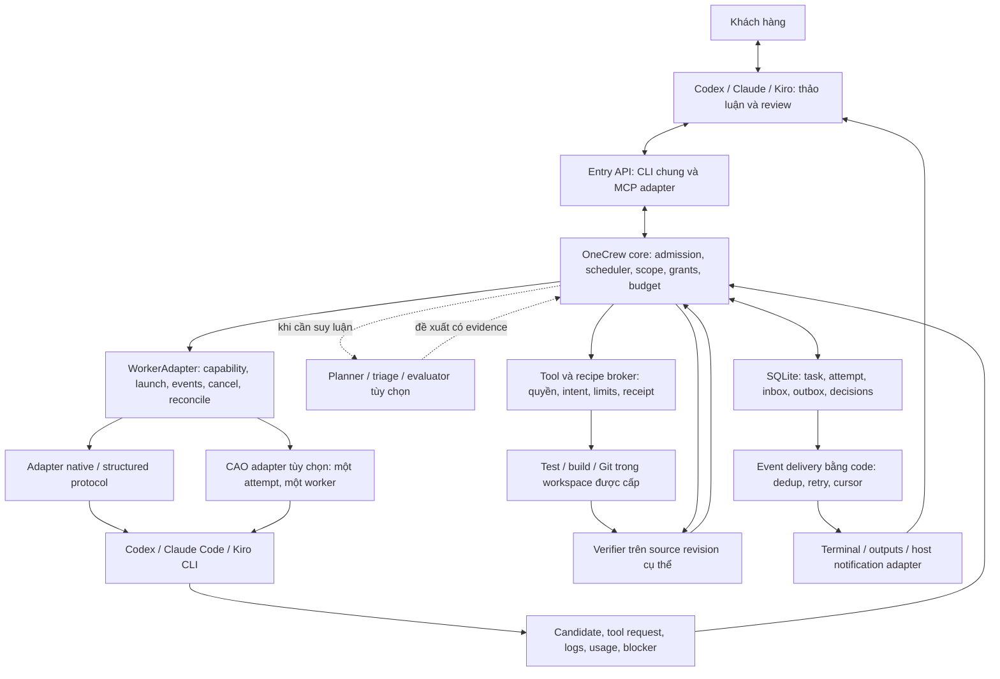

# OneCrew revision 5 — hợp nhất bài học KiroCrew và CAO

Ngày: 09/10/2026, Asia/Saigon. **Trạng thái: thiết kế đã cập nhật; chưa triển khai các khoảng thiếu trong tài liệu này.** Đây là phần bổ sung có hiệu lực của [kiến trúc tổng thể](architecture.vi.md), không phải sản phẩm hay roadmap thứ hai. Giữ ID OC/OE/BG/IN/LR hiện có; không coi việc đọc source upstream là evidence OneCrew đã chạy được.

## 1. Quyết định và bản duyệt nhanh

OneCrew nhận mục tiêu đã làm rõ từ Codex, Claude hoặc Kiro; tự chia phần bàn giao, chạy worker, kiểm chứng và trả kết quả hoặc câu hỏi. Chat là nơi trao đổi/review, không làm hộ các bước thực thi còn thiếu. Cùng task tiếp tục được khi đổi nơi chat; không chuyển nguyên lịch sử riêng tư giữa các công cụ.

- **Học KiroCrew:** vòng lập kế hoạch → thực thi → test/review → phục hồi có giới hạn; checkpoint và lesson có nguồn.
- **Học CAO:** tách cổng điều khiển bên ngoài và giao tiếp worker; giao bất đồng bộ; tách provider khỏi process backend; inbox và sự kiện.
- **OneCrew giữ:** scope/AC, grant/approval, root budget, scheduler, trạng thái task, nghiệm thu kỹ thuật và lịch sử quyết định.
- **Một nơi sở hữu lịch chạy và retry:** core OneCrew. KiroCrew là nguồn tham khảo, không chạy thêm TaskRunner bên dưới. CAO chỉ là ứng viên adapter chạy một worker/attempt; không bật supervisor/workflow/recursive delegation CAO trong chế độ này.
- **Giữ runner native Windows hiện có** trong lúc kiểm chứng CAO. Structured protocol được ưu tiên; đọc TUI là fallback có kiểm thử theo phiên bản. CAO chưa được cài hoặc chạy thử trong lần cập nhật này.
- Không thêm dashboard, vector DB, broker ngoài hay role AI thường trực vào đường găng. Một core Python/SQLite, các adapter và tiến trình worker; số khối trong sơ đồ không phải số service cần tạo.

Kết quả cần đạt trước tiên: một task thực tế hoàn thành trong quyền và ngân sách đã giao, có phần thử được, không cần Codex sửa hạ tầng hoặc chạy hộ bước còn thiếu. Không hứa mọi task thành công; gặp điều kiện ngoài quyền thì giữ trạng thái và hỏi đúng chỗ.

## 2. Kiến trúc đề xuất

Module đang có được tái sử dụng, không tạo bản sao theo tên trong sơ đồ:

| Ranh giới | Trách nhiệm duy nhất | Code hiện có để mở rộng |
|---|---|---|
| Entry | submit/connect/status/inbox/reply/outputs/control; không tự chạy công việc sản phẩm | `entry.py`, `entry_cli.py`, các CLI hiện có |
| Core | claim, dependency, ownership, root budget, transitions, retry và recovery | `ledger.py`, `control.py`, `runner.py`, `owned.py`, `workflow.py` |
| Execution | quản lý process/CLI, workspace và capability; báo trạng thái có nguồn | `supervisor.py`, `providers.py`, `android_jobs.py` |
| Tools/recipes | xác nhận quyền rồi thực thi thao tác đã định kiểu; receipt cho side effect | `worker_tools.py`, `owned_git.py`, `git_history.py`, `android_build.py` |
| Verification/integration | gate đúng snapshot và bản ghép, artifact hashes, AC coverage | `integration.py`, `snapshots.py`, các gate hiện có |
| Delivery/observation | lưu và chuyển sự kiện, theo dõi không gọi model | `notifications.py`, `monitor.py` |
| Decisions/learning | đề xuất model/triage khi cần; outcome và bài học có giới hạn | `routing.py`, `jev.py`, ledger/evidence hiện có |

Đây là trách nhiệm mục tiêu, không phải tuyên bố các module trên đã đáp ứng toàn bộ contract.

## 3. Luồng thực thi và bàn giao từng phần

1. Entry gửi goal, repo roots, AC, non-goals, quyền, giới hạn và câu hỏi còn mở. Yêu cầu nhỏ dùng brief ngắn; không tự tạo bộ spec dài. Quyền đã cấp còn hiệu lực không hỏi lại.
2. Core lưu task và cấp Task ID; chỉ báo đã chạy khi handshake có bằng chứng. Entry kết thúc lượt ngay sau dispatch. Nếu còn queued/starting phải báo đúng trạng thái đó.
3. Runtime tự discovery trong scope; tạo plan nhỏ gắn AC, dependency, read/write ownership và mốc review. Nhánh độc lập chạy song song trong capacity; mặc định không tăng fan-out chỉ vì đủ quota.
4. Core cấp attempt cho worker đủ capability. Worker dùng công cụ native trong workspace được cấp hoặc gửi tool request về broker, tùy execution mode đã kiểm chứng.
5. Khi cần build/test/Git recipe, runtime tự yêu cầu broker và nhận operation ID. Worker không phải gọi vòng AI chỉ để chờ operation. Operation con dùng cùng root task/grant; build thành công không tự hoàn thành task cha.
6. Verifier kiểm candidate và AC. Đạt mốc thì phát output card; fail có evidence thì vào recovery. Review từng phần theo snapshot, chỉ dừng ở review gate đã thỏa thuận. Phản hồi làm stale đúng phần phụ thuộc, không xóa mọi kết quả.
7. Integration owner ghép tuần tự, chạy gate trên bản ghép và kiểm base trước cập nhật target. Publish/push/deploy dùng đúng quyền đã cấp. Hoàn tất khi đủ evidence bắt buộc; customer acceptance là trạng thái riêng.

Trạng thái logic: `queued → running → verifying → completed`, với `waiting_input`, `waiting_dependency`, `recovering`, `blocked`, `failed`, `cancelled` khi cần. Đây là từ vựng chuẩn hóa cho adapter; migration phải ánh xạ phase hiện có (`waiting`, v.v.), không tự đổi enum lưu trữ trong bản cập nhật tài liệu này. Output review và user acceptance không bị gộp vào `completed`.

## 4. Worker và tool contract

Giữ contract adapter ở mục 13.1 kiến trúc tổng thể: probe, launch, events, cancel, reconcile, collect_artifacts và observe_usage. Mỗi event gắn task/attempt/generation/native ID, sequence và bằng chứng; unknown không đổi thành success.

Hai mode thực thi:

- **Artifact mode:** giữ đường hiện có, worker trả candidate/tool request, core kiểm và ghi. Phù hợp khi cần kiểm soát chặt quyền.
- **Workspace mode:** CLI dùng native tools trong worktree cách ly. Chỉ bật khi chứng minh containment, quyền tool, dừng cả process tree, giữ artifact và thu usage. Worktree chỉ cách ly source; không tự cách ly credentials, filesystem hay network.

Broker operation có `operation_id`, loại tool, canonical arguments, scope/grant revision, input snapshot, idempotency key, timeout và giới hạn output. Kết quả có exit/status, log/artifact refs và observed effects. Lưu intent trước mutation, receipt sau xác minh. Retry sau timeout phải reconcile; không coi mất response là chưa thực hiện. Build queue/capacity hiện có tiếp tục dùng chung trên state-root, không có slot riêng để CAO vượt giới hạn.

### Điều kiện cho CAO adapter

Core chọn provider/model/profile/workspace và cấp một attempt. CAO giữ terminal/session cùng transport nội bộ; core giữ plan, task queue, retries, grants và ngân sách. Không chạy song song cả CAO workflow và OneCrew workflow cho cùng task. Transport retry phải idempotent; không được phát thêm lượt model mà core không ghi nhận.

Capability probe phải kiểm: provider/model thực đã nhận, auth mode, launch identity, trạng thái blocked/unknown, command cancellation, process còn sống sau mất kết nối, artifacts còn sau cleanup và giới hạn quyền delegation. Nếu CAO không cưỡng chế được điều kiện bắt buộc thì adapter chưa đủ điều kiện chạy task thật, tiếp tục dùng native adapter. Không dùng biến môi trường hoặc prompt như bằng chứng sandbox.

CAO mặc định dùng tmux; Windows native và WSL/Linux là capability riêng. Không trộn PID/path/auth giữa hai môi trường. Thử CAO là một spike hữu hạn trong backlog, không là migration mặc định. Không tự cài backend hoặc chuyển task đang chạy khi chỉ cập nhật kiến trúc.

## 5. Chống lặp, scope và phục hồi

Mỗi bước phải tạo ít nhất một trong: evidence mới có ích cho AC, source revision mới có liên quan, gate tiến triển, hoặc blocker đã xác định. Log mới, câu chữ mới, model mới và spec dài hơn không tự là tiến triển.

Theo dõi fingerprint của normalized tool args + source revision + kết quả/lỗi. Đọc cùng dữ liệu khi source không đổi có thể dùng cache. Khi chuỗi bước khác tên nhưng không tăng evidence/AC, chốt stagnation dừng hoặc gọi một triage hữu hạn. Ngưỡng đọc/thử/sửa/replan nằm trong policy version được lưu với task; planner không tự nâng. Không hứa bắt mọi vòng lặp ngữ nghĩa.

| Loại vấn đề | Hành động trong quyền đã cấp | Điều kiện dừng/hỏi |
|---|---|---|
| Code/test | sửa phần liên quan, test lại đúng snapshot | lặp fingerprint hoặc hết repair budget |
| Toolchain/môi trường | doctor/check version; recipe khôi phục đã cấp | thiếu SDK/quyền cài/thay cấu hình ngoài scope |
| Network/provider tạm thời | backoff hữu hạn theo tín hiệu, reconcile attempt | hết deadline, state unknown hoặc retry cap |
| Quota/auth | giữ checkpoint; chọn provider khác chỉ khi đã được phép và writer cũ dừng | cần login, grant hoặc quota mới |
| Thiếu yêu cầu/ngoài scope | tạo request có revision; việc độc lập có thể tiếp tục | nhánh phụ thuộc chờ trả lời thật |
| Không xác định | giữ evidence, một triage có ngân sách nếu có ích | không đoán rồi chạy mutation tiếp |

Có bộ đếm riêng theo loại lỗi nhưng mọi model call, review, repair và fallback vẫn dùng root budget. Deadline hiện có vẫn tính thời gian chờ; hết hạn chặn chạy mới, không tự gia hạn. Usage nội bộ CLI không quan sát được phải là unknown; không quảng cáo giới hạn managed calls như hard token cap.

## 6. Sự kiện, câu hỏi và chat không bị chiếm

DB là nguồn trạng thái bền vững; event bus trong process chỉ đánh thức consumer. State mutation và outbox ghi cùng transaction. Consumer dùng event ID/cursor để dedup; reconcile lại DB sau restart hoặc mất sự kiện. Không coi event bus in-memory là durable queue.

- Có attempt/build hoạt động: observer bằng code theo dõi process/events. Cập nhật terminal không gọi AI.
- Có kết quả/câu hỏi/failure mới: outbox chuyển qua host adapter đã cấu hình; gắn task/request/revision, có receipt chuyển tin.
- Hết việc chạy và không có delivery cần xử lý: observer task kết thúc; service có thể chờ event nhưng **không gọi model**. Không tạo heartbeat AI cố định toàn chat.
- `waiting_input`: gửi một thông báo cho revision hiện hành; lưu pending bền vững. Dismiss, timeout, ack hoặc mất chat không approve và không tự resume. Nhắc lại chỉ theo yêu cầu/cấu hình người dùng; retry truyền tải phải dedup.
- Entry mới connect cùng task: nhận progress/output/questions và quyền thực tế. Trả lời CAS đúng revision từ entry có quyền; worker không được giả người dùng.
- Nếu host không có callback đã kiểm chứng: báo rõ chỉ có terminal/CLI/inbox; không hứa tự hiện trong chat. Polling dự phòng chạy bằng code; không thay bằng gọi AI định kỳ.

**Hiện trạng 09/10:** bridge Codex mỗi 5 phút đã PAUSED do chạy cả khi không có việc. Feed pull/ack đã có; tự quản lý lifecycle notification/host callback chưa triển khai. Không bật lại automation trong lần cập nhật tài liệu này.

## 7. Evidence, memory, routing và JEV

Completion gate kiểm: scope/diff, AC bắt buộc, tests đúng snapshot, artifact tồn tại/hash, integration và external receipts. Terminal idle/CLI trả lời xong chỉ kết thúc lượt worker. APK build được không chứng minh đã cài hoặc chạy trên thiết bị. Card bàn giao gồm phần đã làm, phần chưa kiểm, source revision, evidence và cách thử.

Memory dùng SQLite/Markdown/snapshot hiện có: facts, quyết định người dùng, checkpoint, outcomes và lessons có source revision, phạm vi, thời hạn/freshness. Handoff packet có giới hạn; không nạp mọi transcript/lesson vào mỗi call. Lesson được gọi lại nhiều lần không tự là lesson đúng.

LR01–LR04 giữ hiệu lực: ghi mọi kết quả kể cả fail/cancel/assisted, loại việc, provider/model/effort, toolchain, repairs, usage known/unknown, thời gian active/wait và can thiệp ngoài runtime. So sánh route trên bộ task đại diện với ngưỡng chất lượng/chi phí được chốt trước; promotion có policy version và rollback. Chưa thêm vector DB.

Rule/code xử lý status, hash, budget, permission, readiness, retries đã định nghĩa và completion gate. Planner/triage dùng AI khi thực sự cần hiểu yêu cầu hoặc lỗi; JEV là evaluator thay thế/tùy chọn cùng schema, chỉ đề xuất trên evidence đã cấp. JEV không cấp quyền, không giữ queue, không nằm trong mọi tool call. Routing vẫn dùng policy hiện có cho tới khi benchmark chứng minh policy mới tốt hơn.

## 8. Thứ tự triển khai và điều kiện nghiệm thu

Các dòng sau là **pending** của revision 5; tái sử dụng nền đã có, không xóa evidence milestone cũ. Thứ tự này thay các nhãn phase P1–P4 lịch sử khi quyết định việc tiếp theo.

| Ưu tiên/lát | Khoảng cần đóng | Gate chấp nhận | Mapping |
|---|---|---|---|
| P0.1 — thực thi trọn task | runtime tự nối tools/recipe/build → verify → output; giữ native adapter trước | một task thực tế từ submit tới đầu ra, không chat chạy hộ/sửa runtime, budget không reset; báo assisted nếu có can thiệp | OE, BG, OC03/04/08 |
| P0.2 — dừng lặp và phục hồi | progress fingerprint + error taxonomy + root caps | lỗi lặp dừng đúng; lỗi SDK/auth không gọi sửa code; duplicate dispatch và effect unknown không chạy lại mù | OC03/09/12 |
| P0.3 — hoàn thành có evidence | AC ledger và gate thống nhất giữa job/build/integration | stale test/artifact thiếu/merge fail không completed; output ghi rõ phần chưa kiểm và acceptance riêng | OC02/08/11 |
| P0.4 — notification lifecycle | observer/event delivery bằng code, host adapter thực tế | không có task: 0 lượt gọi model theo lịch; waiting input báo một lần/revision; restart giữ pending; host thiếu callback báo đúng giới hạn | BG/IN/UX, OC01/05 |
| P1.1 — entry và CAO spike | CLI/MCP entry contract; probe CAO một worker, không supervisor lồng | đổi entry vẫn cùng task/request; CAO launch/status/cancel/reconcile/artifact kiểm chứng trên OS thật trước quyết định dùng | OC01/04/05/06 |
| P1.2 — task liên quan | ownership/dependency và integration gate | A → (B,C) → D; B review khi C chạy; xung đột writer bị chặn; bản ghép phải test | OC07/08/11 |
| P1.3 — routing/lessons | outcome pipeline và đánh giá policy | policy version có benchmark, tính cả failures/assistance và usage unknown; không lấy recall count làm điểm chất lượng | OC10, LR01–04 |
| P2 — độ bền dài hạn | fault injection và soak có quyền/ngân sách | restart, mất mạng/quota, sleep, duplicate events: không writer trùng, không mất request, không replay side effect; 8 giờ chỉ tuyên bố sau live soak | OC03/09/12 |

Kiểm thử adapter bằng fake để tái hiện crash trước/sau launch, mất receipt, event lặp, source thay trong verify và câu trả lời stale. Sau đó live test nhỏ có ngân sách bằng adapter đã đăng nhập; fixture pass không thay live evidence. Không cần chạy suite sản phẩm cho thay đổi tài liệu này. Mỗi lát cập nhật coverage khi có code/test/result; không đánh dấu Complete từ bản thiết kế.

## 9. Nguồn học và giới hạn review

Đã đọc các phần liên quan; chưa chạy test suite hoặc benchmark vận hành của hai upstream. Không nhập nguyên framework và không suy rằng upstream đáp ứng mọi contract OneCrew.

| Nguồn cố định | Bài học áp dụng |
|---|---|
| [KiroCrew v0.8.0 taskrunner](https://github.com/kirodotdev/KiroCrew/blob/v0.8.0/src/kiro_crew/taskrunner.py) | giới hạn replan, chỉ lập lại phần còn lại, checkpoint, notification theo run |
| [KiroCrew task_executor](https://github.com/kirodotdev/KiroCrew/blob/v0.8.0/src/kiro_crew/task_executor.py), [recovery ladder](https://github.com/kirodotdev/KiroCrew/blob/v0.8.0/src/kiro_crew/recovery/ladder.py) | tách lỗi logic/test, crash và dependency; review không thay tests/AC |
| [CAO 089c53c control planes](https://github.com/awslabs/cli-agent-orchestrator/blob/089c53ccfb056c9865d475ababb6ec7e4507c599/docs/control-planes.md), [MCP source](https://github.com/awslabs/cli-agent-orchestrator/blob/089c53ccfb056c9865d475ababb6ec7e4507c599/src/cli_agent_orchestrator/mcp_server/server.py) | entry bên ngoài khác worker coordination; assign bất đồng bộ khác handoff chờ |
| [CAO provider](https://github.com/awslabs/cli-agent-orchestrator/blob/089c53ccfb056c9865d475ababb6ec7e4507c599/src/cli_agent_orchestrator/providers/base.py) | tách backend/provider, capability model thực tế, không tin terminal text như AC |
| [CAO event flow](https://github.com/awslabs/cli-agent-orchestrator/blob/089c53ccfb056c9865d475ababb6ec7e4507c599/docs/event-driven-architecture.md), [inbox source](https://github.com/awslabs/cli-agent-orchestrator/blob/089c53ccfb056c9865d475ababb6ec7e4507c599/src/cli_agent_orchestrator/services/inbox_service.py) | event + reconciliation bằng code; khóa delivery, không hứa exactly-once side effects |
| [CAO journal](https://github.com/awslabs/cli-agent-orchestrator/blob/089c53ccfb056c9865d475ababb6ec7e4507c599/src/cli_agent_orchestrator/services/workflow_journal.py), [workflow guide](https://github.com/awslabs/cli-agent-orchestrator/blob/089c53ccfb056c9865d475ababb6ec7e4507c599/docs/workflows.md) | replay/checkpoint có điều kiện; side effect ngoài journal vẫn phải reconcile |
| [CAO promotion](https://github.com/awslabs/cli-agent-orchestrator/blob/089c53ccfb056c9865d475ababb6ec7e4507c599/src/cli_agent_orchestrator/services/promotion_service.py), [learning evaluation](https://github.com/awslabs/cli-agent-orchestrator/blob/089c53ccfb056c9865d475ababb6ec7e4507c599/docs/self-learning-validation.md) | outcome trước lesson/promotion; đo chất lượng và latency, không mặc định memory giảm token |

Quyết định chưa chốt bằng thực nghiệm: CAO có phù hợp thay một phần adapter native trên máy này hay không. Quyết định đã chốt: không để hai scheduler cùng sở hữu task và không dùng AI để theo dõi idle.
