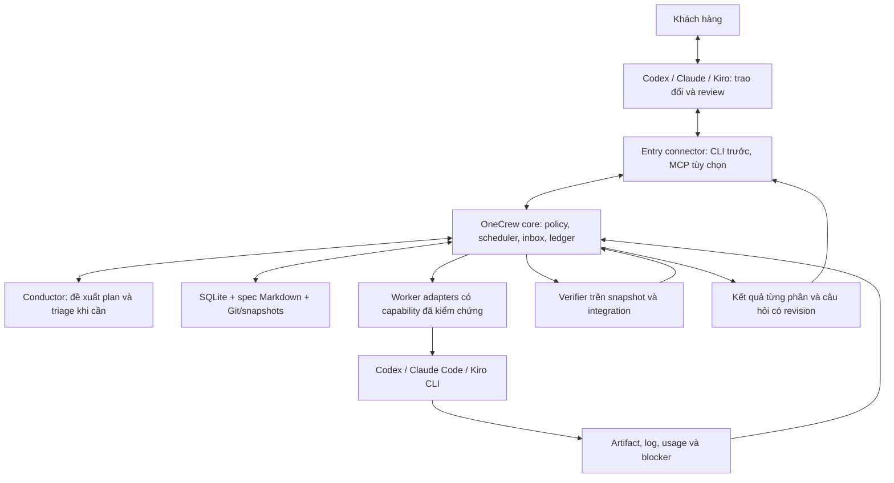

# Kiến trúc OneCrew — baseline 09/10/2026, revision 3

**Ưu tiên revision 3:** [OneCrew sở hữu vòng thực thi](owned-execution.vi.md), [SPEC-007](../specs/SPEC-007-owned-execution.md). Entry chỉ giao mục tiêu/root/quyền/budget; runtime tự khảo sát và thực hiện. Những contract revision 2 dưới đây vẫn áp dụng về quyền/recovery, nhưng không được dùng yêu cầu profile/file list làm điều kiện bắt entry chuẩn bị công việc. Luồng CTS audit/push trước đó cần host hỗ trợ nên không chứng minh autonomy. OE01–OE07 là gate nâng cấp; learning/JEV và các phần OC còn thiếu giữ backlog riêng.

OneCrew là bộ điều phối local nhận yêu cầu đã làm rõ từ Codex, Claude hoặc Kiro; chia việc, gọi worker phù hợp, kiểm chứng và giữ tiến độ chung. Người dùng tiếp tục trao đổi trong công cụ đang dùng. OneCrew không cần xây thêm ứng dụng chat hoặc hệ thống Agile đầy đủ.

**Trạng thái:** milestone OE01–OE07 của revision 3 đã triển khai và có fixture/live evidence; các contract OC/LR chưa hoàn tất vẫn được theo dõi riêng. Cập nhật tài liệu không cấp quyền chạy job 8 giờ, gọi API trả phí hay nghiệm thu sản phẩm. [SPEC-006](../specs/SPEC-006-portable-orchestration.md) là bản duyệt nhanh; [backlog](mvp-backlog.vi.md) xác định thứ tự; [coverage](proposal-coverage.md) phân biệt code đã có với phần còn thiếu.

Revision 2 tiếp thu review source của chín dự án trong mục 12. Các quyết định được chuyển thành contract bắt buộc tại mục 13 và ca nghiệm thu T20–T30; không đưa chín framework vào dependency. OC01–OC12 vẫn là bộ yêu cầu hiện hành, không tạo roadmap thứ hai. Phạm vi bằng chứng là các đường chạy/test đã đọc, không phải audit toàn bộ code của từng repo.

## 1. Quyết định sau review toàn bộ trao đổi

| Chủ đề người dùng đặt ra | Quyết định hiện hành | Yêu cầu |
|---|---|---|
| OneTechAI làm nhiều ngày, tốn token, khó kiểm soát | Lát bàn giao nhỏ có AC, bằng chứng và budget chung; đo kết quả thay vì số agent/spec | OC02, OC09, OC12 |
| Specs dễ đọc, CLI duyệt | Một nội dung có bản nhanh và chi tiết, cùng revision; không tạo spec sau mỗi tin nhắn | OC02 |
| Vai Conductor/Scrum Master | Conductor mỏng lập plan, triage và báo cáo; code giữ scheduler và thẩm quyền | OC03, OC12 |
| Trao đổi trước khi giao việc | Trao đổi ở công cụ đầu vào; bàn giao điều đã chốt và câu hỏi còn mở | OC01, OC06 |
| Codex/Claude/Kiro đều giao và nhận việc | Entry connector độc lập với worker adapter; không buộc hai phía cùng hãng | OC01, OC04 |
| Hết usage Kiro, sang Claude | Kết nối cùng task; câu hỏi và approval đang chờ thuộc OneCrew | OC01, OC05, OC06 |
| Khó khăn cần hỏi lại | Inbox bền vững, câu hỏi ngắn có lựa chọn/khuyến nghị; chỉ nhánh phụ thuộc chờ | OC05 |
| Memory chung | Spec, quyết định, checkpoint và evidence có nguồn; không chuyển nguyên private chat | OC06 |
| Nhiều task liên quan | DAG, contract trước, ownership/worktree riêng, ghép tuần tự có gate | OC07, OC08 |
| Review từng phần, đổi thứ tự | Review snapshot theo revision; ưu tiên chỉ tác động việc chờ đủ dependency | OC11 |
| Model theo độ khó, tận dụng quota | Rule trước; capability/risk trước quota; JEV thêm sau benchmark | OC10 |
| Tự làm lâu, tới 8 giờ | Core độc lập với chat, checkpoint/recovery, deadline và budget cộng dồn | OC03, OC09 |

**Thay đổi so với 08/10:** chọn core OneCrew độc lập; Kiro Crew là tham khảo thay vì host bắt buộc. Decision AI không đứng trên mọi bước. Tách nơi giao việc khỏi worker. Tên project vẫn là OneCrew; cách gọi “CodeCrew” trong trao đổi không tạo sản phẩm khác.

Giữ [kiến trúc cũ](architecture-2026-10-08.vi.md) và [backlog cũ](mvp-backlog-2026-10-08.vi.md) làm lịch sử. ID R/CN/DF và thứ tự spike trong các bản đó không phải kế hoạch hiện hành; OC01–OC12 thay thế chúng cho giai đoạn tiếp theo. Các nguyên tắc scope/budget/authority được giữ trong contract dưới đây.

## 2. Hiện trạng có bằng chứng

| Năng lực | Code hiện có | Khoảng thiếu |
|---|---|---|
| CLI spec | onecrew/specs.py: list/review/diff/approve/request-changes/history | Approval local chưa xác thực/cách ly worker |
| Ledger/inbox/core | SQLite ngoài source, admission/counters, Windows Job supervisor, root/branch triage, reply effects và hủy nhóm lưu transaction | Caller hiện là local operator; trusted multi-entry và đầy đủ fault transitions còn thiếu |
| Workflow tổng quát | Spec/profile→plan→artifact→snapshot→gates; Codex/Kiro/Claude live, background/recovery, dirty bytes | Auth subscription được kiểm tra trước dispatch; Claude code/handoff/cancel đã qua trial; đầy đủ ma trận fault transitions còn thiếu |
| Phân việc/model | DAG hai worker, amendment; quota Codex chỉ đọc, optional account reservation và usage dedup; fixed goal budget và commit-vector gate nhiều repo | Chưa authoritative cumulative settlement, routing dispatch/fallback và dynamic cross-repo scheduler |
| Output | Card/diff/revision, scoped request-changes, reorder, verified review branch và target CAS merge mức file | Tự rebase/conflict repair và authenticated entry acceptance còn thiếu |
| JEV | Credential DPAPI và doctor kết nối được | Chưa semantic routing/benchmark |

Entry CLI hiện có `entry connect/note`: packet đọc nhất quán từ ledger chứa spec/plan/progress/questions/notes; note có revision, idempotency và provenance local. Đổi chat không đổi worker hoặc reset budget. Đây là transport local, chưa xác thực multi-entry; note không tự trở thành amendment, approval hoặc lesson đã kiểm chứng. [Hướng dẫn và giới hạn](entry-context.vi.md).

[SPEC-005 đã bàn giao](incremental-autonomy.vi.md) app CV từ thư mục trống: run RUN-20261008-232057-1d06d8, 585,21 giây, 14 calls, một repair thật, 19 gate checks đạt; runtime commit bf2e673, product commit ad3c748. Bộ kiểm thử được ghi nhận ở lượt đó là 69 tests. Đây là bằng chứng profile local/Codex, không chứng minh orchestration tổng quát hoặc khả năng chặn mọi AI bot ngoài production; khách hàng chưa nghiệm thu.

Các trần 3.600 giây/run, 32 calls, 4 repair và 600 giây/call thuộc runtime CV cũ. Workflow `TASK-` mới dùng grant hữu hạn tối đa tám giờ từ submit và 10.000 managed calls, profile tối đa ba repairs/600 giây mỗi bước. Extension giữ used/deadline gốc tối đa; đã có fixture recovery và Codex→Kiro checkpoint handoff. Chưa kiểm chứng soak tám giờ. Phân biệt giới hạn cấu hình với bằng chứng vận hành.

## 3. Một core, hai nhóm kết nối



Một ứng dụng Python local, tái sử dụng CLI và SQLite; các khối là module, không phải mỗi khối một service. Core chạy độc lập với cửa sổ chat; một instance sở hữu queue/lease/process tree. Mutation đi qua core; query không gọi model. Khi core chưa chạy, CLI báo rõ hoặc khởi động đúng instance qua khóa, không tạo scheduler thứ hai. Máy và process phải hoạt động; sleep/offline không được báo là đang tính toán.

Core là state machine xác định bằng code, với transaction + event/outbox trong một SQLite DB; không cần event-sourcing toàn phần, broker ngoài hoặc nhiều daemon. Worker có hai execution mode: `artifact` (read-only, trả candidate để core kiểm rồi ghi; ưu tiên giữ từ runtime hiện có) và `workspace` (worker sửa worktree cách ly; chỉ bật sau kiểm chứng quyền và stop). Chọn mode theo task/capability, không tự bỏ sandbox để chạy được. Supervisor sở hữu process; Conductor không được tự khởi động thêm scheduler. Module boundaries và adapter contract cụ thể ở mục 13.

| Thành phần | Trách nhiệm | Ranh giới |
|---|---|---|
| Entry connector | Submit/attach/query/reply; chuyển ý định khách hàng có nguồn | Không sở hữu task hoặc giả approval |
| Conductor | Đọc repo, phân rã spec, triage, tóm tắt | Chỉ đề xuất; không scheduler/retry loop/budget riêng |
| Core | Kiểm revision/quyền/scope/budget/dependency; dispatch, cancel, recovery | Nguồn trạng thái duy nhất |
| Worker adapter | Launch/events/cancel/reconcile/artifact/usage | Capability thực; unsupported/unknown hiển thị rõ |
| Verifier | Test theo thay đổi, scope/AC, kiểm bản ghép | Gate ghim revision, worker không sửa để tự pass |
| Memory/ledger | Quyết định, checkpoint, evidence và lịch sử | Worker report; core xác minh trước khi cập nhật |

Claude Desktop có thể là entry; Claude Code là worker khác. Không giả định mọi host có cùng API push, ACP, session resume hoặc quota API. V0 dùng CLI connector mỏng theo khả năng tool từng host; host chưa gọi được CLI cần thao tác terminal rõ ràng, không gắn nhãn đã tích hợp tự động. MCP là transport bổ sung khi cần, cùng contract/quyền.

Kiro Crew cung cấp ý tưởng Conductor/work ledger; OneCrew kết hợp hai trách nhiệm tối thiểu, không chỉ là worker lá. Adapter Kiro Crew, Antigravity, DeepSeek Harness chỉ xem xét khi có nhu cầu và contract test; không bọc scheduler thứ hai.

## 4. Từ trao đổi đến giao việc

1. Người dùng và AI ở entry trao đổi/tra cứu/làm rõ. Ý tưởng chưa chốt không tự thành task chạy.
2. Connector lưu brief, quyết định người dùng đã đồng ý và nguồn; core trả durable acknowledgment. Nội dung chưa bàn giao không tự xuất hiện khi đổi công cụ.
3. Spec có bản nhanh tối đa 350 từ, chi tiết đủ thực thi, AC và non-goals. Duyệt spec và quyền chạy có thể được cấp cùng một lời giao việc rõ ràng; không hỏi lại quyền còn hợp lệ.
4. Core nhận handoff, trả task ID. Conductor đọc repo thực tế, chia theo kết quả kiểm chứng được. Code kiểm DAG/ownership/coverage AC và giới hạn trước dispatch.
5. Worker làm từng bước; core checkpoint, verify, đưa phần dùng được ra review. Lựa chọn kỹ thuật và sửa test fail trong scope tự xử lý trong budget.
6. Hỏi khi cần đổi hành vi chưa rõ, quyền, scope hoặc budget. Bàn giao khi AC/gate đạt; ghi user acceptance riêng.

Handoff tối thiểu: project ID, client_request_id chống submit lặp, spec ID/hash, mục tiêu/AC/non-goals, decision refs, repo paths + base refs/dirty snapshot, quyền theo hành động, root budget/deadline, provider/model policy, dependencies và review checkpoints. Core ghi root_task_id, plan/policy/grant revision. Thiếu dữ liệu repo được khảo sát trong quyền đã cấp; thiếu quyết định nghiệp vụ thì tạo request.

Worker báo “xong” không đủ. Completion trỏ đúng source snapshot, gate version và evidence. Allowlist file không phải bằng chứng duy nhất rằng chức năng còn trong scope.

## 5. Dữ liệu, bộ nhớ và quyền

Kho local thuộc core/project, ngoài worktree được phép sửa. SQLite giữ các nhóm record trong cùng DB:

| Record | Dữ liệu cần giữ |
|---|---|
| Project/root/task/edge | Repo, AC coverage, plan revision, dependency, priority, ownership/state |
| Attempt/lease/dispatch intent | Backend/native ID, process identity, fencing generation, heartbeat, idempotency/reconcile |
| Request/reply/grant | Câu hỏi/options, action revision, actor/provenance, quyền và trạng thái xử lý |
| Checkpoint/artifact/verification | Repo base, diff chưa commit, manifest/hash, gate version và evidence refs |
| Budget/reservation/usage | Deadline gốc, counters cộng dồn, quota snapshot/freshness, số unknown |
| Event/outbox | Sự kiện bền vững, pending notification, cursor/dedup |

Mở rộng record: `ActionIntent/Receipt` lưu payload hash, idempotency key và kết quả confirmed/unknown; `Handoff` lưu source/target generation, từng transition và ownership; `CapabilityEvidence` lưu adapter/CLI/OS version, auth mode và probe/test refs. Budget tách reservation, actual usage và khoản chưa xác định. AC/gate/task/spec có revision riêng để invalidation chính xác. Các bảng thuộc cùng core, không tạo ledger độc lập trong mỗi adapter.

Spec/brief/decision summary là Markdown có revision; source/artifact là Git hoặc immutable snapshot, DB giữ hash/ref. Không ghi secrets, CV thật hoặc toàn transcript vào memory. Tách fact có nguồn, giả định, đề xuất AI, quyết định khách hàng và kết quả verified. Summary ghi evidence revision, đánh dấu stale khi đầu vào đổi; project isolation ngăn dùng nhầm memory/repo.

Ba chiều trạng thái độc lập: execution (queued/running/waiting/recovering/stopped/failed/completed), verification (pending/passed/failed/stale), acceptance (not_requested/pending/accepted/changes_requested). Waiting reason phân biệt dependency/user/quota/environment/budget. Cancel requested khác cancel confirmed; không báo dừng khi process còn chạy.

Worker không được reply như khách hàng hoặc sửa grant/ledger/gate. Capability entry và worker tách biệt, tối thiểu theo nhiệm vụ. Reply cần caller identity và nguồn ý định, không chỉ tin field actor trong JSON. CLI local hiện tại chưa bảo đảm điều này. Cùng OS user với full shell không tạo isolation chỉ bằng prompt/đường dẫn: trước approval đa entry phải kiểm chứng sandbox/tool permissions hoặc isolation tương đương. Không mở endpoint điều khiển không xác thực.

## 6. Hỏi lại và chuyển công cụ

Request lưu ID, task/plan/spec revision, câu hỏi ngắn, lý do cần người dùng, khuyến nghị/options, tác động scope/thời gian/quyền, proposed action revision và tasks bị ảnh hưởng. Trạng thái pending/answered/applied/rejected/expired/superseded. Poll inbox không gọi model; push tùy capability, không là điều kiện để nhận câu hỏi.

Ví dụ CV chưa chốt thời hạn lưu: core hỏi “Giữ CV bao lâu?”, nêu lựa chọn và phần storage đang chờ. Task CSS độc lập có thể tiếp tục. Im lặng không phải approval. Gộp request tương đương cùng revision thay vì hỏi lại nhiều lần.

Kiro hết usage, chuyển Claude:

1. Connect cùng project/task ID; nhận mục tiêu, output verified, phần đang chạy và request pending.
2. Claude hiển thị cùng request; người dùng trả lời, connector gửi request/action revision và provenance.
3. Core kiểm quyền/freshness rồi áp dụng một lần. Reply lặp trả kết quả cũ; reply khác cho request đã áp dụng báo conflict. Reply cho nội dung cũ phải đối chiếu lại, không áp lên action mới.
4. Tiếp tục bằng checkpoint/budget cũ. Đổi entry không đổi worker; worker độc lập không bị khởi động lại.

Nếu **worker** hết usage: xác nhận old writer dừng, reconcile side effects chưa rõ, lưu source/diff/checkpoint/lỗi rồi chọn worker khác trong policy đã cấp. Lease hết hạn không chứng minh process đã chết; chỉ cấp writer mới sau stop/reconcile. Fencing chặn report cũ; isolation/stop chặn writer cũ sửa file. Không có hai writer, không reset calls/retries/deadline. Native session có thể không chuyển được; tiếp tục bằng handoff tối thiểu, không hứa chuyển nguyên chat history.

Handoff dùng state machine bền vững ở mục 13.4. Đổi entry chỉ là attach/read/reply trên task hiện hữu, không tạo Handoff record cho worker. Cùng provider chỉ native-resume khi identity/version/workspace còn hợp lệ; khác provider khởi tạo session mới từ context đã lưu. Context của agent cũ là dữ liệu có nguồn, không được biến thành system instruction hay grant mới.

## 7. Nhiều task liên quan

Bắt đầu tối đa **2 worker toàn core**, có giới hạn từng repo/provider; không phải 2 cho mỗi root task. Kiểm root budget và capacity chung khi dispatch. Ownership và worktree/snapshot riêng; không tự stash/reset phần sửa của người dùng.

Ví dụ A: contract API → (B: backend, C: frontend) → D: integration. B/C chỉ chạy sau A; việc cùng file/schema hoặc không tách ownership chạy tuần tự. Graph cycle bị từ chối hoặc gom thành bước tuần tự có giải thích.

Integration owner ghép lần lượt trên base đã ghi và chạy gate bản ghép; hai nhánh pass riêng chưa đủ. Đa repo ghi vector commit và contract version, không giả định Git commit atomic xuyên repo. Local integration không bao gồm publish.

Gate phải chạy trên chính candidate tích hợp, trước khi cập nhật nhánh đích local hoặc publish đã được cấp quyền. Thiếu worktree/snapshot thì báo lỗi, không fallback sang repo chính. Nếu base đích đổi sau lúc verify, candidate/evidence cũ stale: ghép lại rồi kiểm lại. Tiêu chí chi tiết ở mục 13.7.

Contract/AC đổi tạo revision mới, đánh dấu stale chỉ descendants/evidence bị ảnh hưởng, reconcile worker liên quan trước khi tiếp tục. Giữ output đạt ở nhánh độc lập. Event attempt/revision cũ chỉ vào lịch sử, không hoàn tất task mới hoặc mở lại task đã cancel.

## 8. Task dài và phục hồi

“Tối đa 8 giờ” là trần khi được cấp, không cần tiêu hết. Mặc định deadline tuyệt đối gồm queue/chờ người/chờ quota; hiển thị riêng active time và từng wait reason. Kéo dài cần grant revision rõ ràng, giữ nguyên đã tiêu; không tự cộng giờ khi restart, đổi worker hay tạo task con.

Root budget gồm thời gian, calls, retry/repair/escalation và usage quan sát được. Conductor/evaluator/worker/reviewer do OneCrew gọi cùng thuộc root. Token chat ở app ngoài không đo được phải ghi unknown/excluded, không giả tổng chi phí đầy đủ. Run mới cùng mục tiêu giữ quan hệ root và lịch sử tổng; không reset budget qua workflow khác.

Lưu dispatch intent/reservation/lease trước side effect, native/process ID ngay khi có. Sau crash reconcile với backend/source; trạng thái không rõ không được tự dispatch lại. Idempotency dùng nơi adapter hỗ trợ; nơi khác giữ bước cần xác minh. Side effect không đảo ngược chưa rõ kết quả cần người quyết định.

Checkpoint chứa diff chưa commit, repo/base, artifact hash, evidence, lỗi, bước tiếp theo và counters. Không cần model suy nghĩ liên tục khi chờ. Watchdog/status/cancel đi đường code riêng, tiếp nhận khi worker treo. Sau restart kiểm deadline trước call mới.

Checkpoint là điểm commit tiến độ: lỗi ghi blob/manifest/DB không được báo bước đã durable hoặc hoàn thành. Giữ side effect đã xảy ra ở trạng thái cần reconcile, ngừng dispatch nhánh bị ảnh hưởng và bảo toàn workspace. Không áp dụng cách best-effort cho authority/checkpoint; best-effort chỉ phù hợp telemetry không quyết định trạng thái. Khôi phục khi cả core và worker chết là ca riêng với khởi động lại UI/server còn worker sống.

Không tiến triển, repair không đổi source, lỗi môi trường lặp hoặc hết budget phải dừng có bằng chứng/lựa chọn. Findings ngoài scope vào backlog; chỉ đưa vào task khi có quyền. Sửa build/test trong scope tự làm, không đổi AC/gate để pass. Deadline/cancel chặn dispatch mới và yêu cầu dừng process tree; unknown usage/sai lệch phải hiển thị.

## 9. Model và quota

Thứ tự chọn: quyền/capability → loại việc/rủi ro/context → bằng chứng năng lực → quota/budget/latency. List/status/diff/test có sẵn dùng code. Việc rõ, ít rủi ro dùng model tiết kiệm đã kiểm chứng; kiến trúc/phân quyền/đa repo dùng cấu hình đủ năng lực. Số dòng/file không quyết định độ khó.

Quota snapshot lưu provider/account/window/reset/source/observed-at; hỗ trợ nhiều cửa sổ ngắn/tuần/credits tháng theo adapter thực tế. Còn cửa sổ ngắn không đủ nếu tuần đã hết. Có reserve cấu hình được cho trao đổi/review. Dữ liệu thiếu/cũ là unknown, không phải 0 hoặc unlimited. “MAX” chưa xác nhận biến thể và gói Kiro; không hardcode gói, phần trăm hay giờ reset trong policy.

Reserve dự kiến trước dispatch song song, reconcile usage thực sau đó. App ngoài có thể tiêu quota tài khoản nên snapshot không bảo đảm hard cap phần trăm. Root counters tính mọi lần thử, timeout có usage unknown vẫn ghi. Dedup cumulative usage theo session/request; cached input nằm trong input, không cộng thêm. Không suy token thành USD/usage% chính xác khi provider không cung cấp.

Admission kiểm và reserve trước từng invocation do OneCrew quản lý, gồm intake/planner/reviewer/retry; không chỉ đầu một vòng lặp. Một CLI invocation có thể chứa nhiều model/tool calls nội bộ: chỉ giới hạn cứng nội bộ khi adapter có bằng chứng enforce; nếu không, báo rõ chỉ đo được invocation/time và usage quan sát được. Approval vượt trần phải xác định mức trần/deadline mới; không dùng cờ “đã đồng ý một lần” để bỏ cap vĩnh viễn. Cách quyết toán reservation và crash ở mục 13.5.

Có thể ưu tiên capacity sắp reset nếu đủ năng lực và các cửa sổ khác còn tốt; chuyển tại checkpoint hoặc đợi reset nếu deadline cho phép. Không hạ dưới risk floor, ping-pong provider, tự mua credits hoặc chuyển API trả phí. Fallback/escalation trong grant, giới hạn root, ghi lý do và policy version.

Conductor chỉ đánh giá ngữ nghĩa khi plan/lỗi/scope chưa rõ. JEV là evaluator tùy chọn, shadow/benchmark trước; không approve/dispatch. Kết nối được không chứng minh router tiết kiệm. Chỉ thêm khi giảm tổng usage tới kết quả đạt, latency hoặc can thiệp mà không giảm chất lượng; không dựng đủ 16 decision points cũ như điều kiện MVP.

### 9.1. Chọn model có bằng chứng — bổ sung từ trao đổi 09/10/2026

Hiện trạng: worker dùng model trong profile hoặc lệnh switch explicit; `provider choose` chỉ đề xuất bằng rule. Complexity/tier/cost_rank do đầu vào cung cấp, chưa được calibration bằng lịch sử. Test rule đúng không chứng minh model được chọn là tối ưu. JEV mới có kết nối synthetic, chưa quyết định route. Worker native tools vẫn tắt; artifact mode đã có broker read/search/sealed-check tuần tự với quyền/cap riêng. Task cần browser/MCP/shell tùy ý chưa được hỗ trợ; broker mới có fixture và Docker evidence, chưa tự coi là live model-tool verification.

Đơn vị đánh giá là cấu hình làm việc: provider/model/version, reasoning, adapter/CLI version, prompt/context strategy và tools được cấp. Phân loại task theo loại việc, stack/repo, mức rõ của yêu cầu, rủi ro, dependency, context và tools cần thiết. Chỉ sau bộ lọc quyền/capability/risk mới so bằng chứng chất lượng, tổng usage đến kết quả đạt, latency và quota. Không xếp hạng model chỉ theo tên, kích thước, giá một lượt hay số dòng code.

**LR01 — Hồ sơ quyết định và kết quả.** Trước dispatch lưu task/spec/snapshot/policy revision, đặc điểm công việc, các candidate/nguồn evidence, lựa chọn và lý do. Sau task lưu AC/gate đạt và chưa kiểm, user acceptance riêng, tất cả attempts/repair/review/fallback, usage đã biết/chưa biết, thời gian active/wait, lần cần người can thiệp. Gắn internal turns nếu adapter báo, không đồng nhất với managed calls; không cộng lẫn tokens, credits và phần trăm quota. Dùng attempt/event identity để dedup. Kết quả fail/cancel/unknown cũng được giữ, không chỉ học từ task thành công.

### 9.2. Knowledge và lessons learned

**LR02 — Kho kiến thức có phạm vi và nguồn.** Tận dụng SQLite cho record/query, Markdown cho phần người đọc; snapshot/Git chứa nguồn bằng chứng. Chưa cần vector DB hoặc service mới.

| Nhóm | Nội dung và cách dùng |
|---|---|
| Knowledge project | Kiến trúc, quy ước, lệnh test, quyết định nghiệp vụ, lỗi đã biết; gắn project/repo, revision nguồn và điều kiện còn hiệu lực |
| Lịch sử năng lực | Hồ sơ LR01 để thống kê theo loại việc và cấu hình worker; không coi một lần pass là chứng minh cho mọi repo |
| Lessons learned | Bài học ngắn, điều kiện áp dụng, evidence refs, tác động dự kiến, phạm vi, trạng thái proposed/verified/stale/superseded và provenance |

Ví dụ bài học: “Đổi API này cần kiểm cả client Flutter và backend” với refs tới contract/test; không lưu nhận xét chung “model X kém” như một fact. Chỉ core ghi/promotion; worker/evaluator đề xuất. Model tự khai confidence không đủ nâng thành verified. Khi nguồn/model/tools thay đổi phải đánh giá độ còn hiệu lực; bài học stale hoặc sai project không tự đưa vào context. Chỉ lấy bài học liên quan trong context budget, giữ link tới nguồn. Không lưu credentials hoặc transcript riêng tư làm knowledge dùng chung; bằng chứng cấp project không tự chia sang repo khác.

### 9.3. Đánh giá và cải tiến sau công việc

**LR03 — Đánh giá kết quả và nguyên nhân.** Mỗi mốc đã cấu hình và khi task kết thúc tạo outcome record bằng code, ưu tiên test/AC/integration evidence. Tách chất lượng sản phẩm với hiệu quả route; pass test không tự user acceptance. Phân loại nguyên nhân theo evidence: code/model, thiếu/sai context, yêu cầu mơ hồ, tools/capability, môi trường, quota hoặc unknown; có thể nhiều nguyên nhân. Hạ tầng Docker lỗi không tự trừ điểm năng lực code. Self-review không thay kiểm chứng độc lập; reviewer chỉ theo risk/policy. AI/JEV được dùng khi cần hiểu ngữ nghĩa, trong budget, và kết quả còn là proposal cho đến khi được kiểm chứng. Không bắt buộc gọi thêm AI cho mọi task.

**LR04 — Hiệu chỉnh policy có kiểm soát.** Chu trình: record → đánh giá → đề xuất bài học/policy → kiểm trên bộ task đại diện → áp dụng có giới hạn → theo dõi/rollback. Version bộ task, source, prompt, model/tools, policy và rubric; cùng điều kiện khi so sánh, có tập kiểm chứng tách khỏi dữ liệu dùng để chỉnh policy. Báo số mẫu, phạm vi và bất định; dữ liệu ít hoặc không so sánh được giữ unknown, không tự kết luận thắng/thua. Đặt ngưỡng chất lượng/rủi ro và trần usage/thời gian trước thử nghiệm; không tối ưu chi phí bằng hạ gate hoặc bỏ case khó. Không chạy mọi task qua nhiều model; chỉ một tập chọn lọc trong ngân sách thử nghiệm được cấp.

Policy mới phải có evidence, version, tiêu chí promotion/rollback và quyền áp dụng; thay đổi trong quyền đã cấp không hỏi lại từng lần, vượt quyền tạo request ngắn. Ghi policy revision vào task mới; không đổi model/quyền âm thầm giữa attempt đang chạy, không đổi lịch sử task cũ. Regression chất lượng/rủi ro chặn promotion hoặc khôi phục policy trước. “Tự cải tiến” ở đây là cải tiến context/tools/routing/workflow, không tự sửa core, grant, gate hoặc tự fine-tune model.

**LR05 — Việc lặp lại và vai trò JEV.** Trước một model call, xem có script/template/test hoặc kết quả đã kiểm chứng còn hợp lệ để tái sử dụng không. Khóa reuse gồm scope, input/source/contract và tool/environment revision liên quan; nguồn thay đổi phải invalidate hoặc kiểm lại, không trả cache stale để tiết kiệm token. JEV chỉ nên đề xuất phân loại task/triage khi rule chưa đủ; benchmark ở chế độ chỉ ghi đề xuất trước khi tác động routing. Toàn bộ chi phí evaluator và benchmark được tính; chưa chứng minh cải thiện thì giữ rule baseline.

Thứ tự triển khai: LR01 telemetry → LR03 đánh giá → LR02 lessons có evidence → LR04 calibration/promotion → LR05 reuse và JEV tùy kết quả benchmark. Các contract này bổ sung OC02/OC06/OC09/OC10/OC12; chưa được tính là tính năng đã hoàn thành.

## 10. Review từng phần và đổi thứ tự

Review card: “đã làm gì / cách thử / diff-preview / checks đạt và chưa chạy / giới hạn / quyết định cần anh”. Card trỏ immutable snapshot; feedback/accept/request-changes gắn revision. Output mới không tự kế thừa acceptance cũ. Human gate chỉ ở mốc đã thỏa thuận; việc độc lập tiếp tục.

Priority chỉ áp task queued đủ dependency, cập nhật plan revision bằng compare-and-set. Không bỏ A để chạy B, tự stop worker hoặc cấp budget mới. Ngắt việc đang chạy dùng pause/cancel rõ ràng, đợi xác nhận; resume dùng checkpoint và grant còn hiệu lực.

Các tên lệnh dưới đây là contract thiết kế ban đầu. CLI thực dùng `task submit/connect`, `request list/reply`, và nhóm `work pause/resume/reorder/review/request-changes`; xem [workflow](general-workflow.vi.md) và [review correction](review-corrections.vi.md). `task move`/`output ...` chưa là alias CLI; không copy những tên đề xuất đó để chạy:

```text
onecrew task submit --spec <spec-id> --revision <hash> --grant <grant-file> --request-id <client-key>
onecrew task connect <task-id>
onecrew request list --task <task-id> --pending
onecrew request reply <request-id> --revision <action-hash> --choice <option>
onecrew task pause <task-id>
onecrew task resume <task-id>
onecrew task move <task-id> --before <queued-task-id> --revision <plan-hash>
onecrew output review <output-id> --revision <hash>
onecrew output accept <output-id> --revision <hash>
onecrew output request-changes <output-id> --revision <hash> --comment <text>
```

Nhóm task run/list/status/cancel/outputs/preview và spec hiện có giữ tương thích. Query có JSON cho connector, không gọi AI. Nhóm decision hiện phục vụ JEV connectivity, không dùng nhầm làm approval khách hàng.

## 11. Thứ tự xây và phần để sau

1. Core bền vững + spec-to-plan tổng quát + inbox, một Codex worker tuần tự; chứng minh restart không lặp việc, quyền/budget giữ nguyên.
2. Entry Codex/Claude/Kiro, worker Claude Code/Kiro CLI; đổi entry, reply cùng request và handoff worker thực.
3. Hai worker song song, dependency/ownership/integration; review từng phần và reorder đầy đủ.
4. Routing có quota và giới hạn dài; fault injection trước soak run có ngân sách riêng.

[Backlog](mvp-backlog.vi.md) ghi điều kiện qua từng mốc. Không cần chờ toàn roadmap mới dùng lát đã đạt.

Để sau: dashboard/chat UI riêng, vector DB, multi-user/distributed registry, marketplace, tự sửa policy production, JEV bắt buộc, tự publish/deploy. Chỉ thêm khi workflow thực cần. Đo chức năng dùng thử được, tổng chi phí tới kết quả đạt, số lần can thiệp và thời gian chờ có lý do; số spec/agent/commit không thay kết quả.

## 12. Nguồn tham khảo và quyết định áp dụng

Snapshot review ngày 09/10/2026. Link ghim commit để quyết định không phụ thuộc README/main thay đổi. “Áp dụng” dưới đây nghĩa là contract thiết kế OneCrew; chưa có mã upstream được copy/vendor hoặc framework mới được cài. Nếu tái sử dụng code về sau, kiểm license/NOTICE của đúng phần code và ghim version trong chu kỳ triển khai.

| Nguồn và snapshot | Bài học từ source đã kiểm tra | Quyết định cho OneCrew | Contract / test |
|---|---|---|---|
| [Agent Orchestrator — 2c59fd2](https://github.com/OrchestratorInc/agent-orchestrator/blob/2c59fd29a9db9a82f17368644b7d130f72d6a8f2/backend/internal/session_manager/agent_switching.go#L584) | Transition lưu bền, dừng source và chuyển ownership có generation; luồng switch chỉ liệt kê Claude Code/Codex/FX | Học handoff saga; Kiro phải có adapter/evidence riêng. Không fork toàn app | 13.4 / T21 |
| [Agent Loop System — 864d7ba](https://github.com/tylerdotai/agent-loop-system/blob/864d7ba969e9997f66cbbb48aa019d38e0dec5f7/src/agent_loop/action_broker.py#L346) | Approval theo payload hash, action receipt unknown; reservation bằng transaction ở cùng file | Học action broker + budget reservation; không mặc định runner Unix dùng được trên Windows | 13.2–13.5 / T20, T23, T25 |
| [CAO — 089c53c](https://github.com/awslabs/cli-agent-orchestrator/blob/089c53ccfb056c9865d475ababb6ec7e4507c599/src/cli_agent_orchestrator/services/workflow_service.py#L1574) | Resume path reset attempts; parallel/loop/stall của workflow này còn reserved | Học adapter/session; core giữ scheduler và counters riêng. Không suy thiếu mode này thành CAO không có parallel sessions | 13.1, 13.5 / T14, T20, T27 |
| [Beads — a6fcf91](https://github.com/gastownhall/beads/blob/a6fcf915c05a92d2b38d9bdf9b43585322ca9dd5/internal/storage/issueops/claim.go#L24) | Claim CAS, retry idempotent, lease và readiness | Học task claim/dependency; SQLite hiện có đủ cho local core, chưa thêm Dolt. Lease không thay process containment | 13.2, 13.4 / T09, T21 |
| [LangGraph — 40a2e6d](https://github.com/langchain-ai/langgraph/blob/40a2e6d845054cc0cc17a6a169ca6e7394e5231c/libs/langgraph/langgraph/types.py#L893) | Interrupt cần checkpoint; resume chạy lại node từ đầu | Học pause/resume; effect phải idempotent/reconcile. Chưa thêm graph framework khi state machine nhỏ đủ dùng | 13.3, 13.6 / T23, T25 |
| [Stoneforge — 0a7052a](https://github.com/stoneforge-ai/stoneforge/blob/0a7052a9ffa1fb42fafbff9d9b6b83fa48cdad95/packages/smithy/src/services/merge-steward-service.ts#L737) | RunTests fallback sang repo chính nếu worktree thiếu; luồng ghép có temporary worktree | Học integration owner, nhưng fail closed khi source sai/thiếu; test candidate tích hợp trước chấp nhận | 13.7 / T26 |
| [Omnigent — 5305f53](https://github.com/omnigent-ai/omnigent/blob/5305f5386c7a02fdb99b98663a4b924c5f9f0acd/omnigent/policies/builtins/cost.py#L895) | Cost USD khác quota; một nhánh approval vượt cap subagent gỡ cap cục bộ | Học policy/inbox; OneCrew dùng extension hữu hạn và kiểm root, không coi USD là usage% tài khoản | 13.3, 13.5 / T15, T20, T22 |
| [Gas Town — 649b832](https://github.com/gastownhall/gastown/blob/649b832b7672bc7a2dbef26f5983aba6198b819b/internal/checkpoint/checkpoint.go) | Checkpoint đã đọc lưu metadata/path/commit; riêng record này không sao lưu dirty contents | Học checkpoint/reclaim; OneCrew giữ bytes của thay đổi và chỉ reclaim khi writer đã dừng. Chưa thêm toàn bộ role hierarchy | 13.4, 13.6 / T21, T24 |
| [Athena Loops — 1a32fb1](https://github.com/luckeyfaraday/athena-loops/blob/1a32fb161c49607a9c6bbd2c5b67a25d08f5b4eb/agentloop/orchestrator.py#L180) | Loop seam dễ hiểu; offline probes cho thấy vượt call budget, checkpoint lỗi vẫn completed, chuỗi false thành true | Giữ vòng thực hiện–verify–repair nhỏ; admission từng call, checkpoint bắt buộc, JSON boolean strict. Không dùng loop nguyên trạng | 13.5, 13.6, 13.8 / T20, T23, T28 |

Các chi tiết ảnh hưởng quyết định: [CAO approval chỉ script tier, mặc định tắt](https://github.com/awslabs/cli-agent-orchestrator/blob/089c53ccfb056c9865d475ababb6ec7e4507c599/src/cli_agent_orchestrator/services/approval_gate.py#L116); [Stoneforge Codex hardcode full access/never](https://github.com/stoneforge-ai/stoneforge/blob/0a7052a9ffa1fb42fafbff9d9b6b83fa48cdad95/packages/smithy/src/providers/codex/headless.ts#L146); [Stoneforge merge/commit/push không có test candidate trong hàm này](https://github.com/stoneforge-ai/stoneforge/blob/0a7052a9ffa1fb42fafbff9d9b6b83fa48cdad95/packages/smithy/src/git/merge.ts#L383); [Omnigent test restart giữ runner PID](https://github.com/omnigent-ai/omnigent/blob/5305f5386c7a02fdb99b98663a4b924c5f9f0acd/tests/e2e_ui/approvals/test_approval_server_restart.py#L202).

Bằng chứng review: đã đọc code và một số test liên quan, chưa chạy full suite của các repo. Ba probe Athena dùng source snapshot và agent giả lập offline: max call=1 nhưng quan sát 6 calls/completed; checkpoint lỗi vẫn completed; reviewer trả chuỗi false vẫn completed. Đây là hành vi của snapshot/đường chạy đã thử, không phải phép benchmark model hoặc lỗi đã tái hiện trên OneCrew. Các test upstream đã đọc không được ghi thành test OneCrew đã pass.

OneTechAI/Kiro Crew tiếp tục cung cấp bối cảnh về Conductor, spec review và vấn đề scope. DeepSeek Harness là ứng viên adapter như mục 3; đợt review chín repo này chưa đủ để chốt contract code của nó. Không suy rộng bài học thành đã hiểu/kiểm chứng mọi file của mọi source. Không thêm dependency hoặc chức năng chỉ vì repo tham khảo có sẵn.

## 13. Contract triển khai sau review source

### 13.1. Module và capability thực

Module dự kiến: `core/store`, `core/policy`, `core/scheduler`, `core/supervisor`, `core/actions`, `core/inbox`, `core/budget`, `core/checkpoints`, `core/integration`, `adapters`, `entry`. Đây là ranh giới logic, không phải yêu cầu tạo đủ file/service ngay ở P1. State transitions đi qua core; adapter không sở hữu queue, approval hay tổng budget.

Adapter contract: `probe`, `launch(attempt_id, generation, grant, limits, workspace, context)`, `events(cursor)`, `cancel`, `reconcile(identity)`, `collect_artifacts`, `observe_usage`. Reply/events có schema version, event ID, attempt/generation và sequence. Transport reconnect được replay có dedup; không tin event chỉ có PID hoặc nhãn success. `reconcile` trả alive/dead/unknown kèm evidence; capability unavailable là giá trị rõ ràng.

Capability matrix theo adapter + CLI version + OS + auth mode: artifact/workspace mode, native resume, process-tree stop, launch dedup, structured events, internal-call limit, quota observations, containment. Chỉ enable tổ hợp đã có test/probe phù hợp; CLI đổi version phải đánh dấu evidence cần xác minh lại. Native protocol/structured output được ưu tiên; TUI parsing chỉ fallback có fixture/version và dừng khi format không rõ. Windows native và WSL là hai tổ hợp riêng; PID/path/workspace không trộn lẫn. Không tự bật full access để lách capability thiếu.

### 13.2. Một transaction cho admission, một owner cho tài nguyên

Transaction admission kiểm spec/plan/grant revision, dependency, ownership, capacity toàn core và budget; sau đó claim task, tạo attempt + generation + reservation + dispatch intent + event/outbox cùng lần commit. Điều kiện uniqueness/CAS ngăn hai bên claim cùng task/workspace và ngăn hai root vượt capacity. Không giữ transaction DB mở trong lúc chờ CLI hoặc gọi model.

Process launch xảy ra sau commit; persist native/process identity ngay khi có. Crash ở khoảng launch chưa ack chuyển sang reconcile, không mặc định launch chưa xảy ra. Adapter không tìm được identity chắc chắn thì giữ attempt unknown/recovering và chưa cấp writer mới. Process identity bao gồm host/boot/process start time hoặc backend generation tương đương để tránh PID reuse. At-least-once event delivery đi cùng dedup; không hứa exactly-once cho side effect ngoài DB.

### 13.3. Approval theo hành động và quyền người trả lời

Payload canonical có schema version, project/root/task, action type + tham số thực thi, spec/plan revision, target/resource, grant revision, giới hạn đề nghị và expiry nếu có. Hash loại khỏi phần quyết định các field trình bày như label; mọi field ảnh hưởng thực thi phải được bind. Cùng request key nhưng khác payload là conflict. Nội dung thay đổi tạo revision mới, không tái sử dụng approval cũ.

Core commit reply + grant change + event/outbox trong transaction có điều kiện pending/current revision. Duplicate reply tương đương trả receipt cũ; reply trái nhau chỉ một bên thắng. Worker không được sử dụng entry credential; trường `actor` tự khai không đủ. Không hỏi lại quyền đã cấp còn hiệu lực. Câu hỏi chờ được dựng lại từ DB sau khi cả server/core lẫn runner khởi động lại; push chỉ là thông báo có thể gửi lặp. Timeout/không trả lời giữ pending/expired theo policy, không tự approve.

### 13.4. Chuyển worker và phục hồi ownership

```text
requested -> admitted -> stopping_source -> source_stopped
          -> checkpoint_committed -> starting_target -> target_ready -> completed
          (mọi bước chưa rõ kết quả -> recovering; hết quyền/budget -> waiting/stopped)
```

Mỗi transition dùng expected state + source/target generation và durable receipt. Đích không được có quyền ghi trước khi source dừng được xác nhận, side effect đã đối chiếu và checkpoint commit. Lease timeout chỉ kích hoạt kiểm tra; không chứng minh writer đã chết. DB fencing chặn report cũ, supervisor/containment chặn process cũ ghi file.

Target launch thất bại: reconcile target trước; không tự restart source trong khi target có thể còn sống. Nếu retry/fallback hợp lệ, tạo attempt/generation mới cùng root budget; chưa đủ bằng chứng thì giữ recovering và báo vấn đề ngắn cho người dùng. Không có rollback tự động xóa source/diff. Mỗi trạng thái cần crash test và case hai yêu cầu switch tranh ownership.

### 13.5. Ngân sách hữu hạn, không reset qua handoff

Trước mỗi managed invocation: `used + reserved + requested <= limit` trong transaction; reservation ID bind root/attempt/unit/amount. Cùng ID khác dữ liệu bị từ chối. Root bao gồm intake, planner, implementation, reviewer, triage và retry; task con không tạo thêm quyền. Phân biệt managed invocation count, provider-reported internal calls, tokens, estimated USD và account quota windows; không cộng các đơn vị khác nhau.

Confirmed không launch: release reservation một lần. Đã launch: invocation tính đã dùng; usage được quyết toán idempotent theo source event/session counter. Timeout/crash chưa rõ: giữ khoản bất định/reservation, không trả capacity budget như chưa tiêu; reconcile trước khi settle. Provider không có hard token/cost cap thì reservation cho tokens/USD chỉ là dự toán admission, có thể bị vượt trong một call; ghi phần vượt, chặn call mới và yêu cầu extension khi cần, không quảng cáo hard cap tuyệt đối.

Extension là grant revision có delta/trần mới/deadline, giữ nguyên used/history; không dùng boolean unlimited. Retry/resume/switch không reset counters. No-progress policy dùng số attempt liên tiếp có cùng source/failure fingerprint, AC tiến triển và repair budget để dừng; log mới hoặc đổi provider không tự tính là tiến triển. Deadline kiểm khi dispatch, sau restart và trong supervisor, kể cả đang chờ. Mốc ngừng thử và ngưỡng retry nằm trong policy/grant, không do worker tự nâng.

### 13.6. Checkpoint và replay an toàn

Checkpoint lưu manifest có base refs/commit vector, staged + unstaged diff, bytes của file mới/untracked trong scope, binary/mode/delete metadata cần để dựng lại source, artifact hashes, evidence, counters và next step. Không chỉ lưu danh sách path. File ngoài scope/secrets không tự thu thập; nếu thiếu bytes bắt buộc để resume thì báo checkpoint chưa đầy đủ và giữ workspace, không báo portable resume đã sẵn sàng.

Trình tự: ghi blob/manifest tạm -> flush và atomic rename theo backend đã kiểm chứng -> transaction trỏ tới hash đã tồn tại và ghi event. Crash trước DB commit có thể để orphan blob, không được để DB trỏ snapshot chưa tồn tại. Kiểm hash khi restore, lỗi storage dừng dispatch phụ thuộc; không nuốt lỗi checkpoint rồi báo completed. Chưa cleanup workspace/snapshot còn được dùng bởi attempt, request review hoặc recovery; retention/cleanup cần kiểm references và writer đã dừng.

External action có intent trước thực hiện và receipt sau xác minh. Lỗi/timeout sau side effect tạo `unknown`; recovery kiểm bằng chứng bên ngoài hoặc dùng idempotency key được backend bảo đảm, không replay mù. Nếu sau này dùng LangGraph, đặt effect trong boundary này; node replay không được thực thi side effect lần hai. Không cần thêm LangGraph cho P1.

### 13.7. Evidence đúng source trước khi bàn giao

Verification record bind project/task/attempt, spec + AC + gate revision, source manifest/commit vector, integration base, command, environment/toolchain fingerprint, exit status và logs/artifacts. Missing evidence khác fail và khác pass. Worker report là candidate; verifier/core mới quyết định trạng thái verified. Gate đã được duyệt không được worker sửa để tự pass.

Integration lock theo repo/target; tạo candidate từ base đích đã ghi + branch/snapshot được chọn, kiểm source hash rồi chạy test đúng cwd. Missing worktree, restore không khớp hoặc source đổi lúc chạy làm gate fail/stale, không fallback. Test candidate đạt mới CAS cập nhật target local với expected base. Base đổi thì rebuild/retest; push/deploy là action có quyền riêng. Đa repo giữ vector và compatibility evidence, không coi cập nhật từng repo là một transaction Git xuyên repo.

`execution.completed`, `verification.passed` và `acceptance.accepted` vẫn độc lập. Output card 5 mục ở mục 10 hiển thị phần đã/chưa verify; người dùng review từng phần, không phải đọc log hoặc chờ mọi task xong. Feedback đổi AC/scope tạo revision và chỉ invalidate phần liên quan.

### 13.8. Quyết định AI có schema và giới hạn rõ

LLM được đề xuất decomposition, phân loại rủi ro, tóm tắt và triage khi rule không đủ; code quyết định quyền/admission/transition/completion. Không thêm LLM ở status/list/poll/reorder/kiểm hash hoặc kiểm budget. JEV dùng cùng contract evaluator sau shadow benchmark, không là điều kiện core chạy.

Kết quả đánh giá parse bằng schema versioned, boolean thực (`true/false`), enum và evidence refs; chuỗi `"false"`, field thiếu/extra không hợp lệ theo schema, JSON lỗi hoặc timeout là invalid/unknown, không pass qua truthiness. Retry parse phải nằm trong budget. Self-review không thay verifier; reviewer độc lập theo risk/policy, không tạo vòng nhiều reviewer vô hạn. Mọi quyết định route/triage ghi lý do, input revisions, policy/model version và chi phí quan sát được.

### 13.9. Triển khai vừa đủ và quan sát được

P1 giao trước ledger/inbox/approval, admission/budget, checkpoint và một worker tuần tự. P2 mới thêm từng entry/worker có capability evidence; P3 thêm hai worker và integration; P4 thêm quota optimization/soak. Không nhập nguyên framework, role hierarchy hoặc scheduler thứ hai. Từng mốc dùng được độc lập, không chờ “học hết” rồi mới bàn giao chức năng.

Status lấy từ ledger: AC đạt/còn thiếu, output thử được mới nhất, owner/phase/wait reason, last verified progress, used/reserved/unknown budget, deadline và câu hỏi cần trả lời. Không dùng số token/log/spec làm tỷ lệ hoàn thành. Memory handoff có giới hạn theo task, chỉ lấy contract/quyết định/evidence liên quan và links tra cứu thêm; tóm tắt không thay nguồn thật. Query không gọi model. Ca T29/T30 kiểm no-progress và migration/restore; T01–T19 vẫn giữ hiệu lực.
