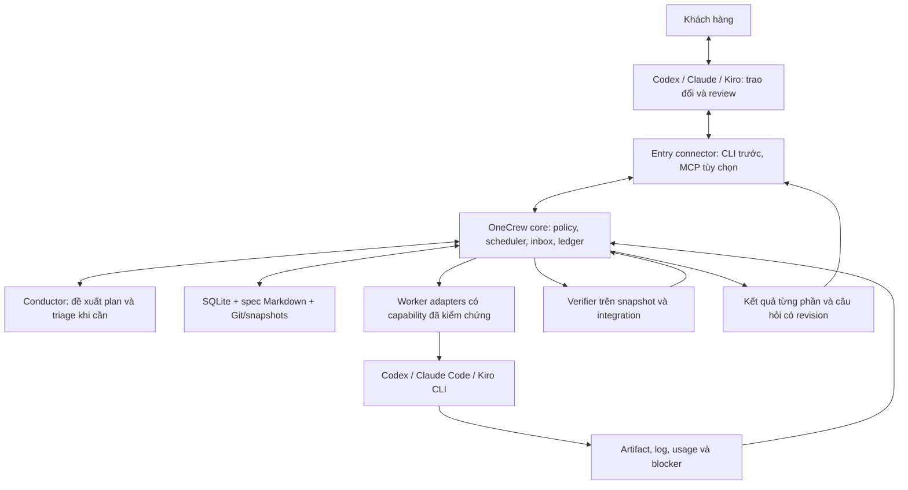

# Kiến trúc OneCrew — baseline 09/10/2026

OneCrew là bộ điều phối local nhận yêu cầu đã làm rõ từ Codex, Claude hoặc Kiro; chia việc, gọi worker phù hợp, kiểm chứng và giữ tiến độ chung. Người dùng tiếp tục trao đổi trong công cụ đang dùng. OneCrew không cần xây thêm ứng dụng chat hoặc hệ thống Agile đầy đủ.

**Đây là kiến trúc sẽ triển khai.** Cập nhật tài liệu không cấp quyền chạy job 8 giờ, gọi API trả phí hay nghiệm thu sản phẩm. [SPEC-006](../specs/SPEC-006-portable-orchestration.md) là bản duyệt nhanh; [backlog](mvp-backlog.vi.md) xác định thứ tự; [coverage](proposal-coverage.md) phân biệt code đã có với phần còn thiếu.

## 1. Quyết định sau review toàn bộ trao đổi

| Chủ đề người dùng đặt ra | Quyết định hiện hành | Yêu cầu |
|---|---|---|
| OneTechAI làm nhiều ngày, tốn token, khó kiểm soát | Lát bàn giao nhỏ có AC, bằng chứng và budget chung; đo kết quả thay vì số agent/spec | OC02, OC09, OC12 |
| Specs dễ đọc, CLI duyệt | Một nội dung có bản nhanh và chi tiết, cùng revision; không tạo spec sau mỗi tin nhắn | OC02 |
| Vai Conductor/Scrum Master | Conductor mỏng lập plan, triage và báo cáo; code giữ scheduler và thẩm quyền | OC03, OC12 |
| Trao đổi trước khi giao việc | Trao đổi ở công cụ đầu vào; bàn giao điều đã chốt và câu hỏi còn mở | OC01, OC06 |
| Codex/Claude/Kiro đều giao và nhận việc | Entry connector độc lập với worker adapter; không buộc hai phía cùng hãng | OC01, OC04 |
| Hết usage Kiro, sang Claude | Kết nối cùng task; câu hỏi và approval đang chờ thuộc OneCrew | OC01, OC05, OC06 |
| Khó khăn cần hỏi lại | Inbox bền vững, câu hỏi ngắn có lựa chọn/khuyến nghị; chỉ nhánh phụ thuộc chờ | OC05 |
| Memory chung | Spec, quyết định, checkpoint và evidence có nguồn; không chuyển nguyên private chat | OC06 |
| Nhiều task liên quan | DAG, contract trước, ownership/worktree riêng, ghép tuần tự có gate | OC07, OC08 |
| Review từng phần, đổi thứ tự | Review snapshot theo revision; ưu tiên chỉ tác động việc chờ đủ dependency | OC11 |
| Model theo độ khó, tận dụng quota | Rule trước; capability/risk trước quota; JEV thêm sau benchmark | OC10 |
| Tự làm lâu, tới 8 giờ | Core độc lập với chat, checkpoint/recovery, deadline và budget cộng dồn | OC03, OC09 |

**Thay đổi so với 08/10:** chọn core OneCrew độc lập; Kiro Crew là tham khảo thay vì host bắt buộc. Decision AI không đứng trên mọi bước. Tách nơi giao việc khỏi worker. Tên project vẫn là OneCrew; cách gọi “CodeCrew” trong trao đổi không tạo sản phẩm khác.

Giữ [kiến trúc cũ](architecture-2026-10-08.vi.md) và [backlog cũ](mvp-backlog-2026-10-08.vi.md) làm lịch sử. ID R/CN/DF và thứ tự spike trong các bản đó không phải kế hoạch hiện hành; OC01–OC12 thay thế chúng cho giai đoạn tiếp theo. Các nguyên tắc scope/budget/authority được giữ trong contract dưới đây.

## 2. Hiện trạng có bằng chứng

| Năng lực | Code hiện có | Khoảng thiếu |
|---|---|---|
| CLI spec | onecrew/specs.py: list/review/diff/approve/request-changes/history | Approval local chưa xác thực/cách ly worker |
| Runtime | runtime.py, incremental.py: Codex, budget/cancel/checkpoint/test/review/repair/delivery | Profile CV cố định, chưa planner tổng quát |
| Phân việc/model | incremental_profile.py: graph 10 file CV, rule theo task/rủi ro | Tuần tự, chưa đa repo/provider/quota |
| Output | Snapshot, outputs và preview local | Chưa feedback inbox/reorder/resume sau crash |
| JEV | Credential DPAPI và doctor kết nối được | Chưa semantic routing/benchmark |

[SPEC-005 đã bàn giao](incremental-autonomy.vi.md) app CV từ thư mục trống: run RUN-20261008-232057-1d06d8, 585,21 giây, 14 calls, một repair thật, 19 gate checks đạt; runtime commit bf2e673, product commit ad3c748. Bộ kiểm thử được ghi nhận ở lượt đó là 69 tests. Đây là bằng chứng profile local/Codex, không chứng minh orchestration tổng quát hoặc khả năng chặn mọi AI bot ngoài production; khách hàng chưa nghiệm thu.

CLI hiện tại tối đa 3.600 giây/run, 32 calls, 4 repair, 600 giây/call; mặc định 1.800/24/3/120. Chưa có run 8 giờ hoặc resume sau crash. Tài liệu này không thay giới hạn code.

## 3. Một core, hai nhóm kết nối



Một ứng dụng Python local, tái sử dụng CLI và SQLite; các khối là module, không phải mỗi khối một service. Core chạy độc lập với cửa sổ chat; một instance sở hữu queue/lease/process tree. Mutation đi qua core; query không gọi model. Khi core chưa chạy, CLI báo rõ hoặc khởi động đúng instance qua khóa, không tạo scheduler thứ hai. Máy và process phải hoạt động; sleep/offline không được báo là đang tính toán.

| Thành phần | Trách nhiệm | Ranh giới |
|---|---|---|
| Entry connector | Submit/attach/query/reply; chuyển ý định khách hàng có nguồn | Không sở hữu task hoặc giả approval |
| Conductor | Đọc repo, phân rã spec, triage, tóm tắt | Chỉ đề xuất; không scheduler/retry loop/budget riêng |
| Core | Kiểm revision/quyền/scope/budget/dependency; dispatch, cancel, recovery | Nguồn trạng thái duy nhất |
| Worker adapter | Launch/events/cancel/reconcile/artifact/usage | Capability thực; unsupported/unknown hiển thị rõ |
| Verifier | Test theo thay đổi, scope/AC, kiểm bản ghép | Gate ghim revision, worker không sửa để tự pass |
| Memory/ledger | Quyết định, checkpoint, evidence và lịch sử | Worker report; core xác minh trước khi cập nhật |

Claude Desktop có thể là entry; Claude Code là worker khác. Không giả định mọi host có cùng API push, ACP, session resume hoặc quota API. V0 dùng CLI connector mỏng theo khả năng tool từng host; host chưa gọi được CLI cần thao tác terminal rõ ràng, không gắn nhãn đã tích hợp tự động. MCP là transport bổ sung khi cần, cùng contract/quyền.

Kiro Crew cung cấp ý tưởng Conductor/work ledger; OneCrew kết hợp hai trách nhiệm tối thiểu, không chỉ là worker lá. Adapter Kiro Crew, Antigravity, DeepSeek Harness chỉ xem xét khi có nhu cầu và contract test; không bọc scheduler thứ hai.

## 4. Từ trao đổi đến giao việc

1. Người dùng và AI ở entry trao đổi/tra cứu/làm rõ. Ý tưởng chưa chốt không tự thành task chạy.
2. Connector lưu brief, quyết định người dùng đã đồng ý và nguồn; core trả durable acknowledgment. Nội dung chưa bàn giao không tự xuất hiện khi đổi công cụ.
3. Spec có bản nhanh tối đa 350 từ, chi tiết đủ thực thi, AC và non-goals. Duyệt spec và quyền chạy có thể được cấp cùng một lời giao việc rõ ràng; không hỏi lại quyền còn hợp lệ.
4. Core nhận handoff, trả task ID. Conductor đọc repo thực tế, chia theo kết quả kiểm chứng được. Code kiểm DAG/ownership/coverage AC và giới hạn trước dispatch.
5. Worker làm từng bước; core checkpoint, verify, đưa phần dùng được ra review. Lựa chọn kỹ thuật và sửa test fail trong scope tự xử lý trong budget.
6. Hỏi khi cần đổi hành vi chưa rõ, quyền, scope hoặc budget. Bàn giao khi AC/gate đạt; ghi user acceptance riêng.

Handoff tối thiểu: project ID, client_request_id chống submit lặp, spec ID/hash, mục tiêu/AC/non-goals, decision refs, repo paths + base refs/dirty snapshot, quyền theo hành động, root budget/deadline, provider/model policy, dependencies và review checkpoints. Core ghi root_task_id, plan/policy/grant revision. Thiếu dữ liệu repo được khảo sát trong quyền đã cấp; thiếu quyết định nghiệp vụ thì tạo request.

Worker báo “xong” không đủ. Completion trỏ đúng source snapshot, gate version và evidence. Allowlist file không phải bằng chứng duy nhất rằng chức năng còn trong scope.

## 5. Dữ liệu, bộ nhớ và quyền

Kho local thuộc core/project, ngoài worktree được phép sửa. SQLite giữ các nhóm record trong cùng DB:

| Record | Dữ liệu cần giữ |
|---|---|
| Project/root/task/edge | Repo, AC coverage, plan revision, dependency, priority, ownership/state |
| Attempt/lease/dispatch intent | Backend/native ID, process identity, fencing generation, heartbeat, idempotency/reconcile |
| Request/reply/grant | Câu hỏi/options, action revision, actor/provenance, quyền và trạng thái xử lý |
| Checkpoint/artifact/verification | Repo base, diff chưa commit, manifest/hash, gate version và evidence refs |
| Budget/reservation/usage | Deadline gốc, counters cộng dồn, quota snapshot/freshness, số unknown |
| Event/outbox | Sự kiện bền vững, pending notification, cursor/dedup |

Spec/brief/decision summary là Markdown có revision; source/artifact là Git hoặc immutable snapshot, DB giữ hash/ref. Không ghi secrets, CV thật hoặc toàn transcript vào memory. Tách fact có nguồn, giả định, đề xuất AI, quyết định khách hàng và kết quả verified. Summary ghi evidence revision, đánh dấu stale khi đầu vào đổi; project isolation ngăn dùng nhầm memory/repo.

Ba chiều trạng thái độc lập: execution (queued/running/waiting/recovering/stopped/failed/completed), verification (pending/passed/failed/stale), acceptance (not_requested/pending/accepted/changes_requested). Waiting reason phân biệt dependency/user/quota/environment/budget. Cancel requested khác cancel confirmed; không báo dừng khi process còn chạy.

Worker không được reply như khách hàng hoặc sửa grant/ledger/gate. Capability entry và worker tách biệt, tối thiểu theo nhiệm vụ. Reply cần caller identity và nguồn ý định, không chỉ tin field actor trong JSON. CLI local hiện tại chưa bảo đảm điều này. Cùng OS user với full shell không tạo isolation chỉ bằng prompt/đường dẫn: trước approval đa entry phải kiểm chứng sandbox/tool permissions hoặc isolation tương đương. Không mở endpoint điều khiển không xác thực.

## 6. Hỏi lại và chuyển công cụ

Request lưu ID, task/plan/spec revision, câu hỏi ngắn, lý do cần người dùng, khuyến nghị/options, tác động scope/thời gian/quyền, proposed action revision và tasks bị ảnh hưởng. Trạng thái pending/answered/applied/rejected/expired/superseded. Poll inbox không gọi model; push tùy capability, không là điều kiện để nhận câu hỏi.

Ví dụ CV chưa chốt thời hạn lưu: core hỏi “Giữ CV bao lâu?”, nêu lựa chọn và phần storage đang chờ. Task CSS độc lập có thể tiếp tục. Im lặng không phải approval. Gộp request tương đương cùng revision thay vì hỏi lại nhiều lần.

Kiro hết usage, chuyển Claude:

1. Connect cùng project/task ID; nhận mục tiêu, output verified, phần đang chạy và request pending.
2. Claude hiển thị cùng request; người dùng trả lời, connector gửi request/action revision và provenance.
3. Core kiểm quyền/freshness rồi áp dụng một lần. Reply lặp trả kết quả cũ; reply khác cho request đã áp dụng báo conflict. Reply cho nội dung cũ phải đối chiếu lại, không áp lên action mới.
4. Tiếp tục bằng checkpoint/budget cũ. Đổi entry không đổi worker; worker độc lập không bị khởi động lại.

Nếu **worker** hết usage: xác nhận old writer dừng, reconcile side effects chưa rõ, lưu source/diff/checkpoint/lỗi rồi chọn worker khác trong policy đã cấp. Lease hết hạn không chứng minh process đã chết; chỉ cấp writer mới sau stop/reconcile. Fencing chặn report cũ; isolation/stop chặn writer cũ sửa file. Không có hai writer, không reset calls/retries/deadline. Native session có thể không chuyển được; tiếp tục bằng handoff tối thiểu, không hứa chuyển nguyên chat history.

## 7. Nhiều task liên quan

Bắt đầu tối đa **2 worker toàn core**, có giới hạn từng repo/provider; không phải 2 cho mỗi root task. Kiểm root budget và capacity chung khi dispatch. Ownership và worktree/snapshot riêng; không tự stash/reset phần sửa của người dùng.

Ví dụ A: contract API → (B: backend, C: frontend) → D: integration. B/C chỉ chạy sau A; việc cùng file/schema hoặc không tách ownership chạy tuần tự. Graph cycle bị từ chối hoặc gom thành bước tuần tự có giải thích.

Integration owner ghép lần lượt trên base đã ghi và chạy gate bản ghép; hai nhánh pass riêng chưa đủ. Đa repo ghi vector commit và contract version, không giả định Git commit atomic xuyên repo. Local integration không bao gồm publish.

Contract/AC đổi tạo revision mới, đánh dấu stale chỉ descendants/evidence bị ảnh hưởng, reconcile worker liên quan trước khi tiếp tục. Giữ output đạt ở nhánh độc lập. Event attempt/revision cũ chỉ vào lịch sử, không hoàn tất task mới hoặc mở lại task đã cancel.

## 8. Task dài và phục hồi

“Tối đa 8 giờ” là trần khi được cấp, không cần tiêu hết. Mặc định deadline tuyệt đối gồm queue/chờ người/chờ quota; hiển thị riêng active time và từng wait reason. Kéo dài cần grant revision rõ ràng, giữ nguyên đã tiêu; không tự cộng giờ khi restart, đổi worker hay tạo task con.

Root budget gồm thời gian, calls, retry/repair/escalation và usage quan sát được. Conductor/evaluator/worker/reviewer do OneCrew gọi cùng thuộc root. Token chat ở app ngoài không đo được phải ghi unknown/excluded, không giả tổng chi phí đầy đủ. Run mới cùng mục tiêu giữ quan hệ root và lịch sử tổng; không reset budget qua workflow khác.

Lưu dispatch intent/reservation/lease trước side effect, native/process ID ngay khi có. Sau crash reconcile với backend/source; trạng thái không rõ không được tự dispatch lại. Idempotency dùng nơi adapter hỗ trợ; nơi khác giữ bước cần xác minh. Side effect không đảo ngược chưa rõ kết quả cần người quyết định.

Checkpoint chứa diff chưa commit, repo/base, artifact hash, evidence, lỗi, bước tiếp theo và counters. Không cần model suy nghĩ liên tục khi chờ. Watchdog/status/cancel đi đường code riêng, tiếp nhận khi worker treo. Sau restart kiểm deadline trước call mới.

Không tiến triển, repair không đổi source, lỗi môi trường lặp hoặc hết budget phải dừng có bằng chứng/lựa chọn. Findings ngoài scope vào backlog; chỉ đưa vào task khi có quyền. Sửa build/test trong scope tự làm, không đổi AC/gate để pass. Deadline/cancel chặn dispatch mới và yêu cầu dừng process tree; unknown usage/sai lệch phải hiển thị.

## 9. Model và quota

Thứ tự chọn: quyền/capability → loại việc/rủi ro/context → bằng chứng năng lực → quota/budget/latency. List/status/diff/test có sẵn dùng code. Việc rõ, ít rủi ro dùng model tiết kiệm đã kiểm chứng; kiến trúc/phân quyền/đa repo dùng cấu hình đủ năng lực. Số dòng/file không quyết định độ khó.

Quota snapshot lưu provider/account/window/reset/source/observed-at; hỗ trợ nhiều cửa sổ ngắn/tuần/credits tháng theo adapter thực tế. Còn cửa sổ ngắn không đủ nếu tuần đã hết. Có reserve cấu hình được cho trao đổi/review. Dữ liệu thiếu/cũ là unknown, không phải 0 hoặc unlimited. “MAX” chưa xác nhận biến thể và gói Kiro; không hardcode gói, phần trăm hay giờ reset trong policy.

Reserve dự kiến trước dispatch song song, reconcile usage thực sau đó. App ngoài có thể tiêu quota tài khoản nên snapshot không bảo đảm hard cap phần trăm. Root counters tính mọi lần thử, timeout có usage unknown vẫn ghi. Dedup cumulative usage theo session/request; cached input nằm trong input, không cộng thêm. Không suy token thành USD/usage% chính xác khi provider không cung cấp.

Có thể ưu tiên capacity sắp reset nếu đủ năng lực và các cửa sổ khác còn tốt; chuyển tại checkpoint hoặc đợi reset nếu deadline cho phép. Không hạ dưới risk floor, ping-pong provider, tự mua credits hoặc chuyển API trả phí. Fallback/escalation trong grant, giới hạn root, ghi lý do và policy version.

Conductor chỉ đánh giá ngữ nghĩa khi plan/lỗi/scope chưa rõ. JEV là evaluator tùy chọn, shadow/benchmark trước; không approve/dispatch. Kết nối được không chứng minh router tiết kiệm. Chỉ thêm khi giảm tổng usage tới kết quả đạt, latency hoặc can thiệp mà không giảm chất lượng; không dựng đủ 16 decision points cũ như điều kiện MVP.

## 10. Review từng phần và đổi thứ tự

Review card: “đã làm gì / cách thử / diff-preview / checks đạt và chưa chạy / giới hạn / quyết định cần anh”. Card trỏ immutable snapshot; feedback/accept/request-changes gắn revision. Output mới không tự kế thừa acceptance cũ. Human gate chỉ ở mốc đã thỏa thuận; việc độc lập tiếp tục.

Priority chỉ áp task queued đủ dependency, cập nhật plan revision bằng compare-and-set. Không bỏ A để chạy B, tự stop worker hoặc cấp budget mới. Ngắt việc đang chạy dùng pause/cancel rõ ràng, đợi xác nhận; resume dùng checkpoint và grant còn hiệu lực.

Các lệnh dưới đây là **đề xuất, chưa triển khai**; cú pháp cuối chốt cùng implementation:

```text
onecrew task submit --spec <spec-id> --revision <hash> --grant <grant-file>
onecrew task connect <task-id>
onecrew request list --task <task-id> --pending
onecrew request reply <request-id> --revision <action-hash> --choice <option>
onecrew task pause <task-id>
onecrew task resume <task-id>
onecrew task move <task-id> --before <queued-task-id> --revision <plan-hash>
onecrew output review <output-id> --revision <hash>
onecrew output accept <output-id> --revision <hash>
onecrew output request-changes <output-id> --revision <hash> --comment <text>
```

Nhóm task run/list/status/cancel/outputs/preview và spec hiện có giữ tương thích. Query có JSON cho connector, không gọi AI. Nhóm decision hiện phục vụ JEV connectivity, không dùng nhầm làm approval khách hàng.

## 11. Thứ tự xây và phần để sau

1. Core bền vững + spec-to-plan tổng quát + inbox, một Codex worker tuần tự; chứng minh restart không lặp việc, quyền/budget giữ nguyên.
2. Entry Codex/Claude/Kiro, worker Claude Code/Kiro CLI; đổi entry, reply cùng request và handoff worker thực.
3. Hai worker song song, dependency/ownership/integration; review từng phần và reorder đầy đủ.
4. Routing có quota và giới hạn dài; fault injection trước soak run có ngân sách riêng.

[Backlog](mvp-backlog.vi.md) ghi điều kiện qua từng mốc. Không cần chờ toàn roadmap mới dùng lát đã đạt.

Để sau: dashboard/chat UI riêng, vector DB, multi-user/distributed registry, marketplace, tự sửa policy production, JEV bắt buộc, tự publish/deploy. Chỉ thêm khi workflow thực cần. Đo chức năng dùng thử được, tổng chi phí tới kết quả đạt, số lần can thiệp và thời gian chờ có lý do; số spec/agent/commit không thay kết quả.
