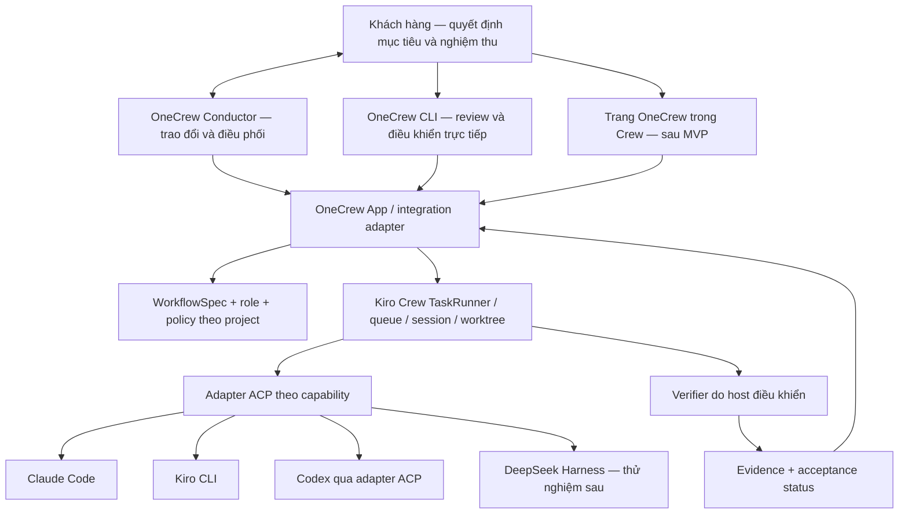

# Kiến trúc đề xuất OneCrew

## Runtime implementation update — SPEC-004

The local CV profile now has one Python controller as the dispatch/budget authority, Codex JSON-only workers, deterministic task/risk routing, sealed host HTTP gates and bounded review/repair. Native Windows sandbox and Node guards support local tests; Docker remains an alternative requiring a working engine. Models do not own scope, tests or acceptance.

See [runtime contracts and limitations](autonomous-runtime.vi.md), [SPEC-004](../specs/SPEC-004-autonomous-local-run.md), and [verification evidence](autonomous-coverage.md). The broader architecture below remains a target; free-form conversation, multiple repos/backends and pause/resume/reorder are not completed by this slice.

Trạng thái: proposal, chưa triển khai. Thiết kế ưu tiên CLI; Kiro Crew là ứng viên host cần qua spike trước khi chốt nền thực thi.

Ngoại lệ đã triển khai: [CLI review/approve spec local](spec-review-cli.vi.md). Đây là kho quyết định theo nội dung; chưa nối vào host, chưa có xác thực/cách ly quyền worker và chưa dispatch agent. Các phần runtime bên dưới vẫn là proposal.

Yêu cầu ưu tiên: khắc phục task kéo dài và khó can thiệp khi dùng Claude Desktop với OneTechAI. Contract cụ thể: [kiểm soát task dài](control-and-latency.vi.md). Host phải tiếp nhận điều khiển độc lập với lượt suy luận, giữ budget xuyên suốt các vai và không báo đã dừng khi worker còn hoạt động.

[Audit lịch sử thực tế](claude-history-audit.vi.md) bổ sung một ràng buộc: task cấp sản phẩm phải gắn với luồng người dùng thử được, package/commit và evidence tương ứng. Mọi workflow/agent/phiên/máy đều quy về task đó để cộng budget; mở workflow mới không tạo ngân sách mới. Trạng thái code xong, gate xanh, đã triển khai bản thử và người dùng chấp nhận là các mốc riêng.

## 1. Bản đồ trách nhiệm



Sơ đồ là kiến trúc mục tiêu. Đường nối TaskRunner → verifier phải được spike chứng minh; chưa khẳng định App SDK cung cấp đầy đủ seam đó.

| Trách nhiệm | Chủ sở hữu trong MVP |
|---|---|
| Queue, lease, retry vận hành, process/session, lịch | Kiro Crew |
| Tạo và phối hợp worktree cho tác vụ | Kiro Crew qua adapter đã kiểm chứng |
| Nội dung spec, role, gate, tiêu chí nghiệm thu | OneCrew |
| Kết quả tool và tình trạng phiên native | Runtime backend, được Crew chuẩn hóa |
| Trạng thái thực thi task | Crew là nguồn duy nhất |
| Task đáp ứng yêu cầu hay chưa | OneCrew dựa trên evidence của verifier |
| Bộ nhớ dự án | Crew hoặc repository đã chọn; OneCrew chỉ giữ reference/provenance |

Không dùng SQLite riêng để tranh quyền sở hữu queue với Crew. Nếu cần DB OneCrew, nó chỉ giữ manifest, liên kết task, evidence và projection có thể dựng lại.

Sau review tổng thể 08/10/2026, ranh giới điều phối được làm rõ: Conductor đề xuất mục tiêu và phân rã công việc; TaskRunner/host là đường thực thi duy nhất, sở hữu task/run, queue, bộ đếm retry và ngân sách. Conductor gửi đề xuất thay kế hoạch qua adapter; không mở một vòng scheduler/retry riêng. Khi tích hợp phải chứng minh planner/replan native của host dùng cùng phạm vi và bộ đếm, hoặc tắt phần chồng lặp. Chưa có bằng chứng này thì chưa bật workflow tự động. Ưu tiên kiểm chứng khả năng mở rộng conductor sẵn có của Crew trước khi tạo một conductor thực thi độc lập.

### OneCrew Conductor: đầu mối trao đổi với khách hàng

Yêu cầu bổ sung ngày 08/10/2026: người dùng đóng vai khách hàng, trao đổi và truy vấn thông tin qua một đầu mối; OneCrew tiếp nhận công việc và điều phối các vai phía dưới. Conductor là vai hội thoại xuyên suốt, kết hợp làm rõ yêu cầu và theo dõi bàn giao. Đây là thiết kế, chưa có runtime hội thoại/dispatch trong CLI hiện tại.

| Vai | Trách nhiệm và quyền quyết định |
|---|---|
| Khách hàng | Chọn mục tiêu, ưu tiên, phạm vi và ngân sách; duyệt thay đổi; chấp nhận kết quả sản phẩm |
| Conductor | Hiểu nhu cầu, tra cứu thông tin có nguồn, hỏi điểm còn thiếu, đề xuất lát nhỏ, soạn spec nháp, điều phối trong quyền đã cấp và tổng hợp kết quả |
| Worker/tester/reviewer | Thực hiện phần được giao và trả artifact, evidence, blocker; lựa chọn các vai cần thiết theo workflow, không bắt mọi việc qua đủ vai |
| Host và verifier | Giữ trạng thái thực thi, kiểm quyền/ngân sách, gọi gate và xác nhận kết quả kỹ thuật; Conductor không tự thay thế các kiểm soát này |

Một cuộc trao đổi có thể bắt đầu khi chưa có spec hoặc task thực thi. Conductor duy trì brief gồm mục tiêu, điều đã thống nhất, giả định, câu hỏi mở và việc để sau; mỗi quyết định giữ nguồn từ lượt trao đổi của khách hàng. Lời đề xuất của AI chưa trở thành quyết định của khách hàng. Không sinh spec mới sau mỗi tin nhắn và không tạo task thực thi chỉ vì một chủ đề được nhắc tới.

Conductor phân biệt ba ý định trong cùng hội thoại:

- **Hỏi thông tin:** đọc source/tài liệu/evidence cần thiết, trả lời kèm nguồn và độ mới; báo rõ phần chưa xác minh. Lệnh đọc trạng thái trực tiếp vẫn lấy dữ liệu host mà không cần gọi model.
- **Làm rõ nhu cầu:** cập nhật brief, hỏi ít câu có ảnh hưởng đến kết quả, trình bày lựa chọn và hệ quả bằng ngôn ngữ người dùng. Công việc khảo sát có giới hạn riêng trong ngân sách mục tiêu, không tự biến thành triển khai.
- **Giao hoặc đổi việc:** đề xuất phạm vi, nghiệm thu, budget và repo liên quan; tạo spec nháp khi người dùng yêu cầu chốt. Khi đang chạy, phản hồi được phân loại thành làm rõ trong scope, ý tưởng backlog hoặc thay đổi cần duyệt; bước ngoài scope chưa được dispatch.

Luồng bàn giao: trao đổi → đề xuất ngắn → spec nháp → khách hàng duyệt đúng revision → chạy khi đã có quyền thực thi → worker/test/verify/review phù hợp → Conductor báo kết quả và cách thử → khách hàng nghiệm thu sản phẩm. Phê duyệt spec và quyền chạy là hai quyết định khác nhau nhưng có thể được người dùng cấp cùng lúc; không hỏi lại quyền đã có. CLI hiện tại chỉ ghi approval spec local, chưa hỗ trợ cấp quyền chạy qua chat hay cưỡng chế các bước này.

Gói giao việc xuống dưới gồm `product_task_id`, spec revision đã duyệt, mục tiêu/AC/non-goals, repo và ownership, giới hạn quyền/budget, dependency và artifact/evidence cần trả. Conductor được chia việc và xử lý lựa chọn triển khai trong phạm vi đó; không tự approve spec của mình, đổi AC, tăng budget hoặc thay user acceptance bằng lời worker báo xong. Báo cáo trở lại khách hàng tập trung vào kết quả thử được, phần còn thiếu, chi phí quan sát được và quyết định cần khách hàng xử lý.

Conductor giữ danh tính và quyết định qua nhiều phiên, nhưng không cần model chạy hoặc suy nghĩ liên tục. Dùng tóm tắt có nguồn và sự kiện host; chỉ gọi model khi có tin nhắn hoặc sự kiện cần xử lý. Không đọc lại toàn bộ transcript hay mở thêm vòng review cho mỗi lần hỏi tiến độ. Chi phí trao đổi, khảo sát, điều phối và worker được tính vào cùng mục tiêu; khi sinh `product_task_id` phải liên kết chi phí trước đó, không reset budget. Các số chưa quan sát được ghi unknown.

Đối chiếu: [tài liệu agent của Kiro Crew](https://github.com/kirodotdev/KiroCrew/blob/main/src/kiro_crew/docs/agents.md), đọc ngày 08/10/2026, mô tả conductor dùng work ledger, gắn work item với session và đánh giá completion bằng acceptance evaluator. OneCrew bổ sung contract trao đổi/duyệt ở trên; đây không phải khẳng định extension seam đã tích hợp hoặc thử thành công trên máy này. Host snapshot vẫn cần ghim và kiểm chứng theo spike hiện có.

## 2. Chiến lược tích hợp

Thứ tự lựa chọn:

1. App/extension được hỗ trợ, CLI gọi endpoint hoặc SDK có contract.
2. Adapter mỏng có contract test, ghim phiên bản host.
3. Bản sửa upstream hoặc fork nhỏ để thêm một seam verifier bắt buộc.
4. Runtime độc lập chỉ khi các phương án trên không đáp ứng yêu cầu bắt buộc và đã đo chi phí duy trì.

Không nhập trực tiếp private internals ở nhiều module. Một `CrewAdapter` che việc submit/status/cancel/resume và cung cấp capability/version rõ ràng. Lệnh không được hỗ trợ phải báo unavailable. Không đổi backend một cách im lặng.

Trong bản đầu, chọn một backend đã kiểm chứng cho mỗi host/run. Việc router đổi model trong cùng backend và việc đổi backend là hai tính năng khác nhau. Chạy hỗn hợp backend theo từng step chỉ được bật sau khi capability/spike xác nhận; một hàng trong backend registry không đủ để đảm bảo tính năng đó.

Phạm vi bắt buộc là Claude/Kiro/Codex. Nếu phải tách khỏi Crew, interface executor sẽ có adapter Claude programmatic, Kiro ACP và Codex app-server. Đây là phương án dự phòng, không triển khai đồng thời hai đường dispatch trong MVP.

## 3. Workflow có hai mức

### Quick task

Tái hiện vấn đề → thay đổi nhỏ → kiểm tra mục tiêu → review diff → ready for integration.

### Feature có thay đổi hành vi

Spec + acceptance criteria → test → build → verify → review độc lập → integration gate.

Chỉ fan-out các phần có ownership tách biệt. Với những bước cùng sửa file/schema, xếp tuần tự. Giá trị mặc định thử nghiệm là tối đa hai worker thực thi đồng thời; đây là điểm bắt đầu để đo tài nguyên, không phải giới hạn cố định đã triển khai.

Không biến mọi lần agent dừng thành lần chạy toàn bộ test suite. Gate theo phạm vi thay đổi trước; chạy kiểm tra tích hợp đầy đủ khi ghép các kết quả.

[Contract kiểm soát phạm vi](scope-control.vi.md) áp dụng trước dispatch: phạm vi, AC và budget nằm ngoài quyền sửa của worker. Việc phát hiện thêm được phân loại thành sửa trong phạm vi, backlog hoặc đề xuất thay đổi. Mọi workflow mới của cùng mục tiêu dùng chung `product_task_id`; không reset số vòng và ngân sách. Host kiểm quyền/budget, reviewer kiểm ngữ nghĩa diff với AC; không coi allowlist file là đủ để phát hiện mọi scope creep.

### Review đầu ra từng phần

Yêu cầu bổ sung: khách hàng có thể xem và phản hồi từng phần trước khi toàn task hoàn tất. Đây là review output, khác với approve spec trước triển khai. Chức năng này chưa có trong CLI/runtime hiện tại.

Khi chia việc, Conductor đề xuất các mốc có đầu ra người dùng đánh giá được: một màn hình, một luồng thao tác, một phần tài liệu hoặc một thay đổi code có diff/test. Không dùng số file hay số agent làm đơn vị bàn giao. Mốc nào cần khách hàng xác nhận trước khi làm bước phụ thuộc phải được ghi rõ trong kế hoạch; không tạo thêm một lần duyệt cho mọi bước kỹ thuật.

Có hai đường vào cùng luồng review: tự đưa đầu ra ra khi đạt mốc đã chốt, hoặc khách hàng yêu cầu “cho tôi xem phần đang làm” bất kỳ lúc nào. Nếu chưa có đầu ra, báo đúng phần chưa sẵn sàng; nếu có bản nháp, cho xem để góp ý sớm kèm giới hạn và gate chưa chạy/đang lỗi. Bản nháp không tự trở thành kết quả đã nghiệm thu và không được bỏ qua gate bắt buộc.

Mỗi lần bàn giao tạo checkpoint có `output_id`, revision/hash, task và spec revision, repo/commit hoặc manifest snapshot, phần AC liên quan, artifact/cách mở hoặc thử, evidence và phần còn thiếu. Bản đang review phải ổn định: worker không ghi đè snapshot/demo khiến người dùng nhìn nội dung khác phiên bản được ghi nhận. Checkpoint chỉ chứa dữ liệu phù hợp quyền truy cập của project.

Conductor trình bày một thẻ ngắn: phần này làm được gì; thay đổi từ bản đã review; cách xem/thử; điều chưa đạt; quyết định cần khách hàng. Người dùng có thể xem lại bất kỳ checkpoint và diff với bản trước, không cần đọc toàn bộ transcript hoặc chờ hết task. Đọc danh sách/checkpoint/evidence đã lưu không gọi model; yêu cầu phân tích bổ sung vẫn có thể tốn token.

Phản hồi gồm chấp nhận phần này, yêu cầu sửa có comment, hoặc góp ý bản nháp chưa nghiệm thu. Quyết định gắn đúng output revision và phần AC, tách khỏi trạng thái gate kỹ thuật. Lịch sử giữ nguyên; phiên bản output hoặc dependency liên quan thay đổi thì phải đánh giá lại freshness, không tự chuyển chấp nhận bản cũ sang bản mới. Chỉ nói “ổn” khi đang có nhiều đầu ra mở thì Conductor phải làm rõ đối tượng trước khi ghi quyết định; không coi im lặng là đồng ý.

Yêu cầu sửa trong scope giao lại đúng phần trong ngân sách chung; ý tưởng ngoài scope đưa backlog/đề xuất thay đổi. Host giữ các bước phụ thuộc vào mốc chưa được chấp nhận hoặc đang cần sửa; các bước độc lập vẫn tiếp tục nếu còn quyền và budget. Nếu phần phụ thuộc đã chạy khi có phản hồi mới, ngừng giao bước ảnh hưởng mới, yêu cầu checkpoint theo khả năng adapter và kiểm lại kết quả đã tạo; chỉ báo dừng khi host xác nhận. Không reset bộ đếm retry/budget vì mở một lượt review output.

Chấp nhận một phần không đóng cả task và không cấp quyền publish/deploy. Hoàn tất task vẫn cần đủ AC, gate tích hợp trên bản ghép và các mốc nghiệm thu người dùng đã thỏa thuận. Review từng phần được nối vào luồng Conductor tới bàn giao sau spike host, không mở thêm scheduler hoặc dashboard riêng.

### Đổi thứ tự công việc

Khách hàng có thể nói với Conductor “làm B trước A”, “đưa C xuống sau” hoặc dùng CLI để sắp lại việc chờ. Conductor hiển thị thứ tự trước/sau và ảnh hưởng tới việc đang chạy, dependency, mốc review; host cập nhật kế hoạch thực thi qua cùng adapter/queue hiện có. Đây là thiết kế, chưa có lệnh reorder hoặc runtime áp dụng.

- **Việc chưa chạy, đã đủ điều kiện:** áp dụng thứ tự mới cho các lần dispatch tiếp theo; không hỏi lại khi chỉ sắp thứ tự trong quyền đã cấp.
- **Việc đang chạy:** đổi thứ tự mặc định chỉ tác động việc chờ, không tự ngắt worker. Muốn chuyển ngay, khách hàng yêu cầu tạm dừng việc đang chạy; host yêu cầu checkpoint/dừng theo khả năng adapter, giữ artifact và xác nhận trạng thái thực trước khi nhường tài nguyên/ownership. Nếu không dừng được, báo lý do; không báo đã chuyển hoặc mở writer xung đột.
- **Việc có dependency hoặc mốc review bắt buộc:** ưu tiên cao hơn không làm nó thành runnable. Ví dụ B cần đầu ra A thì B vẫn chờ A; Conductor giải thích và có thể đề xuất ưu tiên chuỗi điều kiện đã nằm trong phạm vi. Muốn tách dependency, dùng mock hoặc thay cách nghiệm thu cần đánh giá ảnh hưởng và duyệt thay đổi nếu vượt hợp đồng; không tự bỏ điều kiện để đáp ứng thứ tự mong muốn.
- **Việc đã hoàn thành:** không chạy lại hay xóa acceptance chỉ vì sắp lại kế hoạch. Công việc làm lại chỉ phát sinh khi có yêu cầu hoặc evidence không còn phù hợp.

Đổi thứ tự thuần túy chỉ tạo revision kế hoạch và lịch sử ai đổi/gì đổi/lý do nếu có; không sửa spec, không làm mất review output còn hợp lệ và không reset budget/retry. Thay nội dung, quyền, ngân sách hoặc cam kết trong spec đi qua luồng thay đổi riêng. Conductor là bên đề xuất/thực hiện ý định khách hàng, host vẫn là nguồn duy nhất của thứ tự thực thi; không duy trì một hàng đợi riêng trong chat.

Adapter phải kiểm plan revision và trạng thái hiện hành khi áp dụng, cập nhật thứ tự nhất quán ở host và chống gửi trùng. Nếu task đã chuyển trạng thái hoặc người dùng khác vừa thay kế hoạch, trả xung đột kèm trạng thái mới; không âm thầm ghi đè bằng thứ tự cũ. `task list` phân biệt vị trí ưu tiên với trạng thái đủ điều kiện/chờ gì. Thông báo chỉ nói thứ tự đã được host xác nhận, không suy từ lời Conductor nhận yêu cầu.

## 4. Trạng thái và bằng chứng

Giữ hai trường riêng:

- `execution_status`: queued, running, waiting_input, interrupted, failed, completed, cancelled; map từ host, luôn giữ cả giá trị native.
- `acceptance_status`: not_evaluated, verifying, rejected, accepted, stale.

Projection điều khiển bổ sung `pause_requested`, `paused`, `cancel_requested`, `budget_exhausted` và `connection_lost` kèm lý do/bằng chứng; giữ riêng request của người dùng với trạng thái thực host báo. Mapping cụ thể phải qua adapter contract test. Các trạng thái này không tạo queue hay scheduler thứ hai.

`completed + rejected` là kết quả hợp lệ: agent đã kết thúc nhưng công việc chưa đạt. CLI hiển thị lý do và hành động tiếp theo.

Một evidence record tối thiểu gồm:

- task/run/attempt ID và ID native của host;
- repo realpath, base/head commit, manifest hash của đầu vào và đầu ra;
- workflow/skill/gate phiên bản;
- command argv, cwd, exit code, thời điểm, timeout, log đã lọc secret;
- model yêu cầu và model quan sát được, runtime/adapter version;
- hash diff được review, reviewer result và phê duyệt áp dụng cho artifact nào.

Đổi code, test, spec hoặc gate sau khi verify làm evidence liên quan thành stale. Chỉ chứng minh một commit sạch là chưa đủ nếu có file chưa commit; manifest phải bao gồm nội dung thực tế được kiểm tra. Agent không được tự sửa kho evidence hoặc bản verifier dùng để nghiệm thu run của mình.

## 5. Gate và quyền theo vai

Tách policy từ OneTechAI khỏi kiến thức ngành. Pack phát triển phần mềm cung cấp role spec/test/build/review; pack ngành chỉ thêm yêu cầu khi project chọn.

Builder không được tự sửa test nghiệm thu để làm xanh. Điều này phải được kiểm ở tool/sandbox/host và kiểm tra diff cuối, không chỉ bằng prompt. Nếu adapter không đảm bảo ranh giới đó, doctor đánh dấu degraded và workflow không được chạy tự động với lời hứa cách ly vai.

Verifier đọc version gate đã ghim từ nơi worker không thể thay. Gate fail hoặc mất kết quả phải ngăn `accepted`. Gate không chạy được là lỗi vận hành, không phải pass.

Phê duyệt cần gắn với hành động, phạm vi và hash artifact. Duyệt spec không tự cho phép publish/deploy. Ngược lại, cùng một phê duyệt vẫn hiệu lực thì không hỏi lại.

CLI hiện tại lưu approval trong SQLite local và nhận nhãn người duyệt do người gọi khai báo; worker cùng quyền filesystem có thể sửa kho hoặc gọi approve. Trước tự động hóa phải kiểm chứng quyền ghi quyết định thuộc người dùng/control service, worker không có quyền tự duyệt, sửa scope/AC/budget hoặc tăng quyền chạy. Đây là điều kiện tích hợp còn thiếu, không được suy ra từ việc hash spec và 24 test CLI đã đạt.

Spec đã duyệt giữ ổn định. Kế hoạch triển khai, checkpoint và nhật ký tiến độ là artifact riêng, tham chiếu spec revision; cập nhật chúng không tự sửa hợp đồng đã duyệt. Thay đổi yêu cầu, ràng buộc hoặc nghiệm thu mới cần revision spec và quyết định phù hợp. Phần chi tiết không được giấu thêm nghĩa vụ ngoài bản nhanh; kiểm tra ngữ nghĩa vẫn cần review, không được bảo đảm chỉ bằng hash.

## 6. Recovery và giới hạn

Tái sử dụng cơ chế resume của host, ghi ánh xạ ID bền vững trước khi báo đã nhận việc. Khi submit có kết quả không rõ, tra theo idempotency key trước khi submit lại.

Crash giữa một tác vụ có side effect không được tự hiểu là chưa chạy. Ví dụ API tạo PR đã thành công nhưng local chưa ghi nhận thì cần reconcile bằng external ID hoặc dừng chờ quyết định. Không cam kết exactly-once cho hệ thống bên ngoài.

Worker hết quota chờ backoff; lỗi code dùng retry budget riêng; không tiến triển thì dừng và giải thích. Budget gồm timeout, retry, concurrency và usage nếu backend cung cấp. Cost không có thì là unknown, không hiển thị 0. Ước tính usage khác hóa đơn tài khoản.

Chuyển runtime không chuyển nguyên private session state. Handoff dùng goal, spec, artifact và evidence; adapter khởi tạo session mới nếu native resume không tương thích.

## 7. Giao diện CLI dự kiến

Các lệnh dưới đây chưa được triển khai:

```text
onecrew doctor
onecrew project add <path> --name <name>
onecrew task add --project <name> --title <text> --workflow quick-fix
onecrew task list
onecrew task move <task-id> --before <other-task-id>
onecrew task move <task-id> --after <other-task-id>
onecrew plan <task-id>
onecrew run <task-id>
onecrew status --all
onecrew watch <task-id>
onecrew why <task-id>
onecrew evidence <task-id>
onecrew pause <task-id>
onecrew resume <task-id>
onecrew cancel <task-id>
```

`task move` áp dụng cho thứ tự việc chờ; không tự pause việc đang chạy, cấp quyền run hay bỏ dependency. Target/reference đang chạy hoặc đã hoàn thành phải được báo rõ thay vì diễn giải thành một yêu cầu ngắt. Với yêu cầu chuyển ngay, dùng `pause`, đợi host xác nhận rồi xếp lại các việc đủ điều kiện; giữ nguyên checkpoint và ngân sách. `task list` là lệnh đọc, hiển thị thứ tự hiệu lực, trạng thái và lý do chờ.

Các lệnh review output dự kiến dưới đây cũng chưa được triển khai; khác nhóm `spec` đang có:

```text
onecrew output list <task-id> --pending
onecrew output review <output-id> --revision <hash>
onecrew output diff <output-id> --from <hash-cu> --to <hash-moi>
onecrew output accept <output-id> --revision <hash>
onecrew output request-changes <output-id> --revision <hash> --comment <noi-dung>
onecrew output history <output-id>
```

Mọi lệnh query có `--json`, không gọi model và không sửa state. `why` phân biệt thiếu dependency, chờ người, hết budget, test fail, adapter lỗi và chờ integration. Approval/action commands sẽ có schema riêng sau spike; không dùng một nút “approve tất cả”.

Trang quản lý sau MVP ưu tiên bảng công việc, chi tiết kết quả và danh sách cần quyết định. Terminal stream/chat là chi tiết có thể mở ra, không thay thế tiến độ nghiệp vụ.

## 8. Stack đề xuất và ranh giới phạm vi

Python cho CLI/integration để thuận lợi tái sử dụng scripts và cùng hệ sinh thái Crew. Chọn thư viện CLI lúc spike; không cần thêm frontend framework cho v0.1. Khi làm dashboard, dùng App SDK/React của host nếu contract đáp ứng.

MVP chạy local trên Windows, repo có đường dẫn chứa dấu và khoảng trắng. Không dùng shell interpolation cho prompt. Tạo process với argv/stdin, quản lý cancellation cả process tree và kiểm tra file locks khi dọn worktree.

Thứ tự sau review: hoàn thiện các lỗi CLI đã tái hiện → chứng minh một task trên một repo/một backend có status, cancel, budget và gate thực → nối Conductor từ trao đổi tới bàn giao → mở rộng lần lượt nhiều repo và Claude/Kiro/Codex. Đây là thứ tự kiểm chứng, không loại bỏ yêu cầu nhiều repo/ba backend. DeepSeek, registry đa máy và dashboard thuộc giai đoạn sau. Chưa chốt lịch toàn roadmap trước khi có kết quả spike. Mốc nghiệm thu chính là thời gian/token tới một chức năng người dùng thử và chấp nhận, cùng số lần người dùng phải can thiệp.

Chưa xây ở v0.1: vector database riêng, marketplace, nhóm nhiều người, distributed worker, tự sửa skill rồi tự triển khai, kênh chat ngoài hoặc scheduler mới. Những phần này chỉ thêm khi workflow thật cho thấy cần.
