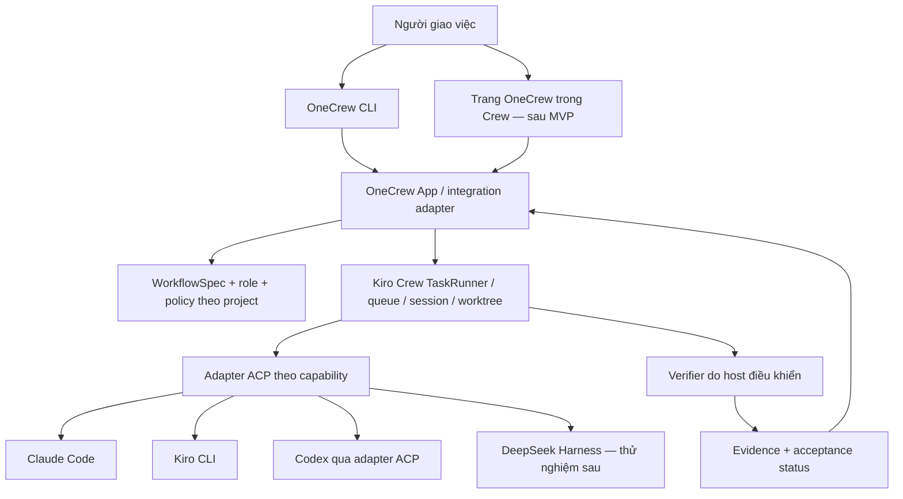

# Kiến trúc đề xuất OneCrew

Trạng thái: proposal, chưa triển khai. Thiết kế ưu tiên CLI; Kiro Crew là host thực thi ban đầu.

Ngoại lệ đã triển khai: [CLI review/approve spec local](spec-review-cli.vi.md). Đây là kho quyết định theo nội dung; chưa nối vào host, chưa có xác thực/cách ly quyền worker và chưa dispatch agent. Các phần runtime bên dưới vẫn là proposal.

Yêu cầu ưu tiên: khắc phục task kéo dài và khó can thiệp khi dùng Claude Desktop với OneTechAI. Contract cụ thể: [kiểm soát task dài](control-and-latency.vi.md). Host phải tiếp nhận điều khiển độc lập với lượt suy luận, giữ budget xuyên suốt các vai và không báo đã dừng khi worker còn hoạt động.

[Audit lịch sử thực tế](claude-history-audit.vi.md) bổ sung một ràng buộc: task cấp sản phẩm phải gắn với luồng người dùng thử được, package/commit và evidence tương ứng. Mọi workflow/agent/phiên/máy đều quy về task đó để cộng budget; mở workflow mới không tạo ngân sách mới. Trạng thái code xong, gate xanh, đã triển khai bản thử và người dùng chấp nhận là các mốc riêng.

## 1. Bản đồ trách nhiệm



Sơ đồ là kiến trúc mục tiêu. Đường nối TaskRunner → verifier phải được spike chứng minh; chưa khẳng định App SDK cung cấp đầy đủ seam đó.

| Trách nhiệm | Chủ sở hữu trong MVP |
|---|---|
| Queue, lease, retry vận hành, process/session, lịch | Kiro Crew |
| Tạo và phối hợp worktree cho tác vụ | Kiro Crew qua adapter đã kiểm chứng |
| Nội dung spec, role, gate, tiêu chí nghiệm thu | OneCrew |
| Kết quả tool và tình trạng phiên native | Runtime backend, được Crew chuẩn hóa |
| Trạng thái thực thi task | Crew là nguồn duy nhất |
| Task đáp ứng yêu cầu hay chưa | OneCrew dựa trên evidence của verifier |
| Bộ nhớ dự án | Crew hoặc repository đã chọn; OneCrew chỉ giữ reference/provenance |

Không dùng SQLite riêng để tranh quyền sở hữu queue với Crew. Nếu cần DB OneCrew, nó chỉ giữ manifest, liên kết task, evidence và projection có thể dựng lại.

## 2. Chiến lược tích hợp

Thứ tự lựa chọn:

1. App/extension được hỗ trợ, CLI gọi endpoint hoặc SDK có contract.
2. Adapter mỏng có contract test, ghim phiên bản host.
3. Bản sửa upstream hoặc fork nhỏ để thêm một seam verifier bắt buộc.
4. Runtime độc lập chỉ khi các phương án trên không đáp ứng yêu cầu bắt buộc và đã đo chi phí duy trì.

Không nhập trực tiếp private internals ở nhiều module. Một `CrewAdapter` che việc submit/status/cancel/resume và cung cấp capability/version rõ ràng. Lệnh không được hỗ trợ phải báo unavailable. Không đổi backend một cách im lặng.

Trong bản đầu, chọn một backend đã kiểm chứng cho mỗi host/run. Việc router đổi model trong cùng backend và việc đổi backend là hai tính năng khác nhau. Chạy hỗn hợp backend theo từng step chỉ được bật sau khi capability/spike xác nhận; một hàng trong backend registry không đủ để đảm bảo tính năng đó.

Phạm vi bắt buộc là Claude/Kiro/Codex. Nếu phải tách khỏi Crew, interface executor sẽ có adapter Claude programmatic, Kiro ACP và Codex app-server. Đây là phương án dự phòng, không triển khai đồng thời hai đường dispatch trong MVP.

## 3. Workflow có hai mức

### Quick task

Tái hiện vấn đề → thay đổi nhỏ → kiểm tra mục tiêu → review diff → ready for integration.

### Feature có thay đổi hành vi

Spec + acceptance criteria → test → build → verify → review độc lập → integration gate.

Chỉ fan-out các phần có ownership tách biệt. Với những bước cùng sửa file/schema, xếp tuần tự. Giá trị mặc định thử nghiệm là tối đa hai worker thực thi đồng thời; đây là điểm bắt đầu để đo tài nguyên, không phải giới hạn cố định đã triển khai.

Không biến mọi lần agent dừng thành lần chạy toàn bộ test suite. Gate theo phạm vi thay đổi trước; chạy kiểm tra tích hợp đầy đủ khi ghép các kết quả.

[Contract kiểm soát phạm vi](scope-control.vi.md) áp dụng trước dispatch: phạm vi, AC và budget nằm ngoài quyền sửa của worker. Việc phát hiện thêm được phân loại thành sửa trong phạm vi, backlog hoặc đề xuất thay đổi. Mọi workflow mới của cùng mục tiêu dùng chung `product_task_id`; không reset số vòng và ngân sách. Host kiểm quyền/budget, reviewer kiểm ngữ nghĩa diff với AC; không coi allowlist file là đủ để phát hiện mọi scope creep.

## 4. Trạng thái và bằng chứng

Giữ hai trường riêng:

- `execution_status`: queued, running, waiting_input, interrupted, failed, completed, cancelled; map từ host, luôn giữ cả giá trị native.
- `acceptance_status`: not_evaluated, verifying, rejected, accepted, stale.

Projection điều khiển bổ sung `pause_requested`, `paused`, `cancel_requested`, `budget_exhausted` và `connection_lost` kèm lý do/bằng chứng; giữ riêng request của người dùng với trạng thái thực host báo. Mapping cụ thể phải qua adapter contract test. Các trạng thái này không tạo queue hay scheduler thứ hai.

`completed + rejected` là kết quả hợp lệ: agent đã kết thúc nhưng công việc chưa đạt. CLI hiển thị lý do và hành động tiếp theo.

Một evidence record tối thiểu gồm:

- task/run/attempt ID và ID native của host;
- repo realpath, base/head commit, manifest hash của đầu vào và đầu ra;
- workflow/skill/gate phiên bản;
- command argv, cwd, exit code, thời điểm, timeout, log đã lọc secret;
- model yêu cầu và model quan sát được, runtime/adapter version;
- hash diff được review, reviewer result và phê duyệt áp dụng cho artifact nào.

Đổi code, test, spec hoặc gate sau khi verify làm evidence liên quan thành stale. Chỉ chứng minh một commit sạch là chưa đủ nếu có file chưa commit; manifest phải bao gồm nội dung thực tế được kiểm tra. Agent không được tự sửa kho evidence hoặc bản verifier dùng để nghiệm thu run của mình.

## 5. Gate và quyền theo vai

Tách policy từ OneTechAI khỏi kiến thức ngành. Pack phát triển phần mềm cung cấp role spec/test/build/review; pack ngành chỉ thêm yêu cầu khi project chọn.

Builder không được tự sửa test nghiệm thu để làm xanh. Điều này phải được kiểm ở tool/sandbox/host và kiểm tra diff cuối, không chỉ bằng prompt. Nếu adapter không đảm bảo ranh giới đó, doctor đánh dấu degraded và workflow không được chạy tự động với lời hứa cách ly vai.

Verifier đọc version gate đã ghim từ nơi worker không thể thay. Gate fail hoặc mất kết quả phải ngăn `accepted`. Gate không chạy được là lỗi vận hành, không phải pass.

Phê duyệt cần gắn với hành động, phạm vi và hash artifact. Duyệt spec không tự cho phép publish/deploy. Ngược lại, cùng một phê duyệt vẫn hiệu lực thì không hỏi lại.

## 6. Recovery và giới hạn

Tái sử dụng cơ chế resume của host, ghi ánh xạ ID bền vững trước khi báo đã nhận việc. Khi submit có kết quả không rõ, tra theo idempotency key trước khi submit lại.

Crash giữa một tác vụ có side effect không được tự hiểu là chưa chạy. Ví dụ API tạo PR đã thành công nhưng local chưa ghi nhận thì cần reconcile bằng external ID hoặc dừng chờ quyết định. Không cam kết exactly-once cho hệ thống bên ngoài.

Worker hết quota chờ backoff; lỗi code dùng retry budget riêng; không tiến triển thì dừng và giải thích. Budget gồm timeout, retry, concurrency và usage nếu backend cung cấp. Cost không có thì là unknown, không hiển thị 0. Ước tính usage khác hóa đơn tài khoản.

Chuyển runtime không chuyển nguyên private session state. Handoff dùng goal, spec, artifact và evidence; adapter khởi tạo session mới nếu native resume không tương thích.

## 7. Giao diện CLI dự kiến

Các lệnh dưới đây chưa được triển khai:

```text
onecrew doctor
onecrew project add <path> --name <name>
onecrew task add --project <name> --title <text> --workflow quick-fix
onecrew plan <task-id>
onecrew run <task-id>
onecrew status --all
onecrew watch <task-id>
onecrew why <task-id>
onecrew evidence <task-id>
onecrew pause <task-id>
onecrew resume <task-id>
onecrew cancel <task-id>
```

Mọi lệnh query có `--json`, không gọi model và không sửa state. `why` phân biệt thiếu dependency, chờ người, hết budget, test fail, adapter lỗi và chờ integration. Approval/action commands sẽ có schema riêng sau spike; không dùng một nút “approve tất cả”.

Trang quản lý sau MVP ưu tiên bảng công việc, chi tiết kết quả và danh sách cần quyết định. Terminal stream/chat là chi tiết có thể mở ra, không thay thế tiến độ nghiệp vụ.

## 8. Stack đề xuất và ranh giới phạm vi

Python cho CLI/integration để thuận lợi tái sử dụng scripts và cùng hệ sinh thái Crew. Chọn thư viện CLI lúc spike; không cần thêm frontend framework cho v0.1. Khi làm dashboard, dùng App SDK/React của host nếu contract đáp ứng.

MVP chạy local trên Windows, repo có đường dẫn chứa dấu và khoảng trắng. Không dùng shell interpolation cho prompt. Tạo process với argv/stdin, quản lý cancellation cả process tree và kiểm tra file locks khi dọn worktree.

Chưa xây ở v0.1: vector database riêng, marketplace, nhóm nhiều người, distributed worker, tự sửa skill rồi tự triển khai, kênh chat ngoài hoặc scheduler mới. Những phần này chỉ thêm khi workflow thật cho thấy cần.
