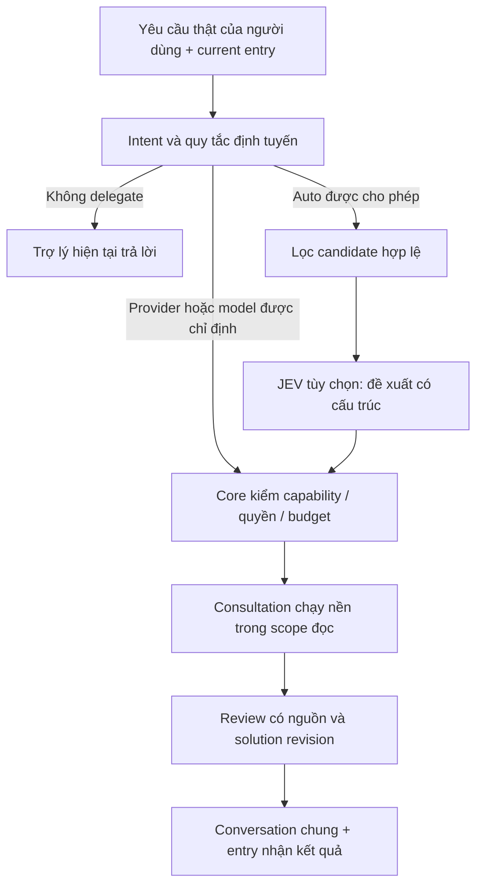

# Điều hướng thảo luận — DR01–DR06, revision 9

**Cập nhật triển khai 09/10/2026:** CLI/MCP conversation, solution gates, consultation runner và notification đã có. Đọc [hướng dẫn revision 9](revision9-implementation.vi.md) và [coverage hiện hành](proposal-coverage.md) trước các bảng thiết kế/baseline phía dưới. Hai CLI Claude/Codex đã có durable ACK thật; Desktop callback và Kiro MCP live chưa được xác nhận. JEV vẫn shadow.

Thiết kế theo yêu cầu ngày 09/10/2026, bổ sung [conversation CS01–CS06](shared-conversation.vi.md) và [solution SG01–SG05](solution-approval.vi.md). Các bảng baseline dưới đây mô tả thiết kế trước triển khai; trạng thái code và kiểm chứng hiện hành ở liên kết cập nhật đầu trang. JEV không tự áp dụng quyết định.

## 1. Quy tắc người dùng nhìn thấy

| Lời yêu cầu tại cửa sổ Codex | Định tuyến |
|---|---|
| “Giải thích solution này” | Trợ lý hiện tại trả lời trong chính lượt chat; không spawn thêm Codex worker |
| “Hỏi Claude review solution này” | Một consultation tới provider Claude; kết quả lưu và trả về cùng conversation, không đổi trợ lý mặc định |
| “Dùng Claude model X để review” | Pin provider và model X nếu adapter xác nhận hỗ trợ; không tự thay model |
| “Tự chọn model phù hợp để phản biện” | Cho phép router chọn trong tập candidate hợp lệ của lượt tư vấn; JEV chỉ hỗ trợ đề xuất |
| Chỉ nhắc Claude trong ví dụ, câu trích dẫn hoặc nhận xét | Không coi đó là lệnh gọi Claude |

Quy tắc đối xứng khi người dùng ở Claude, Kiro hoặc entry khác. Chỉ định “hỏi Claude” áp cho lượt review đó. Lượt tiếp theo vẫn thuộc entry đang dùng, trừ khi người dùng đổi mặc định rõ ràng. Lời mời review không là lệnh implement, sửa solution hoặc approve.

Thứ tự quyết định: **chỉ định provider/model thực của người dùng → explicit auto policy nếu có → current entry**. Current entry là default cho trao đổi thông thường, kể cả worker preference đang ưu tiên Claude. Khi ý định gọi provider mơ hồ, làm rõ thay vì gọi nhiều provider để đoán.

## 2. Hai chính sách riêng

| Policy | Default/đầu vào | Quyền thay đổi |
|---|---|---|
| Discussion routing | Current host/session; pin từng request; auto khi được chọn rõ | Không thay worker đang implement hoặc cài đặt model trong ứng dụng host |
| Execution routing | Profile/preference worker đã cấp cho task, capability/budget/quota evidence | Theo grant/handoff hiện có; explicit task pin vẫn giữ |

Nếu người dùng chỉ nói Claude, lấy model mặc định đã cấu hình cho consultation của Claude hoặc alias đã kiểm chứng; không mặc định “model lớn nhất”. Nếu chưa có cấu hình hợp lệ, báo thiếu hoặc hỏi lựa chọn. Không dùng JEV để quyết định lại provider đã pin. Auto chọn model trong provider đã pin chỉ khi người dùng đã bật phạm vi auto đó. Provider target, model hint và actual resolved model được ghi riêng; host không cung cấp exact model thì ghi unknown, không đoán.

## 3. Vị trí lớp decision AI

TypeSafe mô tả JEV là model cho quyết định có cấu trúc/xác suất, gồm classify/route. Đây là cơ sở lựa chọn vai trò evaluator, không phải bằng chứng nó luôn chọn đúng model cho OneCrew. [Nguồn TypeSafe](https://typesafe.ai/blog/introducing-system-one-models-and-jev). Code hiện có kết nối và JEV shadow; không gọi API thật trong lượt cập nhật thiết kế này.

JEV chỉ cần cho lựa chọn có ý nghĩa: loại công việc (giải thích/phản biện/kiểm tra), độ phức tạp/rủi ro, nhu cầu tool và độc lập reviewer, context size, chất lượng lịch sử theo workload, latency/usage evidence. Core lọc quyền/provider pin/capability trước; metadata quota thiếu hoặc stale giữ unknown, không suy ra từ giờ reset hoặc số token.

Output evaluator chọn candidate ID trong allowlist, confidence và abstain/reason code theo schema. Không sinh executable/tool command/provider tùy ý. Chỉ gửi brief đã giới hạn và metadata cần thiết, không gửi toàn conversation, source hoặc credential. Core kiểm lại candidate/policy trước dispatch; xác suất cao không tự cấp quyền hoặc chứng minh lựa chọn tối ưu.

Không gọi JEV cho mọi message, thao tác read/append hoặc request pin rõ. Một đánh giá có timeout/call cap, không vòng retry vô hạn. Có thể cache route theo loại yêu cầu/context features + policy/capability revision; auth/quota/capacity phải kiểm lại khi dispatch, không cache chúng thành quyền lâu dài. Lesson chỉ là dữ liệu có evidence/version, không thay instruction hoặc approval.

Triển khai ban đầu dùng rules + pin/current-entry; JEV chạy shadow để so với kết quả thực. Chỉ bật auto-apply sau benchmark và policy được người dùng cho phép. Lỗi/abstain không làm đổi provider pin; auto dùng deterministic fallback trong policy đã cấp hoặc trả unavailable/needs_decision. Không tự fallback sang API trả phí. Chi phí evaluator ghi riêng, không suy là nằm trong subscription Claude/Codex/Kiro.

## 4. Consultation lifecycle

Đây là đơn vị tư vấn có theo dõi trong core, không phải fake implementation task. Tái sử dụng supervisor/admission/usage/outbox; không thêm scheduler thứ hai.

1. Entry lưu yêu cầu thật và contribution ID vào CONV, xác định solution ID/hash cần review. Câu “solution này” chưa rõ đối tượng thì hỏi; không chọn một revision tùy ý.
2. Core tạo consultation idempotent gắn request ID, source entry, response destination và route receipt. Packet có mục tiêu review, solution đã pin, relevant decisions/evidence, câu hỏi mở và quyền đọc cần thiết.
3. Adapter gọi native Claude/worker được chọn trong phiên review riêng có scope/budget; không nhắn sang một chat cá nhân có sẵn chỉ vì user nói “hỏi Claude”. Gửi sang một chat cụ thể là hành động riêng cần đúng đích và quyền. API/CLI backend phải có capability/auth đã xác minh.
4. Worker trả verdict/nhận xét, điểm sai hoặc rủi ro, evidence, phương án thay thế, câu hỏi và giới hạn kiểm chứng. Nhận xét đi vào conversation dưới đúng provider/model provenance, không làm thay solution/approval hiện hành.
5. Entry trình bày kết quả của reviewer và tách rõ phần tổng hợp/đánh giá của chính mình. Trả về không tạo vòng agent hỏi agent; một request không tự fan-out hoặc lặp debate.
6. Nếu solution đổi trong lúc review, đánh dấu kết quả thuộc revision cũ. Giữ lịch sử; không tự coi nó là review cho revision mới hoặc tự gọi lại tốn budget. Người dùng có thể đọc/phản hồi từ entry khác.

Consultation record đề xuất: ID, CONV/message/solution hash, role, origin/destination entry, provider_requested/model_requested, selected/actual provider-model, selection_source (explicit/current-entry/rule/jev), policy/evaluator revision, status, attempts/session identity, budget/usage, timestamps, output refs và stale reason. Trạng thái tối thiểu: queued/running/completed/failed/cancelled/waiting_input; result freshness tách khỏi completion. Admission/stop/reconcile/idempotency phải ngăn replay inference hoặc writer sau crash.

Current-entry path không tạo consultation native phụ; chỉ ghi contribution khi adapter đồng bộ. Model host đã dùng có thể không quan sát được usage; ghi unknown. Review từ provider khác có bounded calls/time; request user cho phép review trong phạm vi đó, không tự tăng budget hoặc cấp quyền code/shell.

## 5. Trả kết quả, lỗi và quota

Lệnh hỏi review trả consultation ID và trạng thái đã quan sát, giữ chat dùng tiếp. Callback vào cùng cửa sổ chỉ khi host adapter có hỗ trợ đã kiểm chứng; nếu không, kết quả nằm trong conversation/inbox và được lấy khi attach/tương tác tiếp. Không hứa unsolicited chat message hay bật heartbeat AI để giả callback. CLI/viewer có thể chờ event bằng code.

Explicit Claude không khả dụng: báo lỗi auth/quota/capability đúng loại, giữ request và evidence; không âm thầm thay bằng Codex. Fallback chỉ khi người dùng/policy cho phép trong phạm vi consultation, ghi rõ provider thực. Hết usage của entry nhận không làm mất kết quả, đổi entry không làm chạy lại consultation.

## 6. Nghiệm thu và thứ tự xây

| ID | Contract | Kiểm chứng bắt buộc | Trạng thái |
|---|---|---|---|
| DR01 | Pin của user, current-entry default và auto tách biệt | Ví dụ/quote/mention không gọi provider; current-entry không spawn bản sao; explicit model không bị ghi đè | Pending |
| DR02 | Discussion preference độc lập execution | Claude-first task policy không đổi default chat Codex; consultation không đổi worker/session task | Pending |
| DR03 | JEV đề xuất sau hard gates, có abstain/shadow | Invalid output, timeout, stale quota, provider pin; evaluator không cấp quyền; benchmark trước auto-apply | Pending discussion integration; JEV connection/shadow nền đã có |
| DR04 | Consultation chạy hữu hạn, revision-bound, recoverable | Retry/crash không gọi trùng; read scope; cancel/reconcile; output provenance; revision đổi đánh dấu stale | Pending |
| DR05 | Return vào CONV/entry theo capability | Callback thật hoặc explicit pull; đổi entry giữ kết quả; không AI idle polling/recursive fan-out | Pending |
| DR06 | Đánh giá routing có evidence | First-review acceptance, lỗi bỏ sót được xác minh, rework/latency/usage và phí evaluator; không tự promote lesson/policy | Pending |

Sau CS ledger và adapter: rules pin/current-entry → một consultation Claude thật từ entry Codex → return và lifecycle → JEV shadow benchmark → auto có policy. Mở rộng Kiro/entry khác khi có live evidence riêng. Không cần chờ JEV mới làm được câu “Hỏi Claude review solution này”.
