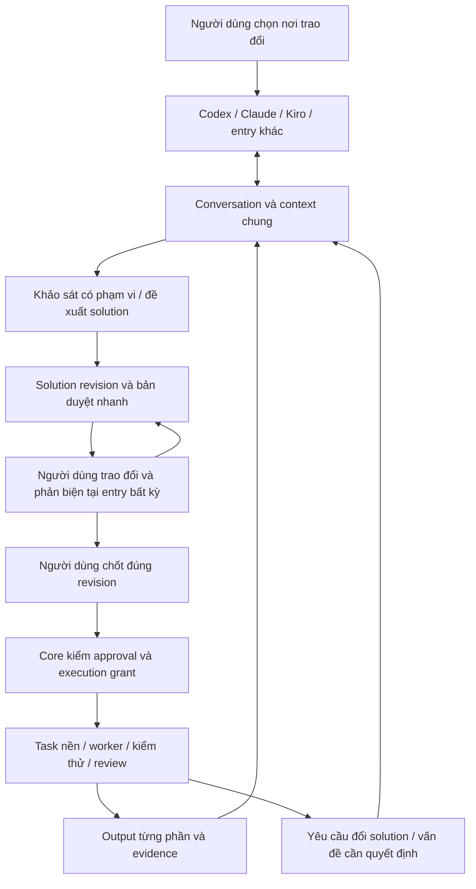

# Conversation chung — contract CS01–CS06, revision 8

Trạng thái: thiết kế được cập nhật theo yêu cầu người dùng; các API/schema dưới đây là đề xuất, chưa phải lệnh đã triển khai. Bổ sung OC01/OC05/OC06 và SG01–SG05, dùng cùng core/ledger hiện có.

## 1. Trải nghiệm và ranh giới

Người dùng chọn một conversation của OneCrew từ Codex, Claude, Kiro hoặc công cụ có adapter phù hợp. Trợ lý đọc phần trao đổi mới, solution hiện hành, quyết định và câu hỏi mở; ghi đóng góp trở lại. Đổi công cụ không cần copy nội dung đã được lưu thành công vào OneCrew. Conversation tồn tại trước task; trao đổi không tự khởi động worker implement.

Đây là một cuộc trao đổi chung về mặt dữ liệu. Các giao diện chat của nhà cung cấp vẫn riêng. Một cửa sổ chứa toàn bộ lịch sử yêu cầu viewer/chat của OneCrew, là phần tùy chọn sau khi sync hoạt động. Không giả định có thể ghép native thread ID, chuyển hidden context hoặc tự đọc toàn bộ private history giữa nhà cung cấp.

MVP ưu tiên các công cụ trên cùng máy dùng chung state-root qua MCP stdio/CLI. Mỗi adapter gọi cùng core transaction; không tạo ledger riêng. Đồng bộ khác máy/cloud cần transport và quyền truy cập được kiểm chứng riêng, chưa thuộc MVP. Không mở endpoint điều khiển công khai chỉ để mọi host kết nối được.

## 2. Luồng đầy đủ

Ví dụ: ở Kiro tạo conversation về đăng ký CTS; Claude đọc cùng conversation và đề xuất sửa phương án; người dùng chốt tại Codex; OneCrew tạo task triển khai với worker đã chọn. Nếu Claude/Kiro là nơi chốt thì quy trình tương tự. Entry không có đặc quyền vì tên nhà cung cấp. Đổi entry không đổi provider của task đang chạy.

Người dùng có thể yêu cầu nhiều góc nhìn. Mặc định chỉ trợ lý đang được người dùng hỏi hoặc bước tư vấn đã được giao mới chạy; không fan-out mọi message tới tất cả model. Budget tư vấn/khảo sát và execution phải hiển thị rõ, không nhân trần bằng cách tạo conversation/task mới.

## 3. Mô hình dữ liệu đề xuất

| Record | Nội dung và quy tắc |
|---|---|
| Conversation | CONV ID, workspace/project bindings, tiêu đề, trạng thái open/archived, created_by; không bắt buộc task_id |
| Contribution | Message ID, conversation, seq, loại user_message/proposal/critique/clarification/evidence, actor và entry provenance, reply_to, source reference, client_request_id, observed cursor, base solution revision; nội dung đã được chia sẻ |
| Context checkpoint | Summary + revision, khoảng seq đã bao phủ, refs tới facts/decisions/open questions, trạng thái stale; không thay thế event gốc |
| Solution revision | Solution ID, parent revision, brief + technical detail, assumptions/evidence, AC/non-goals, affected repos/contracts, content hash; các tài liệu quyết định được pin hash hoặc nhúng nội dung |
| Decision | Solution ID/hash, lựa chọn người dùng, provenance/câu trả lời gốc, thời điểm; proposal/critique không tự trở thành decision |
| Task binding | Conversation ID, solution ID/hash đã duyệt, approval reference, execution grant revision, repo baseline và existing budget lineage |
| Change request | Conversation + task/solution revision, bằng chứng trở ngại, delta đề xuất, impacted tasks, options và trạng thái pending/answered/applied/superseded |
| Entry binding/cursor | Host/session reference khi có, conversation được chọn, quyền theo scope, last-seen seq và khả năng pull/push; không coi host session ID là native worker session |

Lưu trong cùng SQLite thuộc OneCrew; artifact/source lớn ở immutable snapshot, DB giữ ref/hash. Không thêm vector DB, message broker hoặc scheduler thứ hai. `entry.note` cũ tiếp tục đọc được với provenance legacy; không giả dữ liệu note là đầy đủ transcript hoặc approval.

## 4. Đọc và ghi qua MCP/CLI

Nhóm thao tác dự kiến (tên contract, CHƯA là lệnh CLI):

| Thao tác | Hành vi |
|---|---|
| conversation create/list/attach | Tạo/chọn conversation trước task; attach kiểm scope và trả context packet + cursor |
| conversation read | Summary có nguồn, solution hiện hành, quyết định, pending requests và events sau cursor; phân trang khi cần |
| conversation append | Ghi contribution với idempotency key và provenance, trả durable ACK/message ID/seq |
| solution propose/review/diff | Lưu revision đề xuất, so với bản đã duyệt, trình bày bản nhanh và chi tiết cùng hash |
| solution decide | Ghi câu trả lời thực của người dùng đối với revision đang review; không nhận approval tự suy từ assistant text |
| task submit from solution | Kiểm approval + grants + idempotency trong transaction trước khi dispatch; gắn immutable solution revision |
| conversation inbox/reply | Đọc và trả lời request từ entry bất kỳ trong quyền; stale/conflicting reply không được áp dụng |

Adapter cần hai phía: MCP/CLI cung cấp thao tác; host integration hoặc skill hướng dẫn đọc delta trước khi trả lời và ghi contribution sau đó. MCP một mình không tự bắt được mọi keystroke/message và không tự đánh thức host. Host hỗ trợ hook thì kiểm chứng hook; host chỉ có tool-call thì trợ lý phải thực sự gọi tool. Hiển thị sync state/ACK, lỗi ghi và retry để không tuyên bố “đã chia sẻ” khi chỉ nói trong chat.

Chỉ ghi phần người dùng đã chọn chia sẻ trong conversation. Không tự nhập lịch sử tài khoản khác, secrets hoặc hidden reasoning. Attachment lớn lưu reference có quyền truy cập thay vì nhân bản vào mọi packet. Khi chưa có adapter, nêu rõ cần chuyển gói bàn giao thủ công; đây là fallback, không phải bằng chứng trải nghiệm zero-copy đã đạt.

Các tool đọc/append không dispatch model. Quyền discussion/read/propose tách khỏi execution control và quyền ghi nhận quyết định người dùng. `--allow-control` local hiện tại chưa chứng minh xác thực nhiều người dùng; không cấp operator control cho worker.

## 5. Concurrency, freshness và chất lượng context

- Append contribution dùng transaction và sequence tăng dần; retry cùng key/payload trả cùng receipt, khác payload báo conflict. Các contribution song song được giữ với base revision; không mất ý kiến do last-write-wins.
- Thay solution hiện hành/approve/submit dùng CAS đúng revision. Nếu có solution mới cần review, approval cũ không duyệt solution mới; đóng gói approval và task submission phải chống race. Chỉ thêm một nhận xét không tự đổi hợp đồng đã duyệt.
- Tạo draft thay thế không tự thu hồi quyền task đang chạy. Một change request có ảnh hưởng tới hợp đồng đang thực thi mới đặt hold phần liên quan; core chặn apply/delivery và reconcile worker tại checkpoint an toàn. Nếu worker chưa dừng được, ghi trạng thái rõ, không tuyên bố đã pause.
- Context packet gồm summary + delta + các decision/request quan trọng không bị cắt bỏ. Có covered_seq, truncation và các ref truy hồi; summary lỗi/stale không được tạo fact hoặc approval. Read on demand khi cần chi tiết, không gửi lại cả transcript ở mỗi lượt.
- Khi mất mạng/host đóng/hết usage, event đã ACK còn trong ledger. Pending local append giữ idempotency key để retry; không cấp authority từ bản chưa được core ACK. Đổi chat không reset task, budget hoặc pending request.
- Output từ trợ lý và source/log đều là dữ liệu có nguồn. Reviewer kiểm consistency giữa solution và patch/AC; cơ chế hash không phát hiện mọi lệch ý nghĩa, nên vẫn cần ví dụ nghiệm thu, test và review lát đầu.

## 6. Thông báo và lifecycle

Task/solution events đi qua outbox hiện có; entry đọc delta khi attach hoặc khi người dùng tương tác. Local subscription/viewer có thể nhận event bằng code. Callback vào chat chỉ bật khi host hỗ trợ và có live evidence; nếu không có thì inbox/feed là nơi xem pending. Delivery ACK không phải approval.

Không gọi AI định kỳ chỉ để kiểm tra có tin mới. Native viewer chờ event không đồng nghĩa model đang chạy. Khi không có task hoạt động/câu hỏi cần xử lý thì không tạo vòng inference; kết quả cuối vẫn được lưu để người dùng đọc sau. Không tự gửi message tới các chat khác nếu chưa được người dùng giao quyền.

## 7. Hiện trạng và nghiệm thu

Kiểm tra source hiện tại: `entry.py` yêu cầu task_id, packet có 5 notes gần nhất và cursor; `entry note` ghi proposal/decision nhưng không approve. `mcp_entry.py` có status/outputs/inbox và control submit/reply/resume/cancel; chưa expose note/append/conversation. Vì vậy chưa có conversation trước task hoặc đồng bộ thảo luận trọn vẹn.

| ID | Yêu cầu | Test cần đạt | Trạng thái |
|---|---|---|---|
| CS01 | Conversation độc lập task, ràng buộc project | Tạo/thảo luận/restart không sinh worker; không đọc chéo scope | Pending |
| CS02 | Contribution có provenance, cursor, ACK/idempotency | Append song song không mất dữ liệu; crash/retry không nhân message; collision báo conflict | Pending |
| CS03 | Context summary + delta có thể kiểm tra | Stale/truncated summary vẫn giữ decisions/open requests và fetch refs; không giả fact/approval | Pending |
| CS04 | MCP/CLI và adapter đọc/ghi thực sự | Hai host đã kết nối luân phiên cùng CONV không copy/paste; thiếu ACK không báo synced | Pending; có nền MCP/entry |
| CS05 | Solution approval và task/change binding | Approve/submit race, revision cũ, pending qua đổi host; adapter không bypass gate | Pending; liên kết SG01–SG03/SG05 |
| CS06 | Events/lifecycle và compatibility | Task cũ giữ ID/budget/authority; duplicate delivery không duplicate action; idle không model calls | Pending; có nền outbox/runner |

Thử nghiệm đầu tiên: hai entry có khả năng gọi tool đã kiểm chứng trên máy → cùng conversation → một entry đề xuất, entry kia phản biện → người dùng chốt revision → một task nhỏ → runtime mở change request → trả lời từ entry khác. Ghi riêng fixture và live evidence. Chưa được coi cả Codex/Claude/Kiro đều hoạt động chỉ vì JSON-RPC smoke test pass.
